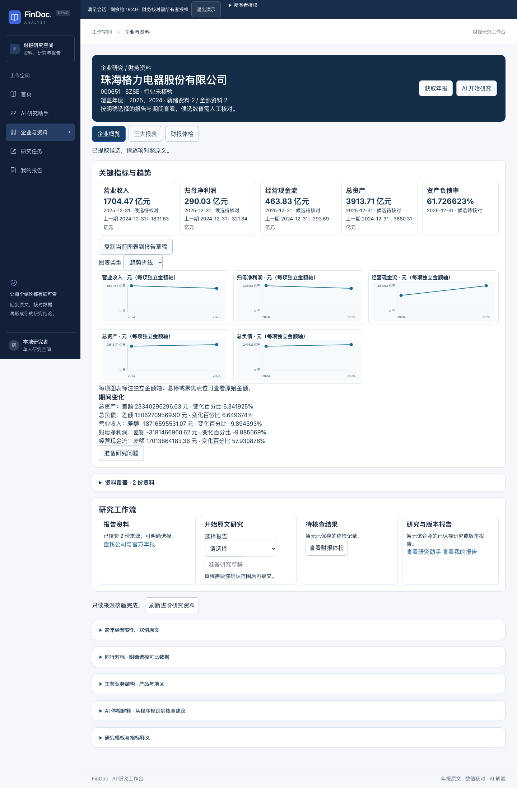
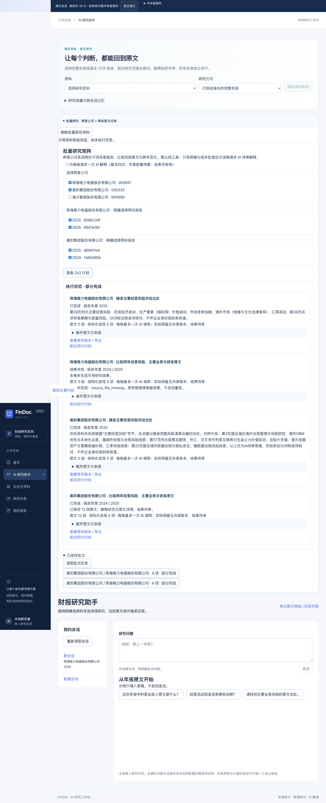
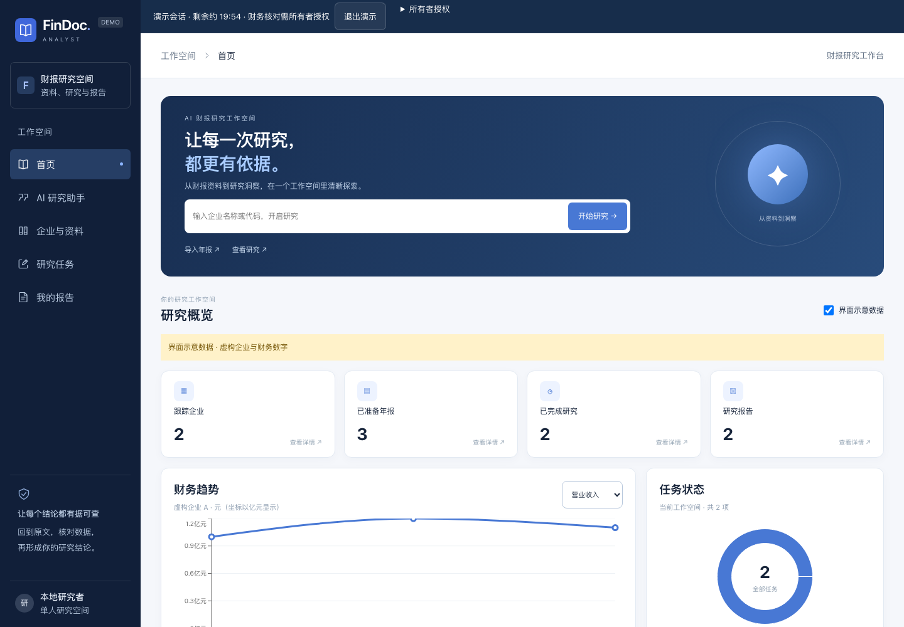

# FinDoc C+ · 有据可查的财报研究演示

基于 **C@45d55d7** 独立开发的求职作品，分支 `codex/findoc-showcase-cplus-integration`。F19–F34提供真实React页面与有限业务路径：官方资料、三表/趋势/体检、混合检索/OCR、单与多Agent、跨会话记忆、批量研究及版本报告。新的真实模型执行已成功；所有未由本人核对的财务值均为候选，AI解释均待审。未合并main、未公开部署。



[本机运行](docs/cplus/RUN_LOCAL.md) · [单一状态](docs/cplus/STATE.md) · [42项任务](docs/cplus/TASK_BOARD.csv) · [固定24题执行矩阵](docs/cplus/eval/CORE_EXECUTION_MATRIX.md) · [三条面试路线](docs/cplus/INTERVIEW_DEMOS.md) · [交付/录屏](docs/cplus/DELIVERY.md) · [已知限制](docs/cplus/KNOWN_ISSUES.md)

|可操作路径|实现与真实性边界|
|---|---|
|官网资料|名称/代码/拼音与市场消歧→巨潮公告→显式下载→受控公开PDF cache→本代身份核验→READY；受限时官网/手工上传回退|
|财务研究|企业360、三大表、实际期间/口径/范围/币种/物理页、五核心指标、Decimal资产负债率、双年趋势、三类体检、双年三主题、同行/业务结构；不自动授予核准资格|
|AI工作区|来源固定、LLM Intent与计划、实际evidence/finance/risk/generalist有限分工及工具交接、阶段事件、AI/原文分层与已保存报告；同题单/多Agent分别批准，不宣称多Agent更优|
|检索与记忆|真实Vision转录→typed OCR研究；BGE/Milvus+FTS/RRF/章节排序；点图追问→原PDF精确匹配或明确回退→收藏→跨context BGE查询→删除不再命中|
|批量与模板|2×2持久异步ACK、逐格状态/摘要/来源/成本上界、只取消queued、历史恢复；实际3AI成功+1来源失效。四类结构化模板，默认关闭AI、可选每模板一次|
|报告与演示|图表真正复制到不可变报告草稿rev1；精确domain/id/revision/SHA的CSV/Excel/PPTX/浏览器PDF；20分钟独占、owner-only接管、旧会话401、完整seed恢复，预算不跨代重置|



本机入口 **http://127.0.0.1:14540**，凭据只在Git忽略的服务端配置。V3五份READY公开年报、OCR、历史归档、本地BGE权重和seed bundle**不随Git分发**，clone后需提供并核对bundle；详细命令与依赖见RUN_LOCAL。原C/V1.2/main及原seed保留。

固定24题累计至少12个required-tier真实执行，**不是12题正确或人类接受**。模型、真实PDF/OCR、BGE/Milvus、HTTP/浏览器、受控fixture、人审分别留证；原失败、UNKNOWN与未运行题不改为通过。最新选定后端回归155PASS/3SKIP/5warnings，C+模式构建通过但保留大chunk警告。正向本人财务核准0。

当前同一5元账本：123物理SDK记录（含原C73）、保守预留 **2.468274元**、原UNKNOWN4保留，实际账单未观察；不是新建或重置额度。全部新解释均为AI待审，不作投资结论。官方adapter/有限报表支持、现金流检索不相关样本与单期PPTX没有可用趋势等限制见KNOWN_ISSUES。

## 原C候选资料（保留历史快照）

以下是原C介绍与当时的截图/证据，不能替代上述C+验证。旧ResearchRun、v1三指标和v2即时指标合同、ACCEPT→SAVE→RESUME、已应用迁移和所有历史资料保留。

# FinDoc Agent · 财报研究工作台

**从企业年报到有来源的研究结论。** 选择资料、核对原文、确认研究计划，查看 Agent 分工，并将结果保存为版本报告。

本分支是 **C 方案求职演示候选**，基于独立 V1.2 分支研发。它覆盖工作包 F01–F18 的功能入口，优先展示真实主路径；真人财务签核、固定评测完整层级和部分旧报告回归仍有明确缺口。当前没有公开部署，也没有合并 main。



> 实际 React 页面与本地 HTTP 后端截图。KPI 来自当前种子库存：2 家企业、3 份 READY 官方年报、2 项历史研究、2 份报告。开启的折线／柱图为带水印的虚构界面示意；不能作为真实企业财务数值。已核准财务图仅接受当前有效的真人确认数据。

[演示录屏](docs/showcase/evidence/M5/showcase-walkthrough.webm) · [实际生成的 5 页报告 PDF](docs/showcase/evidence/M5/real-research-report.pdf) · [手机首页](docs/showcase/evidence/M5/home-390.png) · [三条面试脚本](docs/showcase/INTERVIEW_SCRIPTS.md) · [当前状态与证据](docs/showcase/STATE.md)

## 可以实际操作什么

| 路径 | 行为与证据边界 |
|---|---|
| 登录与首页 | 固定部署者账号、20 分钟独占（可配 30）、冲突剩余时间、等待或 owner 二次确认接管；旧浏览器下线、整代环境恢复。首页搜索、KPI、三类图、最近研究、推荐问题连到真实业务入口。 |
| 企业与资料 | 已验证演示目录覆盖美的／格力 2024、2025；明确下载后校验真实 PDF、解析和 BGE/Milvus 索引。也保留手动上传。目录不是全市场公告搜索。 |
| OCR 与财务核对 | 真正执行 macOS Apple Vision OCR，提供原页、bbox 转录与表格候选；扩展总资产、总负债及资产负债率／变化信号，来源和真实财务日期独立保存。候选不自动成为财务事实。 |
| 统一 AI 工作区 | 快速问答、综合研究、深度研究使用同一冻结资料会话；自然语言意图→计划→明确批准→阶段事件→四类发现→版本报告。需要财务数据时交给旧任务等待本人核对。 |
| 有限 Multi-Agent | 单 Agent 与两个真实子代理的受限工具交接分别运行；检索、已确认事实、研究笔记工具由服务端检查来源、范围、次数与期限。公开阶段事件不包含私有思维链。 |
| 记忆、偏好和报告 | BGE 语义笔记跨会话查询与删除，偏好实际改变首页指标／单位／问题顺序；报告不可变版本、原 PDF 页码、历史来源复核、打印保存 PDF。 |
| 精选历史与评测 | 可恢复的公开精选种子；历史卡明确标识预置演示，不冒充新模型结果。15 条固定题、有限 intent 执行器与只读汇总器，失败与跳过保留。 |

### 三种数据状态

- **已核准**：服务端存在当前有效、由本人明确接受并保存的财务记录；金额与变化用 `Decimal` 计算。
- **预置演示**：真实公开 PDF、已经完成的历史研究／报告、明确的示例笔记，附来源与版本；历史记录不能授权新任务。
- **界面示意**：虚构图表序列，页面有醒目标识；没有真实财务确认时不补造企业数值。

真实调用中的 AI 解释仍待人工审阅；精确引用校验不能替代语义判断。OCR 完成也不授予财务资格。旧 `ResearchRun` 原文、固定来源 revision、`ACCEPT → SAVE → RESUME` 与旧迁移合同保留。

## 本地运行 C 候选

准备 Python 3.11+、`uv`、Node.js 24 与 npm。真实语义检索使用本地 `BAAI/bge-m3`／Milvus Lite。OCR 的已验证引擎要求 macOS 与 Swift/Xcode Command Line Tools；其他平台尚需适配 OCR 引擎。

```bash
git clone --branch codex/findoc-showcase-c-integration https://github.com/aning0922/findoc-agent.git
cd findoc-agent
uv sync --frozen
npm --prefix frontend ci
```

首次使用先下载／加载 BGE 缓存。这个步骤可能较慢，launcher 不会自动下载模型或安装软件：

```bash
uv run python -c 'from app.rag.embed import embed; print(len(embed(["财报研究"])[0]))'
```

### 1. 准备精选种子

源码 Git 不包含 PDF、数据库和模型权重。随本地候选另交付 `findoc-showcase-seed-v1.tar.gz`（约 29.4 MB），仅包含经过 allowlist 核验的公开资料及衍生历史；它不是私有数据库备份，也不含登录凭据或模型配置。源码远端尚未托管该二进制包，新 clone 需取得同一配套包。

```bash
# data/showcase-seed-v1 必须尚不存在，避免覆盖任何已有目录。
test ! -e data/showcase-seed-v1 && tar -xzf /绝对路径/findoc-showcase-seed-v1.tar.gz -C data
uv run python -c 'from pathlib import Path; from app.demo.seed import verify_seed; print(verify_seed(Path("data/showcase-seed-v1").resolve())[1])'
```

Bundle SHA256：`3693670d2369e6bed5f4981108f00a62602686a6a72bc44a64dc997bc28a2afc`。Manifest SHA256：`efc10a4b48584747130af71ec82171a4e5f766fc53eb1ea92c21fe319e7b3ff4`。打包后已实际解包并重新验证。三个官方 READY 年报是格力 2024／2025、美的 2025；另有美的 2025 物理第 9 页派生的单页扫描样本与真实 OCR 产物。完整种子标识仅表示库存齐全。

### 2. 建立本机演示账户并启动

```bash
uv run python scripts/run_showcase_local.py --init-config
uv run python scripts/run_showcase_local.py --check
uv run python scripts/run_showcase_local.py
```

`--init-config` 只生成一次 `data/showcase-local.env`，权限 600、Git 忽略。本人在本机文件查看固定账号、随机生成的共享密码与独立 owner 密码；重复初始化拒绝覆盖。可将其中 `DEMO_TTL_MINUTES` 设置为 `20` 或 `30`，默认 20。

打开 **http://127.0.0.1:14530**。默认等待策略 `wait_only`，无模型调用；可浏览完整历史、OCR 和报告。部署者明确需要 owner 接管时，启动参数加 `--owner-takeover`，仍需独立 owner 密码和二次确认。没有公共匿名强制接管配置。Ctrl+C 停止本次 launcher 的进程组；退出／到期／接管恢复隔离代，不覆盖原资料库。

### 3. 可选：启用真实模型

在当前仓库或同一 Git common-dir 的 sibling worktree 中建立权限 600、被 Git 忽略的 `.env`，填写 `LLM_API_KEY`、`LLM_MODEL`、`LLM_BASE_URL`、`LLM_TIMEOUT_SECONDS`。本次预算代理仅验证了官方 `deepseek-flash` 与 `https://api.deepseek.com`（或 `/v1`），超时上限 240 秒；不要把密钥写入前端、命令行或源码。更换提供者需另行校准费用合同。

部署者首次明确采用本轮 5 元上限时，建立独立共享账本；同一路径已有账本不会清零或补充额度。以后直接复用，演示 reset 也不会补额度。

```bash
# C+：禁止在新工作树创建另一份额度；按上方 C+ RUN_LOCAL.md 显式引用原账本。
uv run python scripts/run_showcase_local.py --check --llm-config /绝对路径/.env
uv run python scripts/run_showcase_local.py --llm-config /绝对路径/.env
```

新模型请求均先预留保守上限，UNKNOWN 保留预留且不重试。不要删除账本来绕过原授权。本次开发验证累计 73 次物理调用、保守预留 **1.354700 元／5 元**，实际账单扣费未观测；不是线上账户余额或计费保证。[费用快照](docs/showcase/evidence/M5/latest-cost-summary.json)

## 实际验证与限制

| 验证层 | 已有结果 |
|---|---|
| 双访客与 reset | 两个独立 Chromium 进程、真实 HTTP 和 BGE/Milvus；owner 接管、旧会话 401／卸载、脏新增删除、完整 seed 库存及 OCR SHA 恢复通过。 |
| 真实资料／OCR | 实际官方下载并解析 219 页；真实 Apple Vision 对派生扫描页识别 68 行、54 候选格；三宽 1440／1280／390 实际检查，GET 预览不重做 OCR。 |
| 模型与报告 | 实际主界面单／双 Agent 研究、来源核验、持久事件、两个报告版本、实际 5 页 PDF 与录屏；单／多分别 4／7 次模型调用，2／4 次工具调用。多 Agent 更优没有得到证明。 |
| 语义记忆与偏好 | 真实本地 BGE、不同会话换词召回、删除后不再召回，以及首页三项偏好效果。 |
| 离线与旧回归 | 最终独立审查 23 PASS；主控较宽回归 141 PASS、57 setup ERROR（缺旧 `product/validation/d21-real-research.json` fixture），不能称全套通过。launcher TTL 跟进 6 项测试通过；前端 build/lint 成功，现存 warning 保留。 |
| 固定评测 | 15 条固定题，仅 5 条实际 intent 观察为 partial，10 条 skipped；其中 2 次模型提案通过验证，3 次走规则回退。尚无满足完整题目层级的 PASS，不报告虚假通过率。 |
| 真人财务核准 | **未执行**。真实候选和旧任务已到等待本人核对；核准图／比率正向仅有 fake fixture 验证。Agent 未代签 ACCEPT／SAVE／RESUME。 |

官方目录仅两家两年，发布日期／更正状态未核实时为未知。OCR 表格需核对，派生单页不代表完整原生扫描年报能力；不自动升级旧来源或财务授权。阶段 UI 使用已持久事件轮询／SSE 重放，并非逐 token 流式文本。Dashboard 大量历史计数／排序及报告边界有 P2，见[已知限制](docs/showcase/KNOWN_ISSUES.md)。求职候选不承诺生产 SaaS 的并发、容灾和多租户能力。

## 结构与交付资料

- `app/demo/`：独立控制库、会话／代际／子进程网关、种子核验、费用护栏。
- `app/dashboard/`、`app/disclosures/`、`app/parsing/`、`app/finance_v2/`：首页、官方资料、独立 OCR 与财务扩展层。
- `app/showcase_research/`、`app/research_memory/`、`app/showcase_reports/`、`app/showcase_seed/`：受限研究、语义记忆、版本报告、只读精选历史。
- `frontend/`：React 19、TypeScript、Vite、Recharts、PDF.js；FastAPI／SQLite、BGE／Milvus、LangGraph 旧人工工作流。
- [36 项任务状态](docs/showcase/task-board.csv)、[产品地图](docs/showcase/PRODUCT_MAP.md)、[接口合同](docs/showcase/contracts/API_MINIMUM.md)、[产品决策](docs/showcase/DECISIONS.md)、[验证记录](docs/showcase/EVIDENCE.md)、[最终独立审查](docs/showcase/reviews/FINAL-independent-review.md)、[本地交付说明](docs/showcase/DELIVERY.md)。
- [V1.2 原 README 存档](docs/showcase/BASELINE_README_V12.md)（保持原文，内部相对链接以仓库根目录为上下文）、[V1.2 用户指南](docs/conversation-v12/user-guide.md)、[旧架构](docs/architecture.md)、[开发说明](docs/development.md)。旧文档不替代当前 C 候选入口与证据。

本项目采用 AI 辅助研发与主控调度。Sol／Terra／Astra 会话分别承担后端、界面与独立审查，按任务实际调整模型和推理强度，交由主控审查集成；[调度记录](docs/showcase/orchestration.json)记录当前交付状态。真实模型、程序验证和财务真人签核分别记载，不将 AI 生成代码等同于作者独立手写经验。
