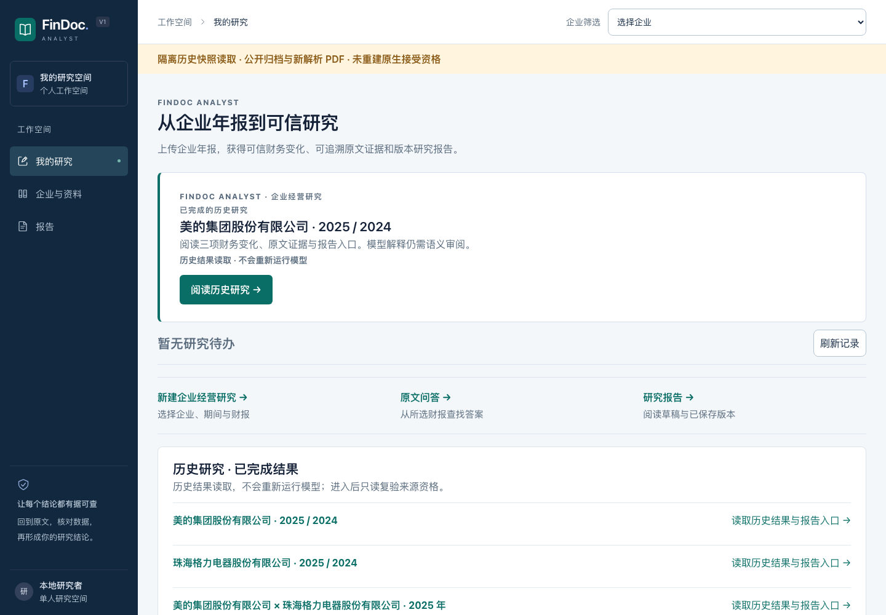
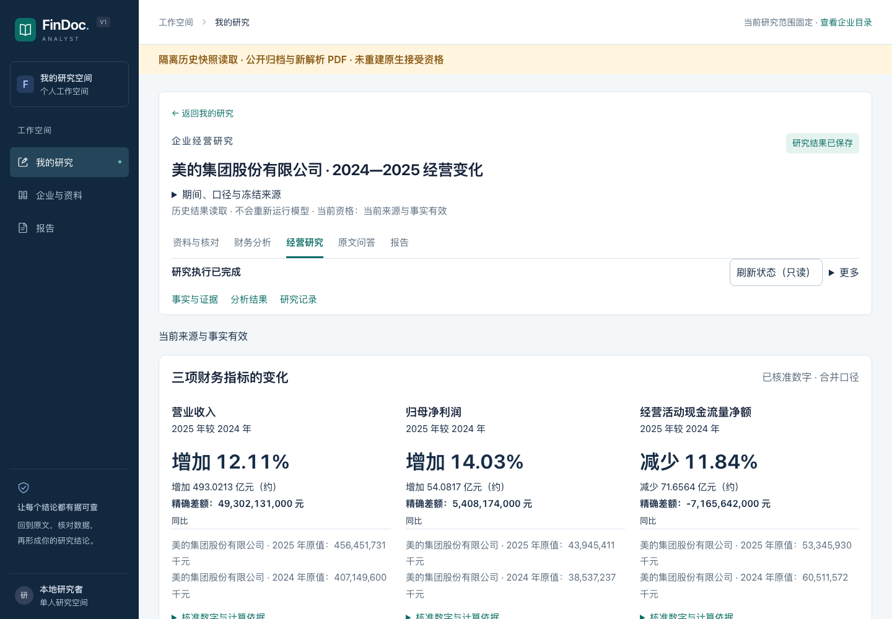

<div align="center">

# FinDoc Agent

**面向财报研究的 Agent 应用 · 让每个结论都有据可查**

读取企业年报，核对财务数据，结合原文形成研究报告。

[](https://github.com/aning0922/findoc-agent/actions/workflows/quality.yml)


[功能概览](#功能概览) · [Agent 工作流程](#agent-工作流程) · [本地演示](#本地演示) · [快速开始](#快速开始) · [项目文档](#项目文档)

</div>

---

FinDoc Agent 将 **RAG 检索、受控工具调用、LangGraph 工作流与人工确认**结合在一个财报研究工作台中。用户可以上传中文企业年报、核对关键指标、比较财务变化、查阅原文，并将完成的经营研究保存为带有来源证据的版本报告。

项目关注三个工程问题：**模型回答如何对应到原文，财务计算如何使用已确认的数据，研究任务如何在人工介入后继续执行。** 界面中保留的 FinDoc Analyst 是工作台名称，与本仓库属于同一项目。



<sub>工作台读取已保存研究的截图。截图所用数据与运行状态见<a href="docs/project-status.md#界面截图">界面说明</a>。</sub>

## 功能概览

| 能力 | 使用方式 |
| --- | --- |
| **企业与年报管理** | 建立企业目录，上传年报，绑定报告年度与会计口径，查看解析和索引状态。 |
| **财务核对与分析** | 提取营业收入、归母净利润、经营活动现金流量净额；对照 PDF 确认并保存后，进行单企业跨年分析或双企业同期比较。 |
| **原文问答** | 在选定报告中检索，由模型选择相关证据，服务端返回原文摘录、来源版本与页码；证据不足时拒答。 |
| **经营研究** | 按研究模板组织数据核对、财务计算、经营原文检索和模型解释；缺少已确认数据时等待用户操作。 |
| **版本报告** | 从已完成的经营研究生成草稿，编辑标题与结论，保存历史版本并导出指定版本的 Markdown。 |

PDF 阅读器支持物理页定位、缩放、引用切换和金额区域高亮。高亮仅在坐标与同版本原文匹配时显示；没有可靠坐标时，仍可查看对应页和原文片段。

<details>
<summary><strong>查看经营研究与财务变化</strong></summary>



<sub>已保存研究中的三项财务变化、原始金额、精确差额与证据入口。</sub>

</details>

## Agent 工作流程

```text
企业年报 PDF → 解析、分块与索引 → 带版本和页码的证据
                                  │
                  ┌───────────────┴────────────────┐
                  ▼                                ▼
              原文问答                         经营研究
       检索 → 模型选择证据             财务候选 → 人工核对与接受
                  │                                │
                  ▼                                ▼
       校验引用 → 原文摘录与历史          保存财务事实 → 确定性分析
                                                   │
                                                   ▼
                                     经营原文检索 → 模型解释草稿
                                                   │
                                                   ▼
                                     保存研究 → 报告版本 → 导出
```

LangGraph 管理经营研究的阶段、人工等待和继续执行。应用校验工具参数、来源范围及调用预算，财务差额和变化率由 Decimal 计算。模型负责证据选择与解释草稿，解释的人工审阅状态单独保留。

用户确认候选数据、保存财务事实、继续研究是三个独立操作。刷新页面只读取已有结果；报告生成与导出复用已保存的经营研究。实现细节见[系统架构](docs/architecture.md)。

## 本地演示

先浏览已保存的研究、问答和报告，只需 Python 3.11+：

```bash
git clone https://github.com/aning0922/findoc-agent.git
cd findoc-agent
python3 demo/serve.py --port 14406
```

打开 [http://127.0.0.1:14406/projects/findoc/](http://127.0.0.1:14406/projects/findoc/)。演示为静态历史阅读页面，不需要 API Key，也不会调用模型。可按“研究 → 原文问答 → 报告 → 版本比较 → 下载”浏览，详见[演示说明](demo/README.md)。

## 快速开始

以下步骤启动可上传资料和执行研究的完整工作台，命令采用 macOS / Linux shell 写法。

### 1. 安装依赖

准备 Python **3.11+**、`uv`、Node.js **24** 与 npm。克隆仓库后，在项目根目录执行：

```bash
uv sync --frozen
npm --prefix frontend ci
```

使用 nvm 管理 Node.js 时，可先执行 `nvm install` 和 `nvm use`，仓库的 `.nvmrc` 已指定 24。首次启动会下载或加载 `BAAI/bge-m3`，需要预留模型缓存空间和启动时间。

### 2. 配置模型

复制配置模板：

```bash
cp -n .env.example .env
```

在 `.env` 中填写服务商提供的实际配置。完整工作台需要 OpenAI 兼容的 Chat Completions 接口，Agent 工具调用还需要所选模型支持 `tools`：

```dotenv
LLM_API_KEY=your-api-key
LLM_MODEL=your-model-name
LLM_BASE_URL=https://your-provider.example/v1
LLM_TIMEOUT_SECONDS=30
```

`.env` 不进入 Git。配置项说明见[开发指南](docs/development.md#模型与存储配置)。

### 3. 启动后端

```bash
export FINDOC_RUNTIME_ROOT="$PWD/data/analyst-runtime"
uv run uvicorn app.api.runtime_factory:create_isolated_runtime_app_from_env \
  --factory \
  --env-file .env \
  --host 127.0.0.1 \
  --port 8000
```

该目录用于保存 PDF、索引和业务记录；以后使用同一路径读取已有数据。此入口要求绝对路径，并拒绝默认的 `data/runtime` 目录。使用单进程启动，不添加 `--reload`，以免热重载中断文档处理任务。

### 4. 启动前端

另开终端，在项目根目录执行：

```bash
npm --prefix frontend run dev -- --host 127.0.0.1
```

| 入口 | 地址 |
| --- | --- |
| 研究首页 | [http://127.0.0.1:5173/](http://127.0.0.1:5173/) |
| 企业与资料 | [http://127.0.0.1:5173/companies](http://127.0.0.1:5173/companies) |
| 原文问答 | [http://127.0.0.1:5173/research?mode=qa](http://127.0.0.1:5173/research?mode=qa) |
| 研究报告 | [http://127.0.0.1:5173/reports](http://127.0.0.1:5173/reports) |
| API 文档 | [http://127.0.0.1:8000/docs](http://127.0.0.1:8000/docs) |

Vite 将 `/api` 代理到本地后端的 `8000` 端口。更多路由和端口设置见[开发指南](docs/development.md#页面与-api-入口)。

### 5. 开始一次研究

1. 在首页建立企业，在“企业与资料”或研究的资料准备区域上传年报，核对企业、报告年度和会计准则。
2. 等待资料处理完成，选择单企业两期或双企业同期研究。
3. 按页面引导核对三项指标的原值、单位、期间与 PDF 来源，接受后单独保存财务事实。
4. 返回研究任务，确认继续执行；研究完成后生成报告、保存版本或导出。

只查原文时，可以直接从首页进入“原文问答”，选择报告后提问。涉及差额、增长率等计算的问题需要走财务核对与分析流程。

也可生成一份虚构资料，先体验 `/legacy` 中的单文档上传与问答：

```bash
uv run python scripts/generate_demo_pdf.py
```

生成器打印实际文件路径，默认目录为 `artifacts/demo/`；这份资料用于基础问答，完整财务研究需要符合支持范围的年报。

## 技术架构

| 层次 | 主要技术 |
| --- | --- |
| Web 界面 | React 19、TypeScript、Vite、Recharts、PDF.js |
| API 与校验 | FastAPI、Pydantic |
| 文档与检索 | PyMuPDF、pdfplumber、bge-m3、Milvus Lite |
| Agent 与工作流 | OpenAI 兼容 SDK、受控工具循环、LangGraph |
| 财务与持久化 | Decimal、SQLite、本地文件存储 |
| 工程验证 | pytest、Ruff、mypy、Node.js 单元测试、Playwright |

核心代码按 `app/documents`、`app/rag`、`app/agent`、`app/research` 和 `app/reports` 划分职责。模块入口与数据流见[系统架构](docs/architecture.md)，前端运行说明见 [frontend/README.md](frontend/README.md)。

## 开发与验证

安装依赖后，可先执行：

```bash
uv run pytest tests/test_parse.py tests/test_demo_pdf.py -q
npm --prefix frontend test
npm --prefix frontend run lint
npm --prefix frontend run build
```

[Quality 工作流](https://github.com/aning0922/findoc-agent/actions/workflows/quality.yml) 运行受控后端检查、前端测试、构建与 Chromium 回归。模型和检索使用测试替身，覆盖交互与数据校验；真实模型效果需要单独评估。复现命令和私有测试资料的跳过规则见[开发与测试](docs/development.md#测试与-ci)。

## 当前范围

当前版本面向本地单人研究，主要覆盖已验证的中文文本层年报及三项财务指标。扫描件 OCR、任意表格版式、混合检索与 rerank、多用户认证和分布式任务调度尚未提供。

财务记录、计算结果与模型解释分别保存。模型解释仍需人工审阅；来源变更或确认撤销后，系统会重新判断相关结果是否可用于分析和导出。已有验证、截图来源和功能限制见[项目状态](docs/project-status.md)。

## 项目文档

| 文档 | 阅读目的 |
| --- | --- |
| [系统架构](docs/architecture.md) | 理解 RAG、Agent、人工确认与版本报告如何协作。 |
| [开发与测试](docs/development.md) | 配置运行环境、查找入口、复现测试与排查启动问题。 |
| [项目状态与截图](docs/project-status.md) | 区分当前实现、公开可复现检查和历史验证记录。 |
| [静态演示](demo/README.md) | 在不配置模型的情况下浏览历史案例。 |

---

<div align="center">
<strong>回到原文，核对数据，再形成研究结论。</strong>
</div>
