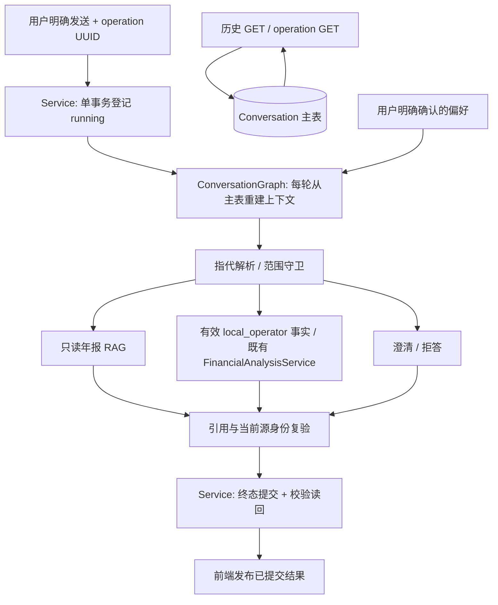

# V1.2 架构决定

A0 主控决定，2026-11-02。精确接口以 contracts.md 和后端严格 DTO 为准。

## 数据流与可信边界

`app/research/models.py` 要求旧 Result.content 严格等于引用原文拼接。Conversation 是独立信封，不能将自由解释写入旧 Result。单次原文读取可保留独立 ResearchRun 子记录，其不可变审计不随会话删除。

`app/research/task_checkpointer.py` 绑定 task_id、执行 claim fencing、task checkpoint 表，不能存聊天。当前锁定 LangGraph 依赖保留；不安装需要升级 checkpoint 的新 SQLite saver。首版以主表为唯一恢复权威，每轮构造新 Graph 输入，thread_id 固定 conversation_id；无跨崩溃节点自动重放。历史、指代焦点与已确认偏好在数据库恢复，running 由独占运行时启动恢复标记 interrupted。未提交草稿不外泄为成功。

模型与工具无写权限。只读工具接收受限参数，source scope 由服务端冻结，不能信任浏览器提供的 workspace/owner/revision/fact ID。财务比较仅复用既有 Decimal 分析，选择歧义时澄清；候选事实不能计算。主表与派生上下文不一致时 fail closed，不从图状态补发工具或补写成功。

## 四种存储

| 存储 | 权威范围 | 恢复 |
| --- | --- | --- |
| 旧 Chat | 单文档传输 | 不冒充线程记忆 |
| ResearchRun | 不可变原文与引用历史 | 数据库读取，不重生成 |
| 经营任务 checkpoint | 显式接受/保存/继续的研究任务状态 | 现有 task claim/fencing，保持原合同 |
| Conversation + Memory | 冻结范围消息、操作状态、经确认研究偏好 | 主表恢复；新发送才执行；偏好独立revision与删除 |

最近历史按 token 上限和最大轮数双重限制，摘要只保存讨论焦点/覆盖游标，不存财务真值或偏好副本。偏好每次新 Turn 重新读取，最多有限条；不作为来源授权或财务证据。第一版无 SSE，完整校验提交后展示。
