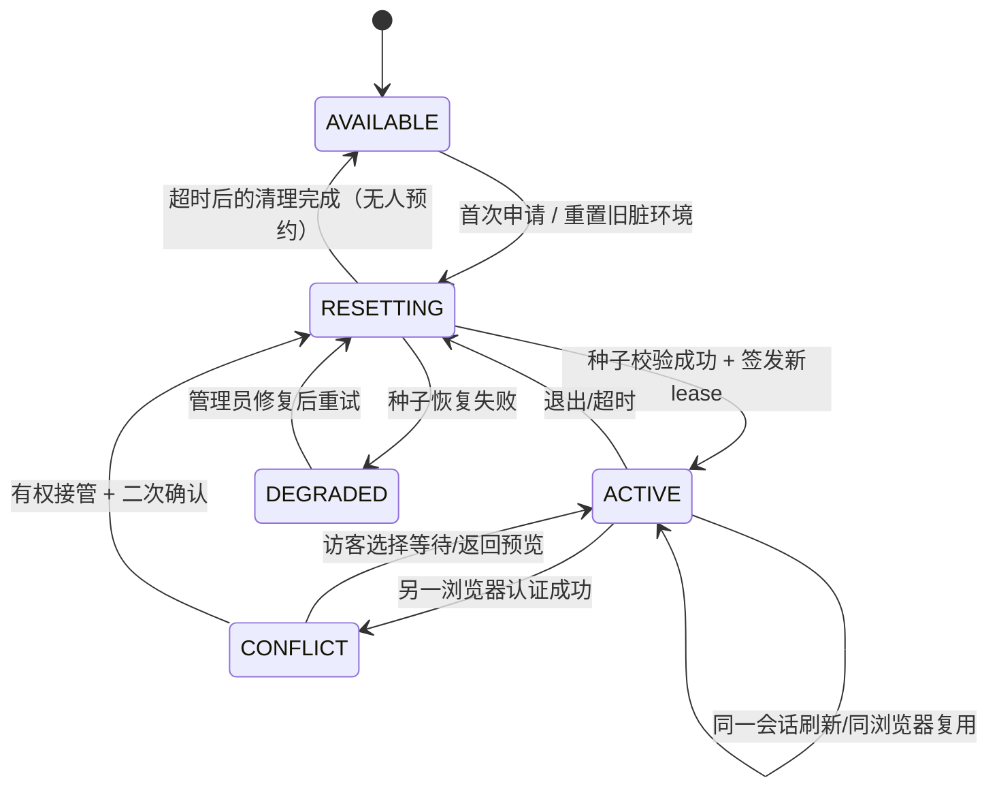

# 03｜固定演示账号、20 分钟独占、登录冲突、接管与种子重置

此部分是**求职展示专属产品功能**，不是完整 SaaS 用户系统。必须是真实后端实现：会话超时/占用/重置不可以只用 localStorage + 弹窗假装。

## 3.1 业务要求冻结
- 固定演示账号，密码由部署者在服务端环境设置；不能在 Git、前端 bundle、原型 ZIP 中放真实账号密码。
- 默认 `20` 分钟绝对时长；部署配置可选 `30` 分钟。不因刷新、点击或重连自动续期。页面计时以服务端 expires_at 为准。
- 全站一套**可写演示环境**，同一时刻只有一个独占会话；多个标签属于同一会话可以复用当前 Cookie，不抢占自己。
- 客户端其他设备用相同账号登录时，展示：“当前有人正在体验，剩余 08:24”；可查看公开预览，或等待。若启用接管策略，必须弹出二次确认。
- `DEMO_CONFLICT_POLICY=wait_only|takeover_enabled`，默认 `wait_only`；`takeover_enabled` 的“接管”应优先需要部署者设置的 owner 接管口令（不同于公共共享密码），避免任何陌生人恶意循环踢人。如果作品展示确实希望公众接管，必须显式打开可选参数、加入限频/冷却并给当前使用者友好警告；**默认不能让所有持有共享密码的人互踢**。
- 用户本人主动退出、租约到期、接管：都会结束当前会话，随后在隔离空间恢复完整种子。恢复操作成功后才允许分配下一个可写租约。
- 初始状态并非全空：含可展示首页图表、企业、真实年报、已完成历史研究和报告。演示产生的新聊天/偏好/任务等在重置后消失。

## 3.2 登录交互与状态机

上图是产品行为模型，实际数据库可以用 `AVAILABLE/ACTIVE/RESETTING/DEGRADED` 作为状态；`CONFLICT` 为请求返回 423 的临时 UI 状态，不必持久化。

## 3.3 登录页主要 UI
- Logo、产品标语、一张克制的样例可视化、`账号/密码`表单、`进入演示`、`只读预览`（可选）。右侧注明“演示访问 · 20 分钟 · 操作会自动恢复”。
- 密码错：统一通用错误，不展示当前是否占用；只有正确账号密码验证通过后才可看到“有人使用”的状态信息。
- 登录冲突弹窗：倒计时、占用原因、预计到期时刻、`稍后再试`；有明确接管授权时显示 `接管演示`，必须二次确认 “这会结束对方体验并重置数据”。
- 当前用户：固定位置显示剩余时间，最后 2 分钟弹非打断提示，时间到转过期页或登录页。
- 被接管用户：显示 “当前演示已被接管，操作未保存到新会话”，不保留可用的旧表单提交。
- 重置中：独立转场页“正在准备演示数据”，清楚展示状态，失败可回到登录/管理员恢复入口。

## 3.4 服务器数据模型建议
独立 `demo_control.db`（不与 FinDoc 的 documents.db 混在一个可被重置的目录），建议字段：
```text
DemoSlot(slot_id='public-demo', status, generation BIGINT, active_session_id?,
         expires_at?, runtime_key?, seed_version, updated_at)
DemoSession(session_id hash, slot_id, generation, issued_at, expires_at,
            revoked_at?, revoke_reason?, last_seen_at?)
DemoReset(reset_id, requested_by, from_generation, to_generation, state,
          seed_manifest_sha, started_at, finished_at?, error_code?)
```
- `generation` 必须单调递增；旧 token/消息/任务/写请求即便被取消或迟到，也只能操作原代际隔离资源。
- 服务器使用不可猜测随机 token，Cookie `HttpOnly + SameSite=Lax/Strict + Secure(HTTPS)`，服务端保存哈希，不能把 token/密码写入前端可读存储；配 CSRF/Origin 检查、基本登录限速、密码在 env 中验证（配置只存哈希）。
- 服务器时间为权威；倒计时前端只是展示，授权端每次执行验证 `lease expires_at + generation + status`。
- `session_id` 对旧 FinDoc 本地单人 Demo 身份只是新保护层，不是多租户用户 ID。真实系统接口必须由统一网关/中间件把写权限和 active generation 校验落到后端。

## 3.5 登录与接管 API 草案
```text
GET    /api/demo/status                  // available|occupied|resetting|degraded, remaining_seconds
POST   /api/demo/login                   // fixed credential + idempotency key
GET    /api/demo/session                 // cookie-auth current lease
POST   /api/demo/logout                  // end lease + reset (owner session)
POST   /api/demo/takeover                // valid credential + additional permission + confirm:true
GET    /api/demo/resets/{reset_id}       // progress, sanitized failure reason
GET    /api/demo/session/events          // SSE optional, takeover/expired; poll fallback
```
**返回建议：** `200` 当前/登录成功，`401` 凭据无效，`423` 占用，`409` 会话代际冲突，`503` 重置失败。严格不缓存票据；所有改动都在 server generation/操作 ID 校验下进行。
- `POST /demo/login` 参数不能从前端决定租约期限、环境 id、密码存储或 generation。
- 重复请求同一 operation ID：只返回已经登记的结果，不创建双会话；多人同时点击接管，只产生一个成功代际。强制接管失败不能把旧会话标“已下线但环境仍可写”。

## 3.6 演示状态恢复：正确选型和禁区
**源种子**放在只读 `demo/seed/vN/`，包含 `manifest.json`（文件 SHA、数据库/索引版本、PDF 来源和是否已核准）、缩减的 SQLite 和已验证索引/对象文件。`data/demo-active/<generation>/` 为每次演示独立可写 runtime。

推荐方案：
1. **最小实现（求职优先）**：演示入口前有独立 Session/Reset Controller，通过进程管理一个隔离的 FinDoc Runtime；需要重置时先撤销旧 session/generation，再停止原 runtime，复制种子至**全新目录**，验证种子和健康检查，再原子切到新 runtime。BGE/Milvus 重新启动可能比较慢，提供进度界面，不要求秒级重置。
2. **优化方案（有性能瓶颈再考虑）**：将共享只读资料索引与会话可写数据做明确隔离，隔离数据库和任务 worker，复位时仅切换租约目录；更复杂，应以 M0 spike 结果决定。

严禁：`rm -rf data/runtime`、在活跃请求下直接覆盖 SQLite 文件、在原始 PDF 对象仓库删文件、让旧线程继续持有新的数据库引用、从用户页面传可删除目录路径。

**并发安全不变量：** 旧会话 A 在生成模型答复途中，B 接管并生成 N+1 代；A 的晚到输出不得出现在 B 的会话历史/首页 KPI/报告/记忆中。持久化操作须以 generation 路由到原代目录，不能通过“登录时只检查一次，后续直接写全局当前库”绕过。

## 3.7 种子数据与恢复策略
- 预置 2–4 家示例企业；3–5 份已核验真实年报（可合法展示其来源和小量引用）；历史已完成研究 2–3、报告 2、示例会话 2、Agent 轨迹 1、真实系统可用指标若干；不强求每次重算。
- 原始财务 **local_operator 接受**只能来自用户/授权人实际进行的明确核验。若无法准备真人核准快照，seed 中使用单独 `demo_sample` 数据视图，页面标“示例，不参与已确认事实计算”，不得伪造正式凭证。
- 数据重置保留 PDF 文件哈希、来源版本、解析状态与正常可读报告；静态备份和 seed 校验记录不随用户演示重置。
- 恢复后首页 KPI 与会话/任务/报告数精确匹配；用户新增记录、备注、临时记忆不保留。

## 3.8 双浏览器验收矩阵（最重要）
| 场景 | 预期 |
|---|---|
| A 登录成功，B 密码错 | B 仅获 401，不暴露 A 存在 |
| A 登录成功，B 账号密码正确 | B 返回占用及剩余时间，不能写任何演示业务 |
| `wait_only` 策略，B 点击等待 | A 不受影响，B 不能通过页面绕行访问写 API |
| `takeover_enabled`，B 无 owner 授权 | 接管不成功，A 保持活跃 |
| B 获 owner 授权并明确接管 | A 离线，复位种子，B 新 lease；所有操作仅一次 |
| A POST/模型回包在接管后迟到 | 数据只在旧代际，B 不受污染，旧 write 401/409 |
| 重置中客户端刷新/并发登录 | 返回 resetting，不能读写半完成数据 |
| 重置出现磁盘空间不足/校验错误 | 状态 degraded，不能发布“登录成功” |
| 自己刷新/同浏览器多标签 | 不新增租约、不延长原 TTL |
| 主动退出与绝对 20 分钟到期 | 新访问看到原始种子，无上个访客私有记录 |
| 进程重启 | 控制库恢复租约/判定已过期并完成或阻塞重置；不能越权复用旧 token |

## 3.9 拟做交付和可延后功能
- 必须做：登录/校验/独占/冲突/倒计时/过期/退出/种子复位/旧身份阻断/2 浏览器测试/人工演示。
- 可延后：短信、验证码、用户管理控制台、复杂排队、数据库连接池、透明扩容、异地灾备、可刷新会话长期续期。
- 性能目标只需单人在可用演示环境跑通；重置可能需要十几秒以上，做好状态说明即可，不做高可用零停机。
