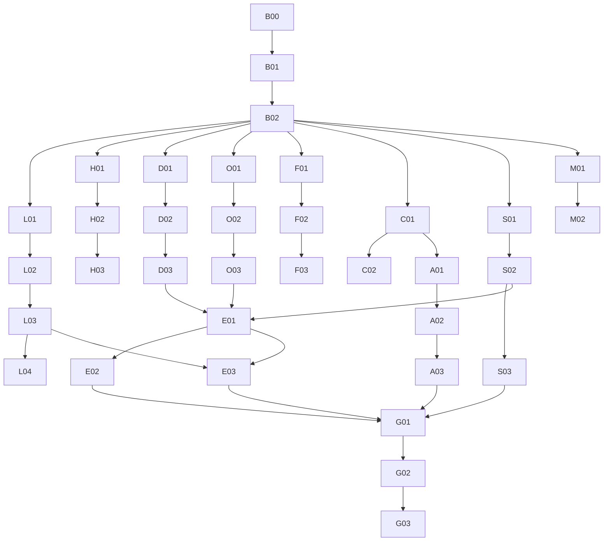

# 08｜36 个可交割任务：WBS、依赖、实际文件与验收

## 8.1 定位与规则
- 共 **36 个任务**（B00–G03），均为**待 Codex 执行**，不能把旧 V1.2 的已完成模块当成新任务已完成。
- 目标是求职演示，不是生产 SaaS；任务完成要有**实际可点击或可调用的功能路径**，不必穷尽所有极端场景。
- `M0` 产品/合同先冻结；M1 视觉+Demo 外壳优先；M2 资料+财务可并行；M3 Agent/报告/记忆协同；M4 演示种子及集成；M5 真人走查。
- 估计为**AI 辅助有效人日，不可直接相加为墙钟时间或承诺工期**。
- 新建 branch `codex/findoc-showcase-c-integration`，每任务独立工作树；热点文件由 Integration Owner 合并。

## 8.2 一览表

| ID | 阶段 | 任务 | 依赖 | 建议责任 | 粗估 |
|---|---|---|---|---|---|
| `B00` | M0 | 锁定 V1.2 真实基线 | — | 主控 | 0.3–0.5d |
| `B01` | M0 | 求职定位与全功能地图 | B00 | 产品/架构 | 0.5–1d |
| `B02` | M0 | 高保真原型+新 DTO/API 冻结 | B01 | UX/架构 | 0.5–1d |
| `L01` | M1 | 固定演示账号与服务端 Cookie | B02 | Demo 后端 | 0.5–1d |
| `L02` | M1 | 单人占用与接管冲突 | L01 | Demo 后端 | 0.5–1d |
| `L03` | M1 | 演示种子与环境复位 | L02 | Demo 运维 | 1–2d |
| `L04` | M1 | 登录与接管端到端 UI | L03 | 前端/QA | 0.5–1d |
| `H01` | M1 | 仪表盘数据查询与种子聚合 | B02 | Dashboard 后端 | 0.5–1d |
| `H02` | M1 | 惊艳首页视觉重构 | B02,H01 | Frontend UX | 1–2d |
| `H03` | M1 | 折线柱环三图与交互 | H01,H02 | Frontend 图表 | 0.5–1.5d |
| `U01` | M1 | 统一研究导航与业务入口 | B02,H02 | Frontend 集成 | 0.5–1d |
| `D01` | M2 | 官方源发现可用性 Spike | B02 | Official source | 0.5–1d |
| `D02` | M2 | 官方目录适配与安全下载 | D01 | Document 后端 | 1–2d |
| `D03` | M2 | 自动查找年报的前端流程 | D02,U01 | Document 前端 | 0.5–1d |
| `O01` | M2 | OCR 引擎与版式 Spike | B02 | OCR 专项 | 0.5–1d |
| `O02` | M2 | PDF 智能解析路由与结果存储 | O01 | 解析后端 | 1–2d |
| `O03` | M2 | 解析预览、表格与质量提示 | O02 | OCR UX/QA | 0.5–1.5d |
| `F01` | M2 | 扩展财务指标 v2 协议 | B02 | 财务架构 | 0.5–1d |
| `F02` | M2 | 2–4 个新增可用财务指标 | F01,O02 | 财务后端 | 1–2d |
| `F03` | M2 | 新财务图表与变化信号 | F02,H03 | 财务前端 | 0.5–1d |
| `C01` | M3 | LLM 意图理解与兜底解析 | B02 | Agent 后端 | 1–2d |
| `C02` | M3 | 对话与经营任务联动 | C01,U01 | Agent 集成 | 0.5–1.5d |
| `S01` | M3 | 可信综合分析结果 schema | B02,F01 | Synthesis 架构 | 0.5–1d |
| `S02` | M3 | 可信综合研究 Agent | S01,C01 | Synthesis 后端 | 1–2d |
| `S03` | M3 | 图表报告升级与 PDF 导出 | S02,F03 | Report 前端/后端 | 1–2d |
| `A01` | M3 | Multi-Agent 分工与路由设计 | C01,S01 | Agent 架构 | 0.5–1d |
| `A02` | M3 | 真实多智能体研究执行 | A01,S02 | Multi-Agent 后端 | 1–2d |
| `A03` | M3 | 执行轨迹与阶段流式 UI | A02,C02 | Agent 前端/事件 | 0.5–1.5d |
| `M01` | M3 | 带来源的研究记忆存储 | B02 | Memory 后端 | 0.5–1.5d |
| `M02` | M3 | 语义召回及偏好真正生效 | M01,C01,H02 | Memory/UX | 1–2d |
| `E01` | M4 | 少量真实资料与精选场景集 | D03,O03,S02 | QA/seed | 0.5–1d |
| `E02` | M4 | Agent 质量与单多 Agent 对照 | E01,A02,M02 | QA评测 | 0.5–1d |
| `E03` | M4 | 完整可恢复演示种子 | E01,L03 | Demo/QA | 0.5–1d |
| `G01` | M4 | 集成、关键回归及响应式验收 | E02,E03,A03,S03,F03 | 主控/QA | 1–2d |
| `G02` | M5 | 真人走查与现场演示打磨 | G01 | 产品/QA | 0.5–1.5d |
| `G03` | M5 | 作品交付/视频/README与PR | G02 | 主控/UX | 0.5–1d |

## 8.3 每个任务的实施与完成定义

### B00｜锁定 V1.2 真实基线
- **阶段/依赖：** M0 / `—`。**建议 owner：** 主控；**有效投入：** 0.3–0.5d。
- **文件所有权建议：** `Git/README/STATE`；若发现多人修改同一热点，必须由主控显式分配给唯一 owner。
- **详细工作：** fetch 远端；确认 v12 分支 HEAD、main/旧 UX、已有测试；隔离工作树、备份种子；列明未完真人验收。
- **展示与 DoD：** 能从独立 v12 创建新集成分支；保留当前工作树无损；基线报告有 SHA/路径/已知限制。
- **交付物：** 分支/HEAD SHA、关键代码/接口位置、1–3 条测试结果（PASS/FAIL/SKIP）、真实或模拟标记、至少一张 UI 截图（有 UI 时）、已知限制和回退方案。不得把未执行的外部访问/真实模型/真人核验写成完成。

### B01｜求职定位与全功能地图
- **阶段/依赖：** M0 / `B00`。**建议 owner：** 产品/架构；**有效投入：** 0.5–1d。
- **文件所有权建议：** `docs/product/*`；若发现多人修改同一热点，必须由主控显式分配给唯一 owner。
- **详细工作：** 按 F01–F18 复用表整理产品故事与演示要求；明确非生产要求；固定 3 条演示路线和首屏要素。
- **展示与 DoD：** 无功能遗漏或冲突；每项有用户动作/输入/输出/示例/DoD；不会把边缘工程要求当终态。
- **交付物：** 分支/HEAD SHA、关键代码/接口位置、1–3 条测试结果（PASS/FAIL/SKIP）、真实或模拟标记、至少一张 UI 截图（有 UI 时）、已知限制和回退方案。不得把未执行的外部访问/真实模型/真人核验写成完成。

### B02｜高保真原型+新 DTO/API 冻结
- **阶段/依赖：** M0 / `B01`。**建议 owner：** UX/架构；**有效投入：** 0.5–1d。
- **文件所有权建议：** `prototype/*; docs/contracts/*`；若发现多人修改同一热点，必须由主控显式分配给唯一 owner。
- **详细工作：** 两套视觉 token 方案、登录/占用/接管/重置/首页/对话核心原型；确认 Demo Controller / Dashboard DTO / Findings v2 / Parse v2 接口。
- **展示与 DoD：** 可点击原型，1440/390 有布局；架构审查签署 ADR；热点代码只有主控集成。
- **交付物：** 分支/HEAD SHA、关键代码/接口位置、1–3 条测试结果（PASS/FAIL/SKIP）、真实或模拟标记、至少一张 UI 截图（有 UI 时）、已知限制和回退方案。不得把未执行的外部访问/真实模型/真人核验写成完成。

### L01｜固定演示账号与服务端 Cookie
- **阶段/依赖：** M1 / `B02`。**建议 owner：** Demo 后端；**有效投入：** 0.5–1d。
- **文件所有权建议：** `app/demo/auth/*`；若发现多人修改同一热点，必须由主控显式分配给唯一 owner。
- **详细工作：** 配置密码哈希、固定账户、登录/会话/登出 API、TTL=20 或 30、token 哈希、Cookie、中间件和访问控制。
- **展示与 DoD：** 未授权不能写入，过期返回 401；秘密不进 Git；自己刷新不延长 20 分钟。
- **交付物：** 分支/HEAD SHA、关键代码/接口位置、1–3 条测试结果（PASS/FAIL/SKIP）、真实或模拟标记、至少一张 UI 截图（有 UI 时）、已知限制和回退方案。不得把未执行的外部访问/真实模型/真人核验写成完成。

### L02｜单人占用与接管冲突
- **阶段/依赖：** M1 / `L01`。**建议 owner：** Demo 后端；**有效投入：** 0.5–1d。
- **文件所有权建议：** `app/demo/lease/*`；若发现多人修改同一热点，必须由主控显式分配给唯一 owner。
- **详细工作：** SQLite lease + generation、并发抢占事务、wait_only/takeover_enabled、倒计时和 owner 授权。
- **展示与 DoD：** 两浏览器抢占只有一个 winner；密码错误不泄漏占用；有权接管时旧会话失效。
- **交付物：** 分支/HEAD SHA、关键代码/接口位置、1–3 条测试结果（PASS/FAIL/SKIP）、真实或模拟标记、至少一张 UI 截图（有 UI 时）、已知限制和回退方案。不得把未执行的外部访问/真实模型/真人核验写成完成。

### L03｜演示种子与环境复位
- **阶段/依赖：** M1 / `L02`。**建议 owner：** Demo 运维；**有效投入：** 1–2d。
- **文件所有权建议：** `app/demo/reset/*; demo/seed/*`；若发现多人修改同一热点，必须由主控显式分配给唯一 owner。
- **详细工作：** 独立控制库，seed manifest、代际目录、停止旧 runtime/复制校验/切换；超时/退出/接管恢复；旧线程代际保护。
- **展示与 DoD：** 重置前后 seed SHA 相同，用户新增会话/记录消失，原始 PDF/工作目录不受影响。
- **交付物：** 分支/HEAD SHA、关键代码/接口位置、1–3 条测试结果（PASS/FAIL/SKIP）、真实或模拟标记、至少一张 UI 截图（有 UI 时）、已知限制和回退方案。不得把未执行的外部访问/真实模型/真人核验写成完成。

### L04｜登录与接管端到端 UI
- **阶段/依赖：** M1 / `L03`。**建议 owner：** 前端/QA；**有效投入：** 0.5–1d。
- **文件所有权建议：** `frontend/src/demo/*; frontend/e2e/demo-*`；若发现多人修改同一热点，必须由主控显式分配给唯一 owner。
- **详细工作：** 登录页、占用提示/剩余时间/二次接管、被踢/过期/重置中、2 浏览器端到端测试。
- **展示与 DoD：** A 登录 B 占用→正确策略→接管→A 下线→B 恢复 seed；不进入脏数据半重置状态。
- **交付物：** 分支/HEAD SHA、关键代码/接口位置、1–3 条测试结果（PASS/FAIL/SKIP）、真实或模拟标记、至少一张 UI 截图（有 UI 时）、已知限制和回退方案。不得把未执行的外部访问/真实模型/真人核验写成完成。

### H01｜仪表盘数据查询与种子聚合
- **阶段/依赖：** M1 / `B02`。**建议 owner：** Dashboard 后端；**有效投入：** 0.5–1d。
- **文件所有权建议：** `app/dashboard/*`；若发现多人修改同一热点，必须由主控显式分配给唯一 owner。
- **详细工作：** 聚合企业/文档/研究/报告真实数量和已可用的图表源；区分已核准/预置案例/缺失。
- **展示与 DoD：** 相同种子数据 KPI 精确对齐；来源失效不被画成当前已核准。
- **交付物：** 分支/HEAD SHA、关键代码/接口位置、1–3 条测试结果（PASS/FAIL/SKIP）、真实或模拟标记、至少一张 UI 截图（有 UI 时）、已知限制和回退方案。不得把未执行的外部访问/真实模型/真人核验写成完成。

### H02｜惊艳首页视觉重构
- **阶段/依赖：** M1 / `B02,H01`。**建议 owner：** Frontend UX；**有效投入：** 1–2d。
- **文件所有权建议：** `frontend/src/product/ResearchHome.tsx; Dashboard*`；若发现多人修改同一热点，必须由主控显式分配给唯一 owner。
- **详细工作：** 高质量 Hero/搜索/CTA、KPI、最近研究、浅底深侧栏、图例/空态和动画；不新增多余导航。
- **展示与 DoD：** 1440px 第一眼有视觉层次，390px 无溢出，CTA 可真正进入业务。
- **交付物：** 分支/HEAD SHA、关键代码/接口位置、1–3 条测试结果（PASS/FAIL/SKIP）、真实或模拟标记、至少一张 UI 截图（有 UI 时）、已知限制和回退方案。不得把未执行的外部访问/真实模型/真人核验写成完成。

### H03｜折线柱环三图与交互
- **阶段/依赖：** M1 / `H01,H02`。**建议 owner：** Frontend 图表；**有效投入：** 0.5–1.5d。
- **文件所有权建议：** `frontend/src/product/DashboardCharts*`；若发现多人修改同一热点，必须由主控显式分配给唯一 owner。
- **详细工作：** 折线收入趋势、柱状对比、任务状态环形图、tooltip/单位/数据标识/点击证据。
- **展示与 DoD：** 三类图可操作；图值与种子一致；没有真实数据不伪装图表。
- **交付物：** 分支/HEAD SHA、关键代码/接口位置、1–3 条测试结果（PASS/FAIL/SKIP）、真实或模拟标记、至少一张 UI 截图（有 UI 时）、已知限制和回退方案。不得把未执行的外部访问/真实模型/真人核验写成完成。

### U01｜统一研究导航与业务入口
- **阶段/依赖：** M1 / `B02,H02`。**建议 owner：** Frontend 集成；**有效投入：** 0.5–1d。
- **文件所有权建议：** `AppShell/productRoutes; ResearchWorkbench; Conversations`；若发现多人修改同一热点，必须由主控显式分配给唯一 owner。
- **详细工作：** 统一首页/AI 助手/企业资料/任务/报告，减少双问答入口；从首页到新会话/准备年报的导航贯通。
- **展示与 DoD：** 旧 run/task/report 深链不失效，新用户可不读文档找到开始路径。
- **交付物：** 分支/HEAD SHA、关键代码/接口位置、1–3 条测试结果（PASS/FAIL/SKIP）、真实或模拟标记、至少一张 UI 截图（有 UI 时）、已知限制和回退方案。不得把未执行的外部访问/真实模型/真人核验写成完成。

### D01｜官方源发现可用性 Spike
- **阶段/依赖：** M2 / `B02`。**建议 owner：** Official source；**有效投入：** 0.5–1d。
- **文件所有权建议：** `experiments/disclosure/*`；若发现多人修改同一热点，必须由主控显式分配给唯一 owner。
- **详细工作：** 用至少 2 家公司验证官方年报候选，确认合法页面路径、公告正文/摘要/更正与规则。
- **展示与 DoD：** 1 入口可用或明确手动 PDF 回退；保存成功/不可用证据。
- **交付物：** 分支/HEAD SHA、关键代码/接口位置、1–3 条测试结果（PASS/FAIL/SKIP）、真实或模拟标记、至少一张 UI 截图（有 UI 时）、已知限制和回退方案。不得把未执行的外部访问/真实模型/真人核验写成完成。

### D02｜官方目录适配与安全下载
- **阶段/依赖：** M2 / `D01`。**建议 owner：** Document 后端；**有效投入：** 1–2d。
- **文件所有权建议：** `app/disclosures/*`；若发现多人修改同一热点，必须由主控显式分配给唯一 owner。
- **详细工作：** 代码/年度搜索，下载带 allowlist、超时、大小/重定向/内网拦截、SHA、去重；DocumentService 对接。
- **展示与 DoD：** 真实官方 PDF 下载/导入可用；重复不产生两个文件；失败降级。
- **交付物：** 分支/HEAD SHA、关键代码/接口位置、1–3 条测试结果（PASS/FAIL/SKIP）、真实或模拟标记、至少一张 UI 截图（有 UI 时）、已知限制和回退方案。不得把未执行的外部访问/真实模型/真人核验写成完成。

### D03｜自动查找年报的前端流程
- **阶段/依赖：** M2 / `D02,U01`。**建议 owner：** Document 前端；**有效投入：** 0.5–1d。
- **文件所有权建议：** `frontend/src/product/Disclosure*; DocumentLibrary`；若发现多人修改同一热点，必须由主控显式分配给唯一 owner。
- **详细工作：** 搜索/选择正文与修订/导入/解析进度，上传/URL 兜底；展示来源说明。
- **展示与 DoD：** 用户能从首页到索引可读；无官方源时不阻塞手工使用。
- **交付物：** 分支/HEAD SHA、关键代码/接口位置、1–3 条测试结果（PASS/FAIL/SKIP）、真实或模拟标记、至少一张 UI 截图（有 UI 时）、已知限制和回退方案。不得把未执行的外部访问/真实模型/真人核验写成完成。

### O01｜OCR 引擎与版式 Spike
- **阶段/依赖：** M2 / `B02`。**建议 owner：** OCR 专项；**有效投入：** 0.5–1d。
- **文件所有权建议：** `experiments/ocr/*`；若发现多人修改同一热点，必须由主控显式分配给唯一 owner。
- **详细工作：** 文本层+扫描页+复杂表格样本，在可用设备真实运行 MinerU/Paddle 候选，验证输出页/表/时间/依赖。
- **展示与 DoD：** 选一个真实可执行引擎；不只写 adapter；给出资源需求/失败回退。
- **交付物：** 分支/HEAD SHA、关键代码/接口位置、1–3 条测试结果（PASS/FAIL/SKIP）、真实或模拟标记、至少一张 UI 截图（有 UI 时）、已知限制和回退方案。不得把未执行的外部访问/真实模型/真人核验写成完成。

### O02｜PDF 智能解析路由与结果存储
- **阶段/依赖：** M2 / `O01`。**建议 owner：** 解析后端；**有效投入：** 1–2d。
- **文件所有权建议：** `app/parsing/*; app/documents/*`；若发现多人修改同一热点，必须由主控显式分配给唯一 owner。
- **详细工作：** fast 为默认，扫描/困难页 OCR；固定原 PDF SHA、parser artifact、状态；隔离重任务。
- **展示与 DoD：** 1 份真实扫描样本得到可索引文本；旧 fast 路线仍然可用。
- **交付物：** 分支/HEAD SHA、关键代码/接口位置、1–3 条测试结果（PASS/FAIL/SKIP）、真实或模拟标记、至少一张 UI 截图（有 UI 时）、已知限制和回退方案。不得把未执行的外部访问/真实模型/真人核验写成完成。

### O03｜解析预览、表格与质量提示
- **阶段/依赖：** M2 / `O02`。**建议 owner：** OCR UX/QA；**有效投入：** 0.5–1.5d。
- **文件所有权建议：** `frontend/src/product/ParseQuality*`；若发现多人修改同一热点，必须由主控显式分配给唯一 owner。
- **详细工作：** 原 PDF/表格对照、页码、异常定位、OCR 页/总页、降级提示。
- **展示与 DoD：** 在手机/桌面能查看至少 1 个识别表格与原图，不把 OCR 候选当核准事实。
- **交付物：** 分支/HEAD SHA、关键代码/接口位置、1–3 条测试结果（PASS/FAIL/SKIP）、真实或模拟标记、至少一张 UI 截图（有 UI 时）、已知限制和回退方案。不得把未执行的外部访问/真实模型/真人核验写成完成。

### F01｜扩展财务指标 v2 协议
- **阶段/依赖：** M2 / `B02`。**建议 owner：** 财务架构；**有效投入：** 0.5–1d。
- **文件所有权建议：** `app/finance_v2/models*`；若发现多人修改同一热点，必须由主控显式分配给唯一 owner。
- **详细工作：** 新增指标清单、来源、口径、候选/确认、Decimal/差额公式；保留旧模板 3×2。
- **展示与 DoD：** 现有财务 API/六项核对/旧迁移零破坏；v2 只新增。
- **交付物：** 分支/HEAD SHA、关键代码/接口位置、1–3 条测试结果（PASS/FAIL/SKIP）、真实或模拟标记、至少一张 UI 截图（有 UI 时）、已知限制和回退方案。不得把未执行的外部访问/真实模型/真人核验写成完成。

### F02｜2–4 个新增可用财务指标
- **阶段/依赖：** M2 / `F01,O02`。**建议 owner：** 财务后端；**有效投入：** 1–2d。
- **文件所有权建议：** `app/finance_v2/extraction*`；若发现多人修改同一热点，必须由主控显式分配给唯一 owner。
- **详细工作：** 优先总资产/总负债/资产负债率/净利率等 2–4 项真实可测；来源证据和缺失状态。
- **展示与 DoD：** 至少 1 份真实 PDF 的新增指标有来源或确定计算，数值非 LLM 编造。
- **交付物：** 分支/HEAD SHA、关键代码/接口位置、1–3 条测试结果（PASS/FAIL/SKIP）、真实或模拟标记、至少一张 UI 截图（有 UI 时）、已知限制和回退方案。不得把未执行的外部访问/真实模型/真人核验写成完成。

### F03｜新财务图表与变化信号
- **阶段/依赖：** M2 / `F02,H03`。**建议 owner：** 财务前端；**有效投入：** 0.5–1d。
- **文件所有权建议：** `frontend/src/product/ExtendedFinance*`；若发现多人修改同一热点，必须由主控显式分配给唯一 owner。
- **详细工作：** 趋势、对比、营收增利润降等规则提示，链接原数据/证据。
- **展示与 DoD：** 可在真实可用年份出图，缺失年份不补零，来源状态明确。
- **交付物：** 分支/HEAD SHA、关键代码/接口位置、1–3 条测试结果（PASS/FAIL/SKIP）、真实或模拟标记、至少一张 UI 截图（有 UI 时）、已知限制和回退方案。不得把未执行的外部访问/真实模型/真人核验写成完成。

### C01｜LLM 意图理解与兜底解析
- **阶段/依赖：** M3 / `B02`。**建议 owner：** Agent 后端；**有效投入：** 1–2d。
- **文件所有权建议：** `app/conversations/intent_v2*`；若发现多人修改同一热点，必须由主控显式分配给唯一 owner。
- **详细工作：** 结构化 IntentV2+程序权限校验；处理复杂问题和跨轮指代；旧规则兜底。
- **展示与 DoD：** 10–20 个固定复杂问题意图/澄清可演示；不允许越权调用。
- **交付物：** 分支/HEAD SHA、关键代码/接口位置、1–3 条测试结果（PASS/FAIL/SKIP）、真实或模拟标记、至少一张 UI 截图（有 UI 时）、已知限制和回退方案。不得把未执行的外部访问/真实模型/真人核验写成完成。

### C02｜对话与经营任务联动
- **阶段/依赖：** M3 / `C01,U01`。**建议 owner：** Agent 集成；**有效投入：** 0.5–1.5d。
- **文件所有权建议：** `app/research_handoff/*; frontend Conversations`；若发现多人修改同一热点，必须由主控显式分配给唯一 owner。
- **详细工作：** 对话内计划卡→用户确认建研究→人工核对→返回会话/报告；操作可追溯。
- **展示与 DoD：** 一条实际端到端，不重复 Task，不自动 ACCEPT/SAVE/RESUME。
- **交付物：** 分支/HEAD SHA、关键代码/接口位置、1–3 条测试结果（PASS/FAIL/SKIP）、真实或模拟标记、至少一张 UI 截图（有 UI 时）、已知限制和回退方案。不得把未执行的外部访问/真实模型/真人核验写成完成。

### S01｜可信综合分析结果 schema
- **阶段/依赖：** M3 / `B02,F01`。**建议 owner：** Synthesis 架构；**有效投入：** 0.5–1d。
- **文件所有权建议：** `app/synthesis/models*`；若发现多人修改同一热点，必须由主控显式分配给唯一 owner。
- **详细工作：** 分层结构化发现、证据链接、已核准数字/AI 草稿/待核实的状态。
- **展示与 DoD：** 旧 ResearchRun 协议不改；模型数字不能成为核准事实。
- **交付物：** 分支/HEAD SHA、关键代码/接口位置、1–3 条测试结果（PASS/FAIL/SKIP）、真实或模拟标记、至少一张 UI 截图（有 UI 时）、已知限制和回退方案。不得把未执行的外部访问/真实模型/真人核验写成完成。

### S02｜可信综合研究 Agent
- **阶段/依赖：** M3 / `S01,C01`。**建议 owner：** Synthesis 后端；**有效投入：** 1–2d。
- **文件所有权建议：** `app/synthesis/*`；若发现多人修改同一热点，必须由主控显式分配给唯一 owner。
- **详细工作：** 复用 RAG/确认事实，产经营/风险/财务综合解释，验证引用，保存结果。
- **展示与 DoD：** 真实年报产生结构化可读摘要；无证据时不猜数。
- **交付物：** 分支/HEAD SHA、关键代码/接口位置、1–3 条测试结果（PASS/FAIL/SKIP）、真实或模拟标记、至少一张 UI 截图（有 UI 时）、已知限制和回退方案。不得把未执行的外部访问/真实模型/真人核验写成完成。

### S03｜图表报告升级与 PDF 导出
- **阶段/依赖：** M3 / `S02,F03`。**建议 owner：** Report 前端/后端；**有效投入：** 1–2d。
- **文件所有权建议：** `frontend Report*; app/reports/v2/*`；若发现多人修改同一热点，必须由主控显式分配给唯一 owner。
- **详细工作：** 新报告摘要/图表/证据/编辑/版本/print-PDF; 旧 Markdown 保留。
- **展示与 DoD：** 一份完整真实案例能打印保存 PDF、返回引用来源、读回版本。
- **交付物：** 分支/HEAD SHA、关键代码/接口位置、1–3 条测试结果（PASS/FAIL/SKIP）、真实或模拟标记、至少一张 UI 截图（有 UI 时）、已知限制和回退方案。不得把未执行的外部访问/真实模型/真人核验写成完成。

### A01｜Multi-Agent 分工与路由设计
- **阶段/依赖：** M3 / `C01,S01`。**建议 owner：** Agent 架构；**有效投入：** 0.5–1d。
- **文件所有权建议：** `docs/agent_v2/*`；若发现多人修改同一热点，必须由主控显式分配给唯一 owner。
- **详细工作：** Supervisor/Evidence/Finance/Risk/Report Agent 的结构输入输出、预算、路由、对照任务。
- **展示与 DoD：** 复杂任务才启用，简单任务保留快速路径；不是角色名称空壳。
- **交付物：** 分支/HEAD SHA、关键代码/接口位置、1–3 条测试结果（PASS/FAIL/SKIP）、真实或模拟标记、至少一张 UI 截图（有 UI 时）、已知限制和回退方案。不得把未执行的外部访问/真实模型/真人核验写成完成。

### A02｜真实多智能体研究执行
- **阶段/依赖：** M3 / `A01,S02`。**建议 owner：** Multi-Agent 后端；**有效投入：** 1–2d。
- **文件所有权建议：** `app/deep_research/*`；若发现多人修改同一热点，必须由主控显式分配给唯一 owner。
- **详细工作：** Supervisor 动态分派至少 2 子 Agent，读取各自工具、结果合并、独立验证、持久化。
- **展示与 DoD：** 一个真实多 Agent 任务有分派/工具/汇合轨迹，LLM 和假实现清楚区分。
- **交付物：** 分支/HEAD SHA、关键代码/接口位置、1–3 条测试结果（PASS/FAIL/SKIP）、真实或模拟标记、至少一张 UI 截图（有 UI 时）、已知限制和回退方案。不得把未执行的外部访问/真实模型/真人核验写成完成。

### A03｜执行轨迹与阶段流式 UI
- **阶段/依赖：** M3 / `A02,C02`。**建议 owner：** Agent 前端/事件；**有效投入：** 0.5–1.5d。
- **文件所有权建议：** `frontend AgentTrace*; app/events/*`；若发现多人修改同一热点，必须由主控显式分配给唯一 owner。
- **详细工作：** 显示多 Agent 真实阶段、工具调用、SSE/轮询、最终已保存结果；恢复只读。
- **展示与 DoD：** 浏览器能看见 ≥3 真实状态，无私有 CoT，刷新不二次发模型。
- **交付物：** 分支/HEAD SHA、关键代码/接口位置、1–3 条测试结果（PASS/FAIL/SKIP）、真实或模拟标记、至少一张 UI 截图（有 UI 时）、已知限制和回退方案。不得把未执行的外部访问/真实模型/真人核验写成完成。

### M01｜带来源的研究记忆存储
- **阶段/依赖：** M3 / `B02`。**建议 owner：** Memory 后端；**有效投入：** 0.5–1.5d。
- **文件所有权建议：** `app/research_memory/*`；若发现多人修改同一热点，必须由主控显式分配给唯一 owner。
- **详细工作：** 收藏问答、研究问题、备注与来源身份，显式确认/删除、向量或检索索引。
- **展示与 DoD：** 旧枚举偏好不破坏；删除未来不召回；来源变更标过期。
- **交付物：** 分支/HEAD SHA、关键代码/接口位置、1–3 条测试结果（PASS/FAIL/SKIP）、真实或模拟标记、至少一张 UI 截图（有 UI 时）、已知限制和回退方案。不得把未执行的外部访问/真实模型/真人核验写成完成。

### M02｜语义召回及偏好真正生效
- **阶段/依赖：** M3 / `M01,C01,H02`。**建议 owner：** Memory/UX；**有效投入：** 1–2d。
- **文件所有权建议：** `app/research_memory/search*; frontend ResearchPreferences*`；若发现多人修改同一热点，必须由主控显式分配给唯一 owner。
- **详细工作：** 新会话搜索上次研究线索，保存偏好改首页问题/图顺序，记忆列表管理。
- **展示与 DoD：** 确实跨会话召回、删除还原；无乱用失效数字。
- **交付物：** 分支/HEAD SHA、关键代码/接口位置、1–3 条测试结果（PASS/FAIL/SKIP）、真实或模拟标记、至少一张 UI 截图（有 UI 时）、已知限制和回退方案。不得把未执行的外部访问/真实模型/真人核验写成完成。

### E01｜少量真实资料与精选场景集
- **阶段/依赖：** M4 / `D03,O03,S02`。**建议 owner：** QA/seed；**有效投入：** 0.5–1d。
- **文件所有权建议：** `demo/seed/*; eval/cases/*`；若发现多人修改同一热点，必须由主控显式分配给唯一 owner。
- **详细工作：** 准备 3–5 份真实 PDF/1 OCR 页/2–3 报告/10–20 评测题、manifest。
- **展示与 DoD：** 演示数据合法可追溯；人工确认和模型待审状态有明示。
- **交付物：** 分支/HEAD SHA、关键代码/接口位置、1–3 条测试结果（PASS/FAIL/SKIP）、真实或模拟标记、至少一张 UI 截图（有 UI 时）、已知限制和回退方案。不得把未执行的外部访问/真实模型/真人核验写成完成。

### E02｜Agent 质量与单多 Agent 对照
- **阶段/依赖：** M4 / `E01,A02,M02`。**建议 owner：** QA评测；**有效投入：** 0.5–1d。
- **文件所有权建议：** `eval/runner*`；若发现多人修改同一热点，必须由主控显式分配给唯一 owner。
- **详细工作：** 输出工具路由、引用、指代、记忆、拒答、用量、耗时的真实分母和失败用例。
- **展示与 DoD：** 能复跑每种指标；没有数据不显示假百分比；单/多 Agent 结果可对照。
- **交付物：** 分支/HEAD SHA、关键代码/接口位置、1–3 条测试结果（PASS/FAIL/SKIP）、真实或模拟标记、至少一张 UI 截图（有 UI 时）、已知限制和回退方案。不得把未执行的外部访问/真实模型/真人核验写成完成。

### E03｜完整可恢复演示种子
- **阶段/依赖：** M4 / `E01,L03`。**建议 owner：** Demo/QA；**有效投入：** 0.5–1d。
- **文件所有权建议：** `demo/seed/manifest*; scripts/seed*`；若发现多人修改同一热点，必须由主控显式分配给唯一 owner。
- **详细工作：** 以实际数据构建只读种子+完整初始 Dashboard，含预置报告和会话。
- **展示与 DoD：** 重置 N 次 seed 一致；演示写操作不污染种子。
- **交付物：** 分支/HEAD SHA、关键代码/接口位置、1–3 条测试结果（PASS/FAIL/SKIP）、真实或模拟标记、至少一张 UI 截图（有 UI 时）、已知限制和回退方案。不得把未执行的外部访问/真实模型/真人核验写成完成。

### G01｜集成、关键回归及响应式验收
- **阶段/依赖：** M4 / `E02,E03,A03,S03,F03`。**建议 owner：** 主控/QA；**有效投入：** 1–2d。
- **文件所有权建议：** `integration branch; frontend/e2e/*`；若发现多人修改同一热点，必须由主控显式分配给唯一 owner。
- **详细工作：** 把各 worktree 有序合入，修 API/UX 冲突，跑关键旧回归/双访客/来源/报告/记忆。
- **展示与 DoD：** 3 条完整演示路可跑；旧财务核验不退化；P0问题关完。
- **交付物：** 分支/HEAD SHA、关键代码/接口位置、1–3 条测试结果（PASS/FAIL/SKIP）、真实或模拟标记、至少一张 UI 截图（有 UI 时）、已知限制和回退方案。不得把未执行的外部访问/真实模型/真人核验写成完成。

### G02｜真人走查与现场演示打磨
- **阶段/依赖：** M5 / `G01`。**建议 owner：** 产品/QA；**有效投入：** 0.5–1.5d。
- **文件所有权建议：** `docs/showcase/*`；若发现多人修改同一热点，必须由主控显式分配给唯一 owner。
- **详细工作：** 看登录首页第一眼/图表/搜索/研究/多Agent/记忆/OCR/PDF；修断点。
- **展示与 DoD：** 面试路线稳定、没有令人困惑的入口/假数据显示/残留数据。
- **交付物：** 分支/HEAD SHA、关键代码/接口位置、1–3 条测试结果（PASS/FAIL/SKIP）、真实或模拟标记、至少一张 UI 截图（有 UI 时）、已知限制和回退方案。不得把未执行的外部访问/真实模型/真人核验写成完成。

### G03｜作品交付/视频/README与PR
- **阶段/依赖：** M5 / `G02`。**建议 owner：** 主控/UX；**有效投入：** 0.5–1d。
- **文件所有权建议：** `README, demo guide, screenshots`；若发现多人修改同一热点，必须由主控显式分配给唯一 owner。
- **详细工作：** 启动脚本、录屏脚本、技术结构图、已知限制、代码分支/PR、状态文档、回滚说明。
- **展示与 DoD：** 可交给陌生面试官体验并说明真实与预置；不自动合并 main/公开部署。
- **交付物：** 分支/HEAD SHA、关键代码/接口位置、1–3 条测试结果（PASS/FAIL/SKIP）、真实或模拟标记、至少一张 UI 截图（有 UI 时）、已知限制和回退方案。不得把未执行的外部访问/真实模型/真人核验写成完成。

## 8.4 并行批次与关键依赖

实际项目中 B02→所有模块并不等于必等全部视觉细节冻结，接口/数据合同先冻结后即可派出后端任务；不允许前端未经协议自行猜新 API。

建议最多三条实质开发工作线：
- **线A Demo/首页：** L、H、U；集中处理 AppShell 与入口。
- **线B 文档/财务：** D、O、F；下载与 OCR 共享 DocumentService，需要单一集成人。
- **线C Agent/记忆/报告：** C、S、A、M；Graph、模型协议、Findings 由主控协调。
- **线D QA/种子：** E、G；可更早开始准备样本，不与生产数据共享 runtime。

## 8.5 冲突热点与任务接力
- `app/api/runtime_factory.py`、`app/companies/migrations.py`、`app/documents/service.py`、`frontend/src/product/AppShell.tsx`、`frontend/src/product/Conversations.tsx`、`frontend/src/product/ResearchHome.tsx`：只允许 Integration Owner 合并跨模块改动；子任务尽量在新文件实现。
- 任务主控记录 `STATE.md` 中的文件 owner、精确 base SHA 与依赖版本；子任务不能自行改 `main` 或重写旧迁移 checksum。
- 在没有真实财务人工签核时，主控继续其他不依赖该审批的任务，不因 M2 资料不能实时抓取而停下首页/记忆/报告实现。
- 合并每组后执行最短相关回归；每日或阶段末运行完整必要集。保留 P2 视觉瑕疵与不影响演示的 edge case，不无限重做。
