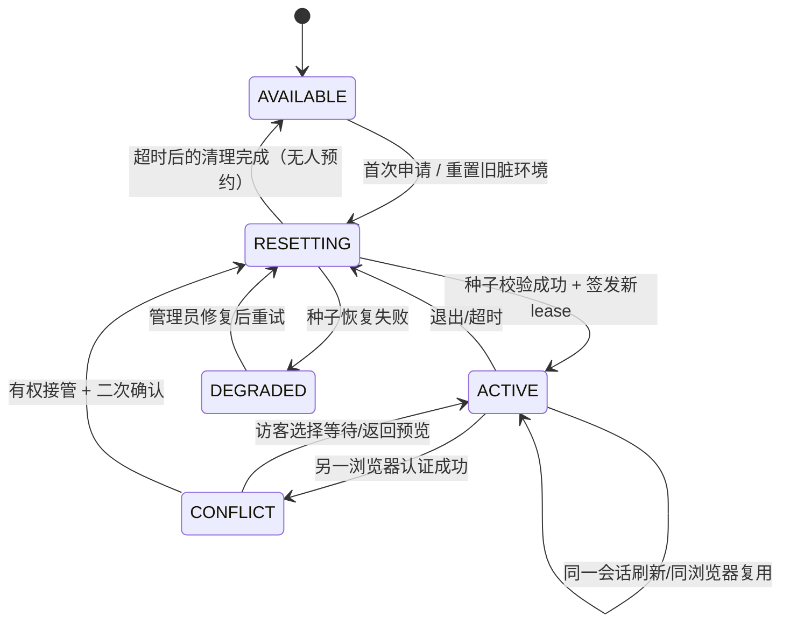
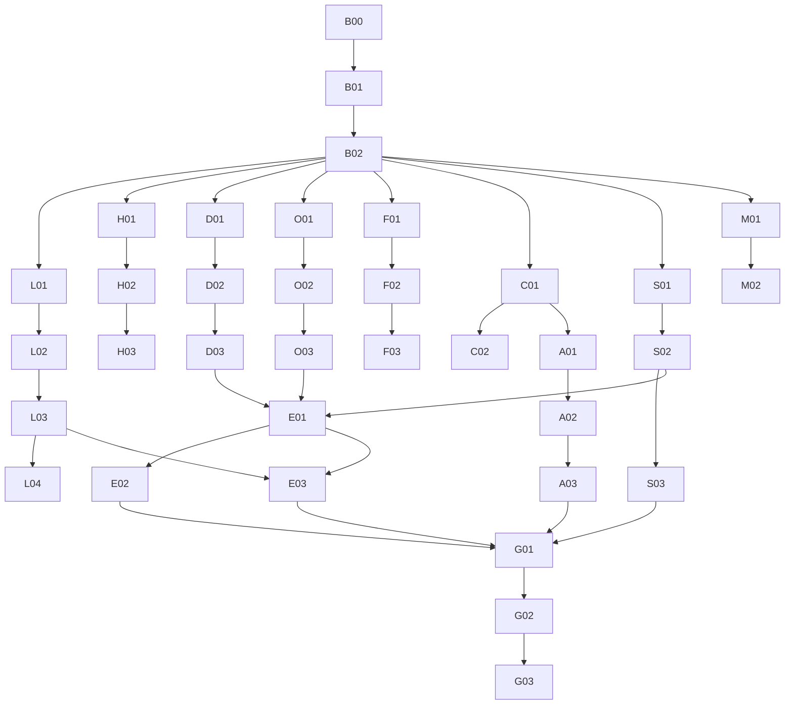

# FinDoc Agent C 方案｜求职演示版·完整新开发工作包（单文件版）

> 2026-11-03 整体重做，替代前次偏向生产 SaaS 的 C 方案包。包含 18 类功能、36 项任务、首页高保真视觉、演示账号独占/重置、技术合同与 Codex 托管执行。

## 目录（与 ZIP 内同名章节对应）

- 00_目标_基线_边界.md
- 01_功能全景_完整规格.md
- 02_首页_视觉系统_图表.md
- 03_演示登录_独占接管_重置.md
- 04_信息架构_页面流程.md
- 05_AI对话_多Agent_记忆_研究.md
- 06_财报获取_OCR_财务_报告.md
- 07_架构_数据结构_API合同.md
- 08_任务WBS_依赖与交付.md
- 09_里程碑_托管并行.md
- 10_演示种子_测试_验收.md
- 11_求职展示_演示脚本.md
- 12_风险_降级_资源.md
- 13_Codex主控开场指令.md
- 14_源代码映射_核验资料.md

---

# 00｜产品定位、基线与“求职演示优先”原则

## 0.1 本版覆盖范围
这是**替换旧 C 方案工作包**的完整新规划，不是增量补丁。旧十项：官方 PDF 获取、OCR、可信综合分析、对话/研究联动、记忆个性化、执行轨迹、评测、Multi-Agent、语义记忆、流式进度；新纳入：惊艳首页仪表盘、固定演示账号、单人会话占用/接管/重置、统一 AI 研究工作台、扩展财务分析指标、增强版报告和演示入口。

## 0.2 用户/评判视角
- 主用户：面试官/招聘人员（首访 30–120 秒）、面试现场的开发者、技术面试官（深入验证 5–15 分钟）。
- 展示目标：首屏看出“专业 AI 财务研究平台”；5 分钟理解完整流程；10 分钟见到 PDF 原文、Agent 轨迹、报告和记忆的实际效果；技术面能从代码和日志证明非纯 UI。
- **产品风格：** 现代金融科技高保真、高级、克制、中文优先、鼠标/触控友好。不是金融炒股建议平台，不生成股价推荐。
- **工作目标：** 功能广度、演示连贯和视觉质量优先；工程深度只做与典型体验/核心可信边界直接相关的部分。

## 0.3 需求优先级（按求职价值排序）
1. 第一印象：首页设计、可见的真实/演示图表、登录及独占体验。
2. 完整感：企业选择 → 官方 PDF → 解析/OCR → 分析 → 对话 → 多 Agent → 报告。
3. Agent 展示：LLM 意图理解、受控工具、协作链路、长期/语义记忆、流式阶段反馈。
4. 技术可信：证据定位、已核准事实、简单离线评测、可复现日志。
5. 延迟：多用户 SaaS、安全合规全栈、超大流量、企业 SSO、多机容灾、百分百 OCR 版式适配。

## 0.4 Git 真正基线
- 仓库：`https://github.com/aning0922/findoc-agent`
- 最新核验（2026-11-03）：`main` 为 `1f0a3d4`，但不包含 V1.2。
- **正确源码分支** `codex/conversation-memory-v12-20261102`，核验 SHA `c8be30808a3ac8c6d13daa5fd9d43c0ea1212c78`。
- 新主控开场先 `git fetch origin --prune` 并核对远端是否更新，且不得把工作包中的 SHA 当永恒最新版。
- V1.2 有单文档旧聊天、严格 ResearchRun 原文问答、ConversationGraph 多轮受控路由、SQLite Conversation/Memory、固定研究模板、财务人工核对、报告版本/Markdown、Milvus+BGE、React 页面。**必须复用而不是重做。**

## 0.5 交付层级（消除生产级过度要求）
- **L1 真实可用 Demo（必需）**：每个目标模块至少一条用真实代码跑通的固定案例，按钮操作有效，来源/结果标注真实或示例；不要求海量/跨站通用。
- **L2 稳定典型流程（必需）**：3–5 份不同真实 PDF、10–20 条精选问题、3 条固定面试路线，一键恢复种子，桌面与手机核心页面无遮挡。
- **L3 工程增强（按收益）**：增量解析优化、更多指标、更多记忆检索、更多 PDF 源；可记录已知问题后延后。
- **L4 生产 SaaS（本阶段不做）**：真实多租户权限、支付、第三方用户管理、水平扩容、可用性 SLO、灾备、全量法规审计。

## 0.6 必须保留的基本真实边界
- 不把假数值冒充真实年报；首页每张图必须写清取值范围：已确认实际数据、演示种子/样例数据或实时服务统计。
- 不把 OCR 候选/模型推测自动提升为经人工确认事实。允许新增“未审核 AI 分析”层，不能改写现有正式财务计算公式/接受回执。
- **演示环境完全隔离**：重置/接管不能触碰真实开发数据库、原始 PDF、Git 仓库和测试证据；重置后旧登录必须失效、旧工作线程不可写入新代际数据。
- 不能发布并泄漏 API key、固定演示密码；用户看到的是演示业务，不是真人隐私数据。
- 自动下载必须限制官方来源和下载目标，避免内网访问、循环重定向和超大文件。
- 已验证的旧 `ACCEPT → SAVE → RESUME` 行为保留；新对话可导航到该流程但不自动批准。

## 0.7 一次性交付和授权语义
工作包默认授权 Codex：在独立分支上规划、原型、开发、隔离测试、修改、提交、阶段集成；不默认授权公网部署、真实财务人工签核、购买新服务、删除既有数据、自动合并 main。M0 一次冻结产品和技术合同后，能够自主进入后续开发批次；遇到有成本/权限/真实来源等外部阻断，记录并继续其他分支。

## 0.8 完整交付约束
- 不允许只上传漂亮截图；代码有真实路由/服务/数据来源，演示可启动。
- 不要求全部功能都达到成熟 SaaS 质量：明确区分 `可演示`、`典型可用`、`已知限制`、`待增强`。
- 每个模块必须附“面试官怎么验证”的 30–90 秒演示脚本；完成后更新主控 `STATE.md` 和 `DEMO_CHECKLIST.md`。

---

# 01｜最终 18 类功能：详细需求、展示行为与验收

**F01–F18 全部纳入 C 方案的最终范围，除非用户明确取消。不要求同一天做完；优先功能骨架→跨模块完整演示→体验/可靠性。** 这里“已存在”不等于不需改造，“新功能”也不能等同于只加按钮。

## F01 登录与演示控制（新增｜最高优先）
**用户故事**：面试官打开公开演示网址 → 固定演示账号密码登录 → 20 分钟独占 → 正常体验完整数据 → 超时/退出/接管后回初始状态。
- `DEMO_TTL_MINUTES=20` 默认，配置支持 30；绝对有效期，从成功取得独占 lease 开始，刷新不延长。
- 一个 demo active lease；登录冲突显示剩余时间、等待、可选接管流程。可配置冲突策略 `wait_only`/`takeover_enabled`；默认公共演示 `wait_only`，演示所有者经二次验证可以接管。若用户确实选择公众可接管，必须显示明示确认与冷却策略，默认关闭。
- 后端会话 Cookie/凭据校验；强制接管时原用户实时/轮询收到下线提示。禁用旧访问、恢复种子、新会话开始的顺序不能颠倒。
- 支持首页公开预览/登录后可编辑演示两种展示方式，未授权用户不能写入数据。测试重置失败要拒绝进入，不允许“重置一半”后仍正常写入。
- **可验收**：双真实浏览器 A/B 演示：A 登录、B 冲突、所有者接管、A 读写 401/423、数据恢复、B 看到干净初始内容；过期同理。

## F02 惊艳首页 + 图表驾驶舱（重构｜最高优先）
- 首屏 Hero + 全球搜索：输入企业名/代码，点击研究即可进入；菜单有资料、研究助手、任务、报告。
- 4–6 KPI 卡：已跟踪企业数、已准备年报数、已完成研究数、报告数、当前/累计任务（只显示真实可解释的状态统计）。
- 至少 **折线图**（已核对年份的收入/指标趋势）、**柱状图**（多企业/多期财务对比）、**饼/环形图**（任务状态/资料类型分布），可加 Sparkline；不允许无来源“收入结构占比”假图。
- 图表交互：tooltip、数值单位/比较期、点击跳研究、空数据示例、移动端布局/表格替代。
- 首页上方必须一眼识别行业与 AI 能力：高级暗色侧栏、浅色内容面、明确色彩系统、精细排版/图例、进度微交互；布局见 `02_`。
- **可验收**：1440、1280、390 宽度截屏检查；点击图/企业/任务可导航；种子真实统计与饼图总数一致。

## F03 统一 AI 研究入口（重构｜最高优先）
- 首访可以走“快速提问/深度研究/选择现有报告”三个主入口；无需先理解各种内部任务名。
- 首次选企业后在同一工作区查看来源、聊天、研究进度、证据；资料缺失原位给“查找官方年报 / 上传”。
- 会话中出现需要确认财务数据时展示明确 CTA，完成后回原会话/任务（带安全的上下文标识）。
- 高级审计字段默认收起；普通用户不直接接触 SHA、fact_set_id、task revision。
- **可验收**：陌生演示者不读 README，从首页到生成首个研究结果 ≤ 5 个主要入口跳转（具体允许核对页）。

## F04 官方年报搜索与导入（新增）
- 支持企业代码/名称匹配、报告年度、官方来源、发布日期、正文/摘要/更正标识。
- 选择候选后明确导入：受控下载 PDF，校验 magic/SHA、大小、去重；调用现有 DocumentService，绑定企业和年报年度，显示准备状态。
- 只承诺一条真实可用官方入口；查询/访问不可用时引导“官方 PDF 网址或手动上传”，不绕过访问限制。
- 避免 SSRF/重定向到内网、超大文件和旧公告伪装。
- **可验收**：两家公司不同年度各一份可查真实 PDF，至少一次从查找到可打开本地 PDF/解析结果的闭环。

## F05 OCR 与智能解析（新增）
- 自动识别文本层/扫描/混合文档；文本层继续走现有 fast；扫描页支持真实 OCR 后端（先与现有 MinerU 输出适配器兼容）。
- 章节、页码、表格结构、识别质量报告、OCR 页数与失败回退；表格按原文行列显示，可点回 PDF。
- OCR 识别错误可提示用户核查，不自动确认为财务数据。
- **可验收**：一份扫描样本真实 OCR，至少一个复杂表格正确映射主要行列；失败时不产生虚假已确认数据。

## F06 扩展财务指标与图表（增强）
- 保留现有三指标六项链路，独立增加总资产、总负债、资产负债率、毛利率、净利率、应收账款、存货、现金流与净利润对照的可用子集。
- 不强求所有指标在所有 PDF 适配：按指标来源和口径显示支持状态；财务计算用 Decimal/确定性公式。
- 允许分析最近 3–5 年“已可用年份”的趋势，不补造缺失值；区分 report_year 与财务 period。
- **可验收**：至少一个真实年报样例的两项新增指标，展示计算/图表/原文核对；旧三指标回归不退化。

## F07 LLM 自然语言意图理解（重构）
- 提问：“帮我看看近三年现金流有没有改善”“那利润呢”“风险在哪里”“写一份报告”等，先由 LLM 产生结构化意图，再由后端校验授权范围和工具白名单。
- 旧规则路径保留兜底/快速路径，LLM 不获权自改企业、范围、fact/来源 ID、调用已禁止写操作。
- 不支持的意图可以明确说明能力边界和推荐下一步。
- **可验收**：固定 10–20 条自然语言用例，含代词、多个年度、公司切换、缺少事实、违法工具，记录准确/拒答/澄清。

## F08 AI 综合研究与可信解读（新增）
- 给出摘要、主要增长/下滑项、年报经营说明、风险/待核实问题、图表与引用。
- **明确三层**：已核准数字（确定性）、来源原文（可追溯）、AI 解释（未审/待核实）；模型不能自己编造计算事实。
- 对外提供“快速总结”（不需完整核对的原文导读）和“完整财务研究”（要求事实确认）。
- **可验收**：一份实际报告的综合结果有图、有论点、有来源；无可确认数字时自动降级不编造。

## F09 对话与业务工作流联动（增强）
- 对话生成研究意图草稿，展示企业、报告、年度和拟执行步骤；用户确认后创建现有研究任务。
- 可以从 Agent 对话进入财务核对，保存后恢复研究；完成后回对话查看报告入口；避免把同一任务重做。
- **可验收**：一条“问答→核对→分析→报告→继续追问”真实闭环，旧 ACCEPT/SAVE/RESUME 仍明确。

## F10 轻量 Multi-Agent（新增）
- 只在深度研究中启用：Supervisor 规划任务；证据、财务、风险/经营、报告整理子 Agent 受控分工；可见任务交接。
- 简单查询走单 Agent；每个 Agent 有实际不同输入/工具/输出；非“改四个名字的假流水线”。
- **可验收**：一条复杂真实多 Agent 轨迹；与单 Agent 对照执行次数/正确性/耗时，诚实展示差异。

## F11 语义研究记忆（增强）
- 已有结构偏好继续保留。新增研究线索/未解决问题/收藏的引用等记忆候选，在用户确认或明确保存后存储。
- 跨会话语义检索，记忆引用原会话/企业/来源版本，支持更新、删除、冲突与过期。不能当财务事实。
- **可验收**：新会话找回上次的“待研究问题”，删除后后续不再召回；记忆失效不能生成旧引用财务结论。

## F12 记忆个性化（增强）
- 保存“关注现金流”后，首页推荐问题/默认图表顺序改变；用户可当前会话覆盖，不影响底层事实口径。
- **可验收**：保存/跨会话生效/删除还原；可见 UX 差异而不只是 DB 条目。

## F13 执行轨迹 + 阶段式流式状态（新增）
- 展示“查找资料→检索→核验→计算→整理结论→保存完成”等真实阶段事件；多 Agent 展示哪个 Agent 负责哪一步。
- 未核实的 token 不当作已证实答案流式放出；最终提交后显示可信结果。
- **可验收**：一次真实研究具备 ≥ 3 个真实阶段事件和可信完成态；刷新只恢复已保存执行记录。

## F14 报告升级（增强）
- 一屏可读的执行摘要、财务图表、经营变化、风险与待核实、来源证据，版本历史、用户编辑、Markdown、打印/PDF；可复制引用。
- 可以从对话和研究任务进入；报告标记“演示资料/实际年报/人工待审”。
- **可验收**：完整报告可打开、版本切换、导出 PDF/Markdown，含正确来源标识，不吞掉旧审计历史。

## F15 Agent 评测展示（新增）
- 先用 10–20 条固定题：工具选择、跨轮指代、引用归属、财务零猜测、记忆删除、单/多 Agent 对比、耗时/调用次数；明确样本大小和通过分母。
- UI 可以一个“技术面板”展示简版评分卡，不与业务首页混用假指标。
- **可验收**：评测脚本/输入/参考答案/实际输出/失败原因可复现；失败不美化。

## F16 作品演示资料与引导（新增）
- 准备真实出处年报、可读历史案例、1–2 条扫描 OCR 页、2–3 份报告、少量历史研究与会话，让首页不空。
- 每次可恢复种子，访客能在不增加真实 API 调用情况下先阅读样例；“预置结果”明确标记。
- **可验收**：复位后 UI 有同样的企业、图表、历史、报告；快照 manifest/SHA 可验证，演示用户操作不改变 seed。

## F17 收藏、研究笔记与建议问题（新增）
- 保存回答/引用到研究笔记，支持收藏/取消、关联报告，自动推荐自然语言问题；可以标记待继续研究。
- **可验收**：收藏回看/报告引用/重置消失；建议问题跳转会话，预填但不自动发起付费模型请求。

## F18 完整 UI/UX 和可访问性基础（重构）
- 统一设计 Token、导航、空态、加载态、图表规范、移动适配；鼠标与键盘基本可用；图表提供表格替代；不为细节做无限设计循环。
- **可验收**：登录、首页、资料、研究、报告在 1440/1280/390 宽度可读，无严重遮挡或水平溢出；至少一次陌生用户走完整演示脚本。

## 默认范围外（不得悄悄转为完成阻断）
生产级 SSO、多租户、支付、独立分布式队列、任意交易所/任意扫描 PDF 完美适配、投资买卖建议、无限模型自主循环、大规模混沌测试和灾备。

## 功能 DoD 的最小门槛
每个 F 类至少：1 条实际可复现路径、对应按钮/页面、失败降级说明、1–3 条关键测试、演示截图或录屏片段。可以清楚写“只支持样例 A/B”，不能声称全市场稳定。

---

# 02｜第一眼惊艳：首页信息架构、图表、视觉系统及高保真验收

**M0 第一优先交付：可点击、可比较、桌面/手机均完整的首页高保真原型**。随包 `原型/index.html` 是风格及交互示意，Codex 应将其转化为现有 React 组件，不应把原型的 mock 数据视为真实财务。禁止仅复制旧仪表盘再堆 6 个 chart。

## 2.1 风格目标与参考属性
- “专业金融研究 × AI 协作工作台”：冷静、可信、精致、带科技感的产品界面；不是券商交易终端，也不是花哨数据墙。
- 色彩：深色侧栏可使用 `#111B30`，背景 `#F5F7FB`，白卡 `#FFFFFF`，主操作蓝色 `#3F67DB`，辅助青绿 `#147E78`，警示琥珀。都只是候选，M0 高保真原型审查后冻结 Token。
- 字体按系统栈，不加载额外受限字体；核心数字可用 tabular figures。
- 细节：侧栏 224–240px、内容最大 1440px、卡片 16–20px 圆角、浅阴影+分层线条、8pt 栅格、图标同笔画风格；减少巨大空白和过多语义徽章。
- 首屏重点：清晰品牌/一句话价值 + 搜索/研究 + 4 KPI + 第一排图表轮廓。登录后的第一眼不能被“待核对六项”阻挡；待办在次屏。

## 2.2 首页结构（桌面 1440px 基准）
```text
┌───────────── 左侧导航 ──────────┬──────────────────────────────────────────┐
│  FinDoc. / Analyst Demo          │ 顶栏：面包屑   搜索   演示状态  19:43 剩余 │
│  概览                            ├──────────────────────────────────────────┤
│  AI 研究助手                     │ HERO：企业财报研究，一站式 Agent 协同     │
│  企业与资料                       │ [搜索公司/代码____] [开始研究] [体验案例] │
│  研究任务                        ├──────────────────────────────────────────┤
│  研究报告                        │ [跟踪企业] [已解析财报] [研究完成] [报告] │
│                                  ├─────────────────────────┬────────────────┤
│  研究偏好/演示会话                │ 营收与净利润趋势（折线）│ 研究任务状态圆环 │
│                                  ├─────────────────────────┼────────────────┤
│  演示模式 · 归位状态               │ 财务指标对比（柱状）   │ 财报处理活动列表 │
│  当前用户/退出                    ├─────────────────────────┴────────────────┤
│                                  │ 最近研究 / Agent 研究进度 / 推荐问题     │
└──────────────────────────────────┴──────────────────────────────────────────┘
```

## 2.3 模块细节
### H01 Hero
- 桌面左侧标题 36–44px：`让财报研究，进入 AI 协作时代`，次文案“查找官方年报 · 提取财务指标 · 证据引用 · AI 深度分析”。右侧不必放大图片；可以用小型可视化/Agent 任务路径卡增添视觉质感。
- 输入框支持代码和公司名，建议补全只来自本地企业目录/明确的官方搜索结果。无结果提供“添加公司/手动上传”。
- 3 CTA：`开始 AI 研究`、`导入官方财报`、`查看已完成示例`；主次操作区分，不能互相开多个无关弹窗。
### H02 KPI（4 卡优先）
- 已关注企业数、已入库财报数、已完成研究数、已生成报告数：来源数据库/种子数据，非前端常量。
- KPI 次要信息：最近新增、上次更新时间、入口；没历史则 0 + 操作建议。
- “模型成功率”放技术评测面板，不能从 0 次调用编造百分比；也不用在业务首页堆并发率、Token 之类后台监控指标。
### H03 折线图
- 内容：**已确认**营业收入/归母净利润/经营现金流的 3–5 年趋势，或只有两年时按实际两点展示；用户切换企业和指标。
- Y 轴明确单位（亿/万/元）；多指标量纲不同要区分系列/坐标轴，不用强制同图画营收与利润 1:1 对比造成误读。
- hover 年份/财务年度/来源期；点击可进财务证据；没有已确认值时不可绘造年报值，可提供 `样例演示数据`独立模式（明显水印）。
### H04 柱状图
- 内容：两期同指标或双企业同期比较，百分比及差额来自现有 Decimal 后端；避免用金额数量差距过大的指标裸柱混合成误导图。
- 对历史数据失效的来源作灰态/标记，不能算“当前已确认”。
### H05 环形图
- 默认展示 **研究任务状态**（已完成/处理中/等待核对/失败），百分比由状态数量计算，图例+精确个数可核；无任务时显示空态。
- 只有存在可核验“业务分部收入结构”数据合同和年报来源时才能切换为收入结构饼图；不要为了好看给真实企业捏造分部占比。
### H06 运营活动、最近研究与建议问题
- 运营活动展示最后若干真实 task/conversation/report 的当前状态与跳转；Agent 执行轨迹展示来自已持久化的工具事件。
- 最近研究卡：企业/年份/研究类型/已核验 vs 待审状态/进入链接。
- 快捷问题根据已选企业年报和记忆偏好排序，点击仅填入聊天，不自动产生模型费用。

## 2.4 演示数据标识原则
| 数据来源 | UI 标识 | 图表能否展示 | 工具调用可信性 |
|---|---|---|---|
| 官方来源 + 人工确认真实财务 | `已核准财务数据` | 是 | 可用于确定性财务工具 |
| 官方年报直接引用、未经财务确认 | `年报原文 / 待核对` | 仅原文与结构预览 | 不能直接当已核准数值计算 |
| 本地种子预置的真实历史研究 | `预置演示案例` | 是（需来源与审阅状态） | 旧历史只读，不冒充本次新调用 |
| UI 原型里造的示例数字 | `界面示意数据` | 原型可见，正式产品默认不作为真实企业图表 | 不能用于面试声称真实分析 |
| 程序实际运行统计 | `本地演示环境统计` | 是 | 须定义计数口径 |

## 2.5 页面动效
- KPI 数值初次载入轻微上浮/渐显，尊重 prefers-reduced-motion。
- 图表 hover 显示来源/单位/期间，选指标 150–250ms 平滑过渡；可自动禁用动画以便截图。
- 加载用骨架卡，不要“整屏一直空转”；环图、折线和柱状均有空态，不许无法读取时默默画 0。
- 登录后第一屏稳定在 1–2 次布局重排内，不闪完整 mock 然后切成空白。

## 2.6 手机与桌面分布
- ≥1280px：侧栏 + 2:1 图表 + KPI 四列，最近研究两列。
- 768–1279px：折叠侧栏、KPI 两列、图表上下排列。
- 360–767px：单列、首页搜索优先、Hero 简化、KPI 2×2、图表支持横向滚动和表格替代、固定导航不遮挡退出/计时。
- 基础无障碍：键盘可导航、图表信息有可读数字/表格替代、警示不能只靠颜色、modal 焦点回收、登录倒计时不每秒骚扰屏幕阅读器。

## 2.7 高保真原型交付标准
- M0 必须在 React/独立 HTML 中输出：登录页、首页有数据态、首页空数据态、登出/超时态、占用冲突提示、强制接管二次确认、被下线状态、研究助手与首页 CTA 接线示意。
- 必须进行至少两套同一结构的视觉配色探索（可以通过 CSS token 切换），然后主控按“沉稳高级 + 图表可读 + 风格一致”选择一套；不要因未获主观反馈无限重做。
- 高保真 UI 实现必须统一使用已有图表库/组件，不允许全部是截图或所有按钮无动作。
- **随包 HTML 只是参考样式与交互，不要求像素级完全复制**，允许 Codex 产出更好的方案，但业务信息结构不可缩水。

---

# 03｜固定演示账号、20 分钟独占、登录冲突、接管与种子重置

此部分是**求职展示专属产品功能**，不是完整 SaaS 用户系统。必须是真实后端实现：会话超时/占用/重置不可以只用 localStorage + 弹窗假装。

## 3.1 业务要求冻结
- 固定演示账号，密码由部署者在服务端环境设置；不能在 Git、前端 bundle、原型 ZIP 中放真实账号密码。
- 默认 `20` 分钟绝对时长；部署配置可选 `30` 分钟。不因刷新、点击或重连自动续期。页面计时以服务端 expires_at 为准。
- 全站一套**可写演示环境**，同一时刻只有一个独占会话；多个标签属于同一会话可以复用当前 Cookie，不抢占自己。
- 客户端其他设备用相同账号登录时，展示：“当前有人正在体验，剩余 08:24”；可查看公开预览，或等待。若启用接管策略，必须弹出二次确认。
- `DEMO_CONFLICT_POLICY=wait_only|takeover_enabled`，默认 `wait_only`；`takeover_enabled` 的“接管”应优先需要部署者设置的 owner 接管口令（不同于公共共享密码），避免任何陌生人恶意循环踢人。如果作品展示确实希望公众接管，必须显式打开可选参数、加入限频/冷却并给当前使用者友好警告；**默认不能让所有持有共享密码的人互踢**。
- 用户本人主动退出、租约到期、接管：都会结束当前会话，随后在隔离空间恢复完整种子。恢复操作成功后才允许分配下一个可写租约。
- 初始状态并非全空：含可展示首页图表、企业、真实年报、已完成历史研究和报告。演示产生的新聊天/偏好/任务等在重置后消失。

## 3.2 登录交互与状态机

上图是产品行为模型，实际数据库可以用 `AVAILABLE/ACTIVE/RESETTING/DEGRADED` 作为状态；`CONFLICT` 为请求返回 423 的临时 UI 状态，不必持久化。

## 3.3 登录页主要 UI
- Logo、产品标语、一张克制的样例可视化、`账号/密码`表单、`进入演示`、`只读预览`（可选）。右侧注明“演示访问 · 20 分钟 · 操作会自动恢复”。
- 密码错：统一通用错误，不展示当前是否占用；只有正确账号密码验证通过后才可看到“有人使用”的状态信息。
- 登录冲突弹窗：倒计时、占用原因、预计到期时刻、`稍后再试`；有明确接管授权时显示 `接管演示`，必须二次确认 “这会结束对方体验并重置数据”。
- 当前用户：固定位置显示剩余时间，最后 2 分钟弹非打断提示，时间到转过期页或登录页。
- 被接管用户：显示 “当前演示已被接管，操作未保存到新会话”，不保留可用的旧表单提交。
- 重置中：独立转场页“正在准备演示数据”，清楚展示状态，失败可回到登录/管理员恢复入口。

## 3.4 服务器数据模型建议
独立 `demo_control.db`（不与 FinDoc 的 documents.db 混在一个可被重置的目录），建议字段：
```text
DemoSlot(slot_id='public-demo', status, generation BIGINT, active_session_id?,
         expires_at?, runtime_key?, seed_version, updated_at)
DemoSession(session_id hash, slot_id, generation, issued_at, expires_at,
            revoked_at?, revoke_reason?, last_seen_at?)
DemoReset(reset_id, requested_by, from_generation, to_generation, state,
          seed_manifest_sha, started_at, finished_at?, error_code?)
```
- `generation` 必须单调递增；旧 token/消息/任务/写请求即便被取消或迟到，也只能操作原代际隔离资源。
- 服务器使用不可猜测随机 token，Cookie `HttpOnly + SameSite=Lax/Strict + Secure(HTTPS)`，服务端保存哈希，不能把 token/密码写入前端可读存储；配 CSRF/Origin 检查、基本登录限速、密码在 env 中验证（配置只存哈希）。
- 服务器时间为权威；倒计时前端只是展示，授权端每次执行验证 `lease expires_at + generation + status`。
- `session_id` 对旧 FinDoc 本地单人 Demo 身份只是新保护层，不是多租户用户 ID。真实系统接口必须由统一网关/中间件把写权限和 active generation 校验落到后端。

## 3.5 登录与接管 API 草案
```text
GET    /api/demo/status                  // available|occupied|resetting|degraded, remaining_seconds
POST   /api/demo/login                   // fixed credential + idempotency key
GET    /api/demo/session                 // cookie-auth current lease
POST   /api/demo/logout                  // end lease + reset (owner session)
POST   /api/demo/takeover                // valid credential + additional permission + confirm:true
GET    /api/demo/resets/{reset_id}       // progress, sanitized failure reason
GET    /api/demo/session/events          // SSE optional, takeover/expired; poll fallback
```
**返回建议：** `200` 当前/登录成功，`401` 凭据无效，`423` 占用，`409` 会话代际冲突，`503` 重置失败。严格不缓存票据；所有改动都在 server generation/操作 ID 校验下进行。
- `POST /demo/login` 参数不能从前端决定租约期限、环境 id、密码存储或 generation。
- 重复请求同一 operation ID：只返回已经登记的结果，不创建双会话；多人同时点击接管，只产生一个成功代际。强制接管失败不能把旧会话标“已下线但环境仍可写”。

## 3.6 演示状态恢复：正确选型和禁区
**源种子**放在只读 `demo/seed/vN/`，包含 `manifest.json`（文件 SHA、数据库/索引版本、PDF 来源和是否已核准）、缩减的 SQLite 和已验证索引/对象文件。`data/demo-active/<generation>/` 为每次演示独立可写 runtime。

推荐方案：
1. **最小实现（求职优先）**：演示入口前有独立 Session/Reset Controller，通过进程管理一个隔离的 FinDoc Runtime；需要重置时先撤销旧 session/generation，再停止原 runtime，复制种子至**全新目录**，验证种子和健康检查，再原子切到新 runtime。BGE/Milvus 重新启动可能比较慢，提供进度界面，不要求秒级重置。
2. **优化方案（有性能瓶颈再考虑）**：将共享只读资料索引与会话可写数据做明确隔离，隔离数据库和任务 worker，复位时仅切换租约目录；更复杂，应以 M0 spike 结果决定。

严禁：`rm -rf data/runtime`、在活跃请求下直接覆盖 SQLite 文件、在原始 PDF 对象仓库删文件、让旧线程继续持有新的数据库引用、从用户页面传可删除目录路径。

**并发安全不变量：** 旧会话 A 在生成模型答复途中，B 接管并生成 N+1 代；A 的晚到输出不得出现在 B 的会话历史/首页 KPI/报告/记忆中。持久化操作须以 generation 路由到原代目录，不能通过“登录时只检查一次，后续直接写全局当前库”绕过。

## 3.7 种子数据与恢复策略
- 预置 2–4 家示例企业；3–5 份已核验真实年报（可合法展示其来源和小量引用）；历史已完成研究 2–3、报告 2、示例会话 2、Agent 轨迹 1、真实系统可用指标若干；不强求每次重算。
- 原始财务 **local_operator 接受**只能来自用户/授权人实际进行的明确核验。若无法准备真人核准快照，seed 中使用单独 `demo_sample` 数据视图，页面标“示例，不参与已确认事实计算”，不得伪造正式凭证。
- 数据重置保留 PDF 文件哈希、来源版本、解析状态与正常可读报告；静态备份和 seed 校验记录不随用户演示重置。
- 恢复后首页 KPI 与会话/任务/报告数精确匹配；用户新增记录、备注、临时记忆不保留。

## 3.8 双浏览器验收矩阵（最重要）
| 场景 | 预期 |
|---|---|
| A 登录成功，B 密码错 | B 仅获 401，不暴露 A 存在 |
| A 登录成功，B 账号密码正确 | B 返回占用及剩余时间，不能写任何演示业务 |
| `wait_only` 策略，B 点击等待 | A 不受影响，B 不能通过页面绕行访问写 API |
| `takeover_enabled`，B 无 owner 授权 | 接管不成功，A 保持活跃 |
| B 获 owner 授权并明确接管 | A 离线，复位种子，B 新 lease；所有操作仅一次 |
| A POST/模型回包在接管后迟到 | 数据只在旧代际，B 不受污染，旧 write 401/409 |
| 重置中客户端刷新/并发登录 | 返回 resetting，不能读写半完成数据 |
| 重置出现磁盘空间不足/校验错误 | 状态 degraded，不能发布“登录成功” |
| 自己刷新/同浏览器多标签 | 不新增租约、不延长原 TTL |
| 主动退出与绝对 20 分钟到期 | 新访问看到原始种子，无上个访客私有记录 |
| 进程重启 | 控制库恢复租约/判定已过期并完成或阻塞重置；不能越权复用旧 token |

## 3.9 拟做交付和可延后功能
- 必须做：登录/校验/独占/冲突/倒计时/过期/退出/种子复位/旧身份阻断/2 浏览器测试/人工演示。
- 可延后：短信、验证码、用户管理控制台、复杂排队、数据库连接池、透明扩容、异地灾备、可刷新会话长期续期。
- 性能目标只需单人在可用演示环境跑通；重置可能需要十几秒以上，做好状态说明即可，不做高可用零停机。

---

# 04｜全站五导航、页面功能和完整使用流程

## 4.1 产品导航（保持少量一级入口）
```text
登录/占用/接管（产品外壳）
  └── 首页 /                     首屏 Hero + KPI + 图表 + 研究入口
      ├── AI 研究助手 /conversations   会话 / 选企业 / 追问 / 深度研究 / 证据抽屉 / 记忆
      ├── 企业与资料 /companies       搜索公司 / 官方年报 / 导入 / OCR 质量 / 财务概览
      ├── 研究任务 /tasks            自动计划 / 人工财务核对 / Multi-Agent 进度 / 研究结果
      └── 我的报告 /reports          AI 分析 / 图表 / 编辑 / PDF、Markdown / 版本比较
次级入口：研究笔记/收藏、演示控制、执行轨迹、技术评测、设置和审计（不要增加五个一级导航）
```
**重要**：V1.2 新版 `/conversations` 保留，旧 `/research?mode=qa`/`/legacy` 走“兼容/高级”二级链接；不要同时在侧栏并列两个让新人搞不清差别的问答入口。现有 task/report 深链不失效。

## 4.2 页面逐一要求
### P0 登录 `/login`
- 未登录：高级金融科技风产品封面，右侧输入框，演示规则提示；如果支持公开只读预览，不能暴露有写权限的业务 API。
- 登录成功首屏跳 `/`；客户端避免闪烁上一用户会话数据。正确账号的占用对话展示余时；请求接管时二次明确同意。
- 被踢/过期：集中提示，不默默把失效状态下的旧页面仍显示为可编辑。
### P1 首页 `/`
- Hero+搜索+KPI+折线/柱/环图+最近研究+推荐问题+产品能力入口；主要 CTA 唯一，图表数据有来源类别/更新时间。
- 顶部演示剩余 20 分钟可见但不过分抢眼；示例数据徽记存在，不污染正常“真实年报”视图。
### P2 资料 `/companies`
- 左公司列表，右官方公告目录/上传二选一；筛选报告年/正文/更正；导入后进入解析结果。
- 解析结果页：原 PDF 页/表格结构并排，列“已解析页数、OCR 页面、需要人工检查的表格、索引状态”。
- PDF 上传可以继续用原入口；不因自动搜索不可用而卡死。
### P3 研究助手 `/conversations`
- 桌面三栏：左会话、中心消息与简易研究请求、右研究上下文/证据/工具事件（屏幕窄时右侧变 drawer）。
- 顶部显著显示“快速提问/深度研究”模式；无来源时可点击搜索/上传；新手不需输入原始 document_id。
- 显示 Agent 进展：检索→财务核验→合并→报告；推送状态来自已保存的任务事件，不显示模型私有推理文本。
- 聊天中执行“创建研究”要先呈现计划卡（研究目标、公司、年报、步骤、数据核对状态）并请求用户确认；不自动支付或发外部业务写请求。
- 每条回答可以展开“引用原文”“复制带出处”“加入研究笔记”“生成报告草稿”。
### P4 研究任务 `/tasks`
- “待你操作 / 进行中 / 已完成”三类优先级；最重要的“下一步”是业务语言，不是 `UNKNOWN` 代码。
- 财务核对保留 V1.2 同屏 PDF 流程。把工程按钮的多步确认视觉上折叠为单张业务步骤卡，但底层 ACCEPT、SAVE、RESUME 保持独立动作。
- Deep Research Multi-Agent 任务卡与其独立子 Agent 状态，点击查看每个工具执行摘要和来源。
### P5 报告 `/reports`
- 报告首页以封面卡片和摘要列表展示，报告内先“结论+图表”，之后“证据+附录”。
- 导出 Markdown、PDF/打印，两者均核验当前版本；已失效旧报告允许历史只读，不能伪装为当前可信分析。
- 显示是否“预置示例/用户新生成/待人工确认”，明确AI解释未审。

## 4.3 用户旅程 A：第一次打开 / 无人占用
访问网址 → 登录页 → 输入共享凭据 → 服务端确认 available → 复制种子/分配 20 分钟会话 → Hero Dashboard → 点击示例企业 → 看近年趋势 → 进入 AI 助手 → 预填问题 → 真实回答/原文/报告 → 退出 → 归位。

## 4.4 用户旅程 B：有人占用 / 强制接管
A 在研究中 → B 正确凭据登录 → 看到占用计时 → B 选择等待或（有授权）接管 → 二次确认 → A 收到被接管状态并退出 → 数据从只读种子重建 → B 获得干净的 Dashboard → A 的晚到写入不能污染 B。

## 4.5 用户旅程 C：从零开始研究新公司
首页搜索公司 → 搜索官方年报或手动上传 → 选两年 → 解析进度 → PDF/表格质量确认 → 点击“开始研究” → Agent 引用数据/建议问题 → 财务分析需核对时进入核对 → 完成后返回原研究 → 生成可编辑版本报告。

## 4.6 用户旅程 D：复杂 Multi-Agent 深度研究
输入“比较 A/B 近两年的经营与现金流变化” → Agent 先检查已授权企业与年报 → 显示计划 → 用户启动 → 主控将证据、财务和风险子任务分派 → 显示各自工具及证据 → 如无事实标待核对 → 汇总待审分析 → 一键整理报告。

## 4.7 用户旅程 E：记忆真的改变使用体验
提问“以后都优先看经营现金流” → 显示“拟保存偏好” → 用户保存 → 下一次新会话首页默认推荐现金流问题/图表 → 再问“我们上次没研究完什么” → 语义记忆召回用户已收藏的问题/源 → 删除记忆 → 新会话不再返回该条。

## 4.8 各页面共同的 6 种状态
`初次空状态`、`加载中`、`已成功`、`等待用户核对`、`数据/来源已变更`、`明确失败/可重试`。不能只为成功截图开发页面；至少一次完成核心空态和失败提示，但不要求所有异常组合穷尽。

## 4.9 技术详情的展现原则
- 普通用户只看到“年报来源已变化，需要重新核对”，高级技术面板才看到 SHA/revision/operation_id。
- Multi-Agent 工具事件采用**公开可解释摘要**，不能冒充未公开的模型链式思考。
- 日志与测试账户信息不得泄漏密钥、文件系统绝对路径或模型原始私有上下文。

---

# 05｜AI 核心升级：对话、自然语言理解、Multi-Agent、记忆和深度研究

## 5.1 V1.2 的真实基础（不要从零再造）
- `app/conversations/graph.py`：LangGraph 有限状态图、当前 `checkpointer=None`，每轮从 Conversation 主表重构上下文；不是任意任务规划。
- `app/conversations/context.py`：关键词/语法规则恢复企业、年份、指标和有限指代；复杂自然语义未支持。
- `app/conversations/tools.py`：真实原文引用、已确认事实和确定性比较，旧严格 ResearchRun 内容不变。
- `app/memory/`：目前是用户明确保存的少量枚举研究偏好，不是任意自然语言语义记忆。
- `app/agent/operating_research_graph.py`：固定经营研究流程的 durable checkpointer/人类确认；不要复用 TaskCheckpointer 作为对话记忆表。
- 新版应**添加新能力并组合**，不要修改既有不可变研究记录或直接删除既有迁移。

## 5.2 三种研究模式（前端可见，底层共享服务）
| 模式 | 用途 | 工具与限制 | 预计模型调用 |
|---|---|---|---|
| 快速问答 | 原文/指标/追问 | LLM 意图识别 + 原文 RAG / 已核准数值 | 0–2 次为上限建议 |
| 综合分析 | 某公司经营、财务、风险摘要 | 多路只读查证+综合解释草稿+图表 | 2–5 次建议 |
| 深度研究 | 多企业/多年度复杂研究 | Supervisor + 若干子 Agent + 报告整合 | 约 4–10 次建议（真实需预算控制） |

**注意**：上述次数是目标预算，不承诺实时必然达到。简单题不要启用 Multi-Agent；“缺财务确认”可以返回行动卡，不能生成看似确定的同比。

## 5.3 LLM 意图解析层（最值得增强）
- 输入：本轮用户文本、当前会话冻结资料范围、最多 8 轮相关历史结构摘要、用户已确认偏好；不从前端接受 workspace/fact authority。
- 输出 `IntentV2` 结构：`mode`、`goal`、`company_ids`、`periods`、`metric_keys`、`actions`、`confidence`、`clarifying_question`、`source_turn_ids`、`requires_confirmed_facts`。公司/年份/指标必须程序二次解析与核对，模型提议不是权限。
- 支持示例：“刚才讲的那一年呢”“把那两家公司按现金流比较一下”“我只关心风险，不要计算比例”“根据已有证据整理成报告草稿”。
- 失败降级：模型格式不合格→有限规则解析→仍不可靠则澄清；不凭概率过低的猜测执行复杂工具。
- 用户消息与 PDF 原文均当不可信指令，prompt 注入不得改工具范围/模型预算。
- 关键测试：错误公司、超过四份报告、财务年度/报告年度混用、因果解释/原文摘录意图区分、删除偏好后的旧上下文影响。

## 5.4 可信综合分析新协议
**定义统一的 `ResearchFindingV2` 输出**，每条 finding 包含：
- `finding_type: confirmed_financial | sourced_excerpt | model_interpretation | unresolved_question`。
- `claim_text`（中文可读内容）、`fact_refs[]`（服务端核实的财务实体）、`evidence_refs[]`（文档/源版本/物理页/段落）、`interpretation_review_status`（unreviewed/reviewed_by_user）。
- `origin: tool | verified_rag | model_draft | user_note`、`confidence_label` 为状态提示，不把自报置信度当真值。
- AI 解释可以自由写文字，但涉及金额/比率/百分数的断言必须关联后端确定性结果或明确降级为“未核实”；建议使用程序级数值渲染和 LLM 只输出解释字段。

流程：冻结选择→检索实际原文→读取已核准事实（若无则保留空/请用户核对）→结构分析→LLM 整理解释草稿→程序核验引用/数字→历史保存→报告输入。
- 不用覆盖旧 `ResearchRun` `content == 原文拼接` 的严格约束；新综合解释使用新模型/表/接口，旧历史仍可读。
- **演示案例**：2025 年收入变化与经营现金流、近年风险披露、实际 PDF 引用和“解释未经审核”标签。

## 5.5 Multi-Agent 方案（真分工、少角色）
- `Supervisor`（主控）：以目标输出可编辑/确认计划；校验预算/授权；分配任务，合并各子代理结果，决定是否请求用户核对。
- `EvidenceResearchAgent`：根据冻结来源调用检索工具，输出引用和相关原文，不能算财务数据。
- `FinanceAgent`：查询已核准事实和既有 Decimal 工具，输出数据变化和待核对需求，不能修改确认数据。
- `RiskOperationsAgent`：从年报中整理经营/风险段落，给出证据与未验证解释。
- `ReportAgent`（可选轻量）：将结构化 findings 生成摘要/章节顺序，不直接创建已审核正式报告。
- `Verifier`（程序组件，不一定是 Agent）：验证工具归属、source revision、数值、引用及预算；另一个 LLM “说没问题”不能替代。
- Graph 状态按 `plan→delegate→collect→verify→draft→save`；至少一处是真正根据计划条件选择不同子任务，而非所有角色每轮都跑。
- 子 Agent 间交接传结构化结果和可追溯 id，不传无限原始聊天或 PDF 全文；保存任务事件供 UI 可视化。
- **演示要求**：同一研究任务，切换 `快速单 Agent` 与 `深度 Multi-Agent` 对比任务调用次数、耗时、输出范围及命中引用。Multi-Agent 不好时如实展示而非美化。

## 5.6 记忆层：保留偏好 + 新增语义研究线索
- 目前已确认的记忆：关注哪个指标、偏好的显示单位和证据优先；要让首页图表顺序、推荐问题和报告视觉优先级明显受它影响。
- 新 `ResearchMemory` 范围只选择：收藏引用、用户主动记下的结论、后续研究问题、对某家公司分析的历史研究进度；**不是用户私人账户/敏感资料的万能画像**。
- 触发保存：用户明确收藏、点击保存研究笔记、对话中明确“记住这次未完成的问题”；AI 可提议候选但不能无确认自动写入长期记忆。
- 存储字段：`memory_id / scope / type / text / source_conversation_id / source_turn_ids / company_id / document_id / source_revision / created_at / confirmed_at / revoked_at / embedding_model_version` 等。
- 使用复用现有 BGE/Milvus 或小规模 SQLite+embedding adapter；数据量很小，优先低成本。每次召回先按企业/来源过滤再语义排序；必须判断 source changed/edited/deleted。
- 用户可列表管理、删除或更新；删除后未来新的上下文不可召回，即使向量索引有残留，也需在最终数据库授权层过滤。
- **真实 Demo**：“上次研究美的现金流时还有哪些问题没解决？” → 返回上一条已保存研究笔记及关联报告/原文；删除后不再返回。

## 5.7 执行可视化和流式状态
- 不是展示真实链式思维（CoT），而是用户可解释的任务节点：`资料准备 / 证据检索 / 财务核验 / Agent 分工 / 解释生成 / 引用审核 / 保存结果`。
- 建议 SSE 事件 `task_id / event_seq / event_type / label / state / public_summary / timestamp`；事件来自持久化审计，客户端重连按 `last_event_id` GET 读取，刷新不能重调模型。
- 如果实现逐字流式解释，必须标“生成中草稿，未经核验”，最终结果由已保存、通过验证的版本覆盖；更简便的 Demo 是阶段式 SSE + 最终答案完整展示。
- Agent 执行面板能展开每个子任务、耗时、工具名、文档来源与错误；默认收起难懂的原始 schema。

## 5.8 与经营研究工作流联动
- 对话在新建研究时传 **研究意图**，不直接提交事实/receipt/金额。
- 用户确认目标/企业/期间 → 现有 Task 模块根据当前资料重建合法研究请求 → 等待人工接受和保存数据 → 明确 resume → 输出结果/报告 → 原会话追加一个“关联研究任务”链接。
- 缺少指标、来源未就绪、错期年份时，尽量返回“缺少哪一步”而不是通用 error。
- 旧会话、已保存研究与报告只读历史保持不变；与新多 Agent 结果另用 v2 合同，不要往 v1 表硬塞新数据类型。

## 5.9 真实面试考点映射
| 功能 | 候选人应能讲清楚 |
|---|---|
| 意图解析与工具调用 | LLM 提议/程序授权分离；Pydantic / 白名单 / 参数校验 |
| 多轮上下文 | 线程级短期记忆、摘要、意图切换、不混公司年度 |
| Multi-Agent | 分工理由、Graph 路由、共享状态、预算与退出条件 |
| 语义记忆 | 写入时机、召回排序、源失效、删除防复活 |
| RAG/财务 | 引用真实页码、版本冻结、人工确认、Decimal 算术 |
| 失败处理 | 幂等/UNKNOWN、双击重试、后台任务取消边界 |
| 评测 | 任务成功率、引用正确率、拒答、单/多 Agent 对比和成本 |

---

# 06｜资料获取、OCR 解析、指标扩展和报告交付

## 6.1 官方年报发现（首版 1 源足够）
- 源候选：巨潮资讯等官方披露入口、各交易所官方网站；**须先核实当前合法可用的 URL、访问条款、公告正文与更正状态**，不得直接相信历史抓取 API 仍开放。
- 输入企业/证券代码 + 报告年 → 列出 `title`, `publish_date`, `report_year`, `report_kind`, `is_amendment`, `official_url`, `provider`, `downloadable`。
- 对“年度报告摘要”“年度报告全文”“年度报告（修订）”做显式分类，按发布时间和版本而非文件名排序。
- 选择报告后下载与导入，保存官方来源 URL、抓取时间、原 PDF SHA、格式/大小、来源报告的修订状态。
- 找不到/被限流：提供“复制官方地址→手工上传”和明确的降级，不需全球源爬虫。
- SSRF 最小防护：官方 HTTPS 主机 allowlist + DNS 解析后公网 IP 校验 + 每跳重定向复核 + 大小/超时/内容类型/Magic 限制；不要把整个网络作为 URL 代理。
- **初始演示种子可以预置固定官方年报**，不依赖现场公网一定可用；现场完整自动搜索链路另有一个实时验证场景。

## 6.2 下载与导入管道
```text
官方查询 / 手工 URL / 本地上传
    → metadata 候选核查（公司、年份、公告类型）
    → 受控下载 / 上传
    → 原 PDF SHA / magic / size 限制
    → 当前 DocumentService 去重与来源绑定
    → 解析路由（fast / OCR）
    → 结构化 chunks + 页面/表格 + 质量报告
    → 存证据 / 建索引（复用现有 RAG）
    → 用户开始研究/检索
```
- 现有 `DocumentService` 单文件默认 20 MiB；不建议只把常量改成 200MiB。应加流式下载上限、可调 `max_pdf_bytes`（首版 50–100MiB 按实际源选择），对超大或损坏文件给用户明确错误，保存旧上传兼容。
- 文件持久化按 source identity/version 保存，OCR 新产物必须与原 PDF SHA + parser version 关联，重解析不能覆盖历史引用身份。

## 6.3 OCR/复杂表格的低成本第一版
- fast 解析（PyMuPDF/pdfplumber）继续保留。用每页文本字符数/图像占比/表格结构信号判别是否需要 OCR；不要只用“整份 PDF 是否有文本层”决定。
- 在本地高性能电脑或隔离 Worker 上运行 OCR，云端轻量网站仅用演示结果和对外推理 API（如果确实可用）。不要求 4C8G 云机跑大规模 GPU OCR。
- 引擎 M0 spike：现有 `app/rag/parse/mineru_adapter.py` 是**解析输出适配器，不等于正式 OCR 引擎已接入**；先选兼容版本的 MinerU 或 PaddleOCR，记录安装和依赖差异。不可随意升级整个 Python 锁文件破坏 V1.2。
- 页面展示：源 PDF + 抽取文本 + 识别表格 + 物理页 + “OCR 页/总页” + 需要核对项；错列/合并格等作为“需人工核对”而非悄悄重排。
- **Demo 验收**：一份扫描示例/含图像表格的真实或授权公开 PDF，页面能看见 OCR 真实处理痕迹、原图对照和结构化表格；出现识别错误可人工纠错但不自动签财务事实。

## 6.4 扩展财务指标（两层）
**层 A：V1.2 原合同完全保留**
- 营业收入、归母净利润、经营活动现金流量净额；固定每侧三项、六项核对、两种模板和现有 Calc/Report API。

**层 B：扩展指标服务与新分析视图**
- 首批候选：总资产、总负债、资产负债率、净利率、毛利率、存货、应收账款、经营现金流/净利润对照；优先做 2–4 项有真实数据验证的指标。
- 每种指标定义标准名、原文关键词、报表位置、单位/口径、期间、计算公式、缺失语义和可比条件；衍生指标和原始数值分开。
- API 示例：`GET /api/financial/extended-metrics?company_id=...`，`POST /api/financial/extended-analyses`（用户已选的已确认事实 ID；服务端验证）。
- 财务值展示永远区分“候选/已确认/缺失”，应用 Decimal 处理，0 分母、负基数、不同口径不可直接输出普通同比。
- 图表用已核准的可用年份，不能把“2025年报里的2024比较列”当成 2025 年数据；年份来源和报告年度需分别标注。

## 6.5 简明的财务变化提示（非投资建议）
- 规则引擎处理已确认金额：如营收上升利润下降、现金流和净利润反向变化、负转正等，只输出“值得关注的现象”。
- 解释因果原因需要额外原文证据，AI 推断标未核实，避免自动得出“公司经营恶化”等结论。
- 页面放研究结果头部小卡片，点击跳证据/报告。

## 6.6 报告目标（技术与视觉都要展示）
**阅读顺序**：封面/公司/期间 → 3–5 条重要发现摘要 → 财务图表 → 经营解释/风险 → 原文引用/证据 → 限制和方法 → 详细审计。
- 模板：企业年度概览、跨年对比、双企业比较、现金流专项、深度 Multi-Agent 研究；模板不支持的指标须显示未覆盖而不是假填。
- 每条研究发现有对应数值/原文/推断三种状态，模型解释有“AI 待审核”的可见标签。
- 用户编辑标题/结论后生成新版本，旧版本只读；打印/PDF 可采用前端 print CSS 或服务端生成，展示浏览器导出结果的真实 status（不能写“已下载”而未验证）。
- 引用附件支持定位 PDF 原文页码，Markdown/打印 PDF 中尽可能使用可访问的引用 URL；离线 PDF 不要声称应用内页链接无需服务即可工作。
- 简易 CSV/Excel 导出用于已确认数据，低优先级，不能抢占报告 PDF/HTML 的展示效果。

## 6.7 解析与研究联动的验收样例
| 输入 | 期望展示 | 限制 |
|---|---|---|
| 带文本层的官方年报 | 快速解析、章节与财务表、PDF 链接 | 沿用已有 fast，不退化 |
| 扫描页 + 复杂财务表 | OCR 识别 + 原图对照 + 质量提示 | 不保证所有表格自动准确 |
| 2024/2025 报告 | 跨年趋势+来源年度信息 | report_year 与 fact period 分离 |
| 企业 A/B 资料 | 同年度图表 + 经营对比 | 年份不同/口径不同必须提示 |
| 导入后覆盖/纠错 | 旧来源冻结/新研究重新核对 | 不破坏历史旧 PDF SHA |
| 无财务确认数据 | 可以做年报原文阅读/待核实总结 | 不能生成已核准财务计算 |

---

# 07｜最小必要架构、DTO/API 和新旧合同边界

本文件描述**提案合同**，M0 需由 Codex 从实际源码进一步核实并冻结。用户要完整演示而非生产 SaaS：允许采用 SQLite、单进程/本地 worker、固定演示资料，但不可牺牲演示隔离与核心数据真实性。

## 7.1 推荐模块切分
```text
DemoShell / AuthGateway (独立控制层) ─── DemoLease / ResetManager / SeedManager
           │ 代际授权+路径路由
           ▼
React Dashboard + Conversation / Sources / Tasks / Reports
           │
FastAPI runtime_factory (主控唯一集成点)
           ├── Existing DocumentService/SourceService ── OfficialDisclosure adapter
           │                                           └─ ParseRouter (fast/OCR/quality)
           ├── Existing RAG + Milvus/BGE ── EvidenceService/QuoteValidator
           ├── Existing FinancialReview + FinancialAnalysis (Decimal)
           │                                   └─ ExtendedMetricService (V2)
           ├── Existing ConversationService/MemoryService
           │         ├─ IntentRouterV2 / ResearchHandoff
           │         └─ ResearchMemoryStore
           ├── DeepResearchSupervisor ── [EvidenceAgent, FinanceAgent, RiskAgent]
           ├── SynthesisService / StructuredFindings / ReportRenderer
           └── PublicExecutionEvents / EvaluationRunner
```

## 7.2 数据归属和迁移
| 数据 | 权威位置 | 是否重置 | 说明 |
|---|---|---|---|
| 演示密码/lease/generation | `demo_control` 独立持久库 | 不随会话重置 | owner 对外不泄密 |
| 可复原种子文件/原始 PDF/静态索引 | `demo/seed/vN` 只读 | 永不用户写入 | 有 SHA256 manifest |
| 访客临时业务库/会话/笔记/报告 | `demo/active/<generation>` | 每次会话结束重建 | old-generation write 无法污染新 runtime |
| V1.2 原数据库、ResearchRun、Task 和 Memory | 现有隔离 runtime | 不迁移历史时不改 | 迁移只追加版本，不改旧校验和 |
| 官方目录候选 | `disclosure_candidates`/只读缓存 | 可清 | 按来源和公告时间版本 |
| 下载文件引用 | `document_imports` | 复位归位 | 含原始 sha/官方来源URL |
| OCR 解析产物 | `parse_artifacts_v2` | 按来源版本保留/种子化 | 引用原 PDF 和 parser version |
| 扩展指标 | `extended_metric_facts` | 归位/新增 | 状态 candidate/confirmed/unsupported |
| 深度研究 | `deep_research_jobs`, `agent_steps`, `findings` | 归位/新增 | 保存公开事件和结构化结果 |
| 研究记忆 | `research_memory_items` | 归位/新增 | 来源指针、删除墓碑、检索 generation |

不得从公开登录 API 接收 `runtime_root`、`workspace_id`、`source_revision`、数据库表名、文件路径等授权参数；请求携带业务键只作为查找线索，服务端重新验证。

## 7.3 主要 API 提案
```
# Demo controller
GET    /api/demo/status
POST   /api/demo/login
GET    /api/demo/session
POST   /api/demo/logout
POST   /api/demo/takeover
GET    /api/demo/resets/{reset_id}

# Homepage
GET    /api/dashboard/overview          # KPIs, recent tasks, seed/real metadata
GET    /api/dashboard/charts?company_id=...&metric=...  # eligible rows only

# Documents
GET    /api/disclosures/search?code=...&report_year=...
POST   /api/disclosures/import           # stable candidate identity, explicit import
GET    /api/documents/{id}/parse-quality
POST   /api/documents/{id}/parse-retry    # explicit action, isolated work

# Research / Agent
POST   /api/research/intent              # proposal only (no side effects)
POST   /api/research/handoffs            # explicit user permission → existing task
POST   /api/synthesis/jobs               # source-qualified AI draft
GET    /api/synthesis/jobs/{id}
POST   /api/deep-research/jobs           # explicit user approval
GET    /api/deep-research/jobs/{id}
GET    /api/deep-research/jobs/{id}/events?after_seq=...

# Finance & Memory
GET    /api/financial/extended-metrics?company_id=...
POST   /api/financial/extended-analyses
POST   /api/research-memories            # explicit save of user research note
GET    /api/research-memories?company_id=...&q=...
PATCH  /api/research-memories/{id}
DELETE /api/research-memories/{id}

# Export/evaluation
GET    /api/reports/{id}/revisions/{rev}/export.pdf
GET    /api/evaluations/runs
POST   /api/evaluations/runs              # dev/demo administrator only
```

## 7.4 核心输出 DTO 草案
```json
{
  "schema_version": "research-finding-v2",
  "finding_id": "...",
  "kind": "confirmed_financial | sourced_excerpt | model_interpretation | unresolved",
  "text": "年报研究中的业务发现",
  "financial_refs": [],
  "evidence_refs": [{"document_id": "...", "source_revision": "...", "physical_page": 12}],
  "review_status": "verified_data | unreviewed_interpretation | pending_source_check",
  "origin": "deterministic_tool | rag_quote | model_draft | user_note"
}
```
这是说明字段集合的示意，正式 DTO 应采用枚举/多类型分支，不要直接将包含 `|` 的字符串用作 API 合法值。

```json
{
  "schema_version": "demo-session-v1",
  "state": "active",
  "expires_at": "2026-11-03T11:03:00+08:00",
  "remaining_seconds": 1199,
  "lease_generation": 22,
  "viewer_can_takeover": false
}
```
`viewer_can_takeover` 仅是 UI 展示提示，真正权限必须在服务端再次校验。拒绝/过期时不应泄漏其他访客身份。

## 7.5 数据合同必须冻结的问题（M0）
1. Demo Controller 是否独立于当前固定 workspace 的 FastAPI app？**建议独立**，否则 reset 当前 SQLite/Milvus 进程长期引用容易损坏。
2. Seed runtime 文件如何复制、BGE/Milvus warmup 需多久？先做一次真实重启 Spike，再确定快速 reset 优化必要性。
3. 官方文档是否有稳定且合规的发现/下载入口？不能假设第三方 JSON API 恒定可用。
4. OCR 引擎版本、输出 token/chunk/page metadata 与旧 `DocChunk` 如何映射？存两份解析版本还是只存最新？
5. 新扩展指标如何允许数据未核验时展示，又不进 V1.2 的 3-metric 既有事实服务？
6. 语义记忆与现有结构化偏好记忆是两个库还是共享 memory manager？删除与来源失效如何可靠联动？
7. 深度研究任务与现有 `research/tasks` 是独立 v2 数据表还是通过 adapter 组合？推荐 v2 独立，低风险复用旧工具。
8. 所有模型和 OCR 调用如何记录费用/成功状态并避免重置旧 generation 结果污染新环境？

## 7.6 工程兼容约束
- 旧 ResearchRun `Result.content` 是原文摘录，不许直接变成自由解释正文；新摘要用独立 schema。
- 旧 `TaskCheckpointer` 绑定任务 ID，ConversationGraph 当前无 saver；Multi-Agent 应用自己的 job state/持久记录，不绑定错误的旧 graph_id。
- 原财务三指标和原证据核验原封保留；扩展指标新表/新 adapter，不在首轮直接修改旧 immutable migration 或既有 receipts。
- 多 Agent 的工具来源/授权来自固定 server scope；agent_tool 的 `company_id`/`document_id` 输入不可作为最终授权凭证。
- 浏览器图表只消费服务端已明确身份的结果 DTO；不要在 React 中执行财务业务计算并发布为正式结果。

## 7.7 失败和重试要求（求职项目的最小必要值）
- 前端双击提交/网络超时：同一个 `operation_id` 不重复创建研究/下载/报告；GET 只读查询状态，未知不偷偷再 POST。
- 资料源失效：旧历史保留、后续引用/财务计算阻断或重新核验；不要拿老 SHA 当新源。
- OCR 超时：记录该文档 `partial_or_failed`，可以人工改用文本层/上传另份；不阻断全站。
- 单 Agent 执行异常：显示错误原因与建议操作，其他模块继续可用。
- 演示接管：属于必须正确的可信操作，旧 generation 请求不能写新环境；完整实现见 `03_`。

---

# 08｜36 个可交割任务：WBS、依赖、实际文件与验收

## 8.1 定位与规则
- 共 **36 个任务**（B00–G03），均为**待 Codex 执行**，不能把旧 V1.2 的已完成模块当成新任务已完成。
- 目标是求职演示，不是生产 SaaS；任务完成要有**实际可点击或可调用的功能路径**，不必穷尽所有极端场景。
- `M0` 产品/合同先冻结；M1 视觉+Demo 外壳优先；M2 资料+财务可并行；M3 Agent/报告/记忆协同；M4 演示种子及集成；M5 真人走查。
- 估计为**AI 辅助有效人日，不可直接相加为墙钟时间或承诺工期**。
- 新建 branch `codex/findoc-showcase-c-integration`，每任务独立工作树；热点文件由 Integration Owner 合并。

## 8.2 一览表

| ID | 阶段 | 任务 | 依赖 | 建议责任 | 粗估 |
|---|---|---|---|---|---|
| `B00` | M0 | 锁定 V1.2 真实基线 | — | 主控 | 0.3–0.5d |
| `B01` | M0 | 求职定位与全功能地图 | B00 | 产品/架构 | 0.5–1d |
| `B02` | M0 | 高保真原型+新 DTO/API 冻结 | B01 | UX/架构 | 0.5–1d |
| `L01` | M1 | 固定演示账号与服务端 Cookie | B02 | Demo 后端 | 0.5–1d |
| `L02` | M1 | 单人占用与接管冲突 | L01 | Demo 后端 | 0.5–1d |
| `L03` | M1 | 演示种子与环境复位 | L02 | Demo 运维 | 1–2d |
| `L04` | M1 | 登录与接管端到端 UI | L03 | 前端/QA | 0.5–1d |
| `H01` | M1 | 仪表盘数据查询与种子聚合 | B02 | Dashboard 后端 | 0.5–1d |
| `H02` | M1 | 惊艳首页视觉重构 | B02,H01 | Frontend UX | 1–2d |
| `H03` | M1 | 折线柱环三图与交互 | H01,H02 | Frontend 图表 | 0.5–1.5d |
| `U01` | M1 | 统一研究导航与业务入口 | B02,H02 | Frontend 集成 | 0.5–1d |
| `D01` | M2 | 官方源发现可用性 Spike | B02 | Official source | 0.5–1d |
| `D02` | M2 | 官方目录适配与安全下载 | D01 | Document 后端 | 1–2d |
| `D03` | M2 | 自动查找年报的前端流程 | D02,U01 | Document 前端 | 0.5–1d |
| `O01` | M2 | OCR 引擎与版式 Spike | B02 | OCR 专项 | 0.5–1d |
| `O02` | M2 | PDF 智能解析路由与结果存储 | O01 | 解析后端 | 1–2d |
| `O03` | M2 | 解析预览、表格与质量提示 | O02 | OCR UX/QA | 0.5–1.5d |
| `F01` | M2 | 扩展财务指标 v2 协议 | B02 | 财务架构 | 0.5–1d |
| `F02` | M2 | 2–4 个新增可用财务指标 | F01,O02 | 财务后端 | 1–2d |
| `F03` | M2 | 新财务图表与变化信号 | F02,H03 | 财务前端 | 0.5–1d |
| `C01` | M3 | LLM 意图理解与兜底解析 | B02 | Agent 后端 | 1–2d |
| `C02` | M3 | 对话与经营任务联动 | C01,U01 | Agent 集成 | 0.5–1.5d |
| `S01` | M3 | 可信综合分析结果 schema | B02,F01 | Synthesis 架构 | 0.5–1d |
| `S02` | M3 | 可信综合研究 Agent | S01,C01 | Synthesis 后端 | 1–2d |
| `S03` | M3 | 图表报告升级与 PDF 导出 | S02,F03 | Report 前端/后端 | 1–2d |
| `A01` | M3 | Multi-Agent 分工与路由设计 | C01,S01 | Agent 架构 | 0.5–1d |
| `A02` | M3 | 真实多智能体研究执行 | A01,S02 | Multi-Agent 后端 | 1–2d |
| `A03` | M3 | 执行轨迹与阶段流式 UI | A02,C02 | Agent 前端/事件 | 0.5–1.5d |
| `M01` | M3 | 带来源的研究记忆存储 | B02 | Memory 后端 | 0.5–1.5d |
| `M02` | M3 | 语义召回及偏好真正生效 | M01,C01,H02 | Memory/UX | 1–2d |
| `E01` | M4 | 少量真实资料与精选场景集 | D03,O03,S02 | QA/seed | 0.5–1d |
| `E02` | M4 | Agent 质量与单多 Agent 对照 | E01,A02,M02 | QA评测 | 0.5–1d |
| `E03` | M4 | 完整可恢复演示种子 | E01,L03 | Demo/QA | 0.5–1d |
| `G01` | M4 | 集成、关键回归及响应式验收 | E02,E03,A03,S03,F03 | 主控/QA | 1–2d |
| `G02` | M5 | 真人走查与现场演示打磨 | G01 | 产品/QA | 0.5–1.5d |
| `G03` | M5 | 作品交付/视频/README与PR | G02 | 主控/UX | 0.5–1d |

## 8.3 每个任务的实施与完成定义

### B00｜锁定 V1.2 真实基线
- **阶段/依赖：** M0 / `—`。**建议 owner：** 主控；**有效投入：** 0.3–0.5d。
- **文件所有权建议：** `Git/README/STATE`；若发现多人修改同一热点，必须由主控显式分配给唯一 owner。
- **详细工作：** fetch 远端；确认 v12 分支 HEAD、main/旧 UX、已有测试；隔离工作树、备份种子；列明未完真人验收。
- **展示与 DoD：** 能从独立 v12 创建新集成分支；保留当前工作树无损；基线报告有 SHA/路径/已知限制。
- **交付物：** 分支/HEAD SHA、关键代码/接口位置、1–3 条测试结果（PASS/FAIL/SKIP）、真实或模拟标记、至少一张 UI 截图（有 UI 时）、已知限制和回退方案。不得把未执行的外部访问/真实模型/真人核验写成完成。

### B01｜求职定位与全功能地图
- **阶段/依赖：** M0 / `B00`。**建议 owner：** 产品/架构；**有效投入：** 0.5–1d。
- **文件所有权建议：** `docs/product/*`；若发现多人修改同一热点，必须由主控显式分配给唯一 owner。
- **详细工作：** 按 F01–F18 复用表整理产品故事与演示要求；明确非生产要求；固定 3 条演示路线和首屏要素。
- **展示与 DoD：** 无功能遗漏或冲突；每项有用户动作/输入/输出/示例/DoD；不会把边缘工程要求当终态。
- **交付物：** 分支/HEAD SHA、关键代码/接口位置、1–3 条测试结果（PASS/FAIL/SKIP）、真实或模拟标记、至少一张 UI 截图（有 UI 时）、已知限制和回退方案。不得把未执行的外部访问/真实模型/真人核验写成完成。

### B02｜高保真原型+新 DTO/API 冻结
- **阶段/依赖：** M0 / `B01`。**建议 owner：** UX/架构；**有效投入：** 0.5–1d。
- **文件所有权建议：** `prototype/*; docs/contracts/*`；若发现多人修改同一热点，必须由主控显式分配给唯一 owner。
- **详细工作：** 两套视觉 token 方案、登录/占用/接管/重置/首页/对话核心原型；确认 Demo Controller / Dashboard DTO / Findings v2 / Parse v2 接口。
- **展示与 DoD：** 可点击原型，1440/390 有布局；架构审查签署 ADR；热点代码只有主控集成。
- **交付物：** 分支/HEAD SHA、关键代码/接口位置、1–3 条测试结果（PASS/FAIL/SKIP）、真实或模拟标记、至少一张 UI 截图（有 UI 时）、已知限制和回退方案。不得把未执行的外部访问/真实模型/真人核验写成完成。

### L01｜固定演示账号与服务端 Cookie
- **阶段/依赖：** M1 / `B02`。**建议 owner：** Demo 后端；**有效投入：** 0.5–1d。
- **文件所有权建议：** `app/demo/auth/*`；若发现多人修改同一热点，必须由主控显式分配给唯一 owner。
- **详细工作：** 配置密码哈希、固定账户、登录/会话/登出 API、TTL=20 或 30、token 哈希、Cookie、中间件和访问控制。
- **展示与 DoD：** 未授权不能写入，过期返回 401；秘密不进 Git；自己刷新不延长 20 分钟。
- **交付物：** 分支/HEAD SHA、关键代码/接口位置、1–3 条测试结果（PASS/FAIL/SKIP）、真实或模拟标记、至少一张 UI 截图（有 UI 时）、已知限制和回退方案。不得把未执行的外部访问/真实模型/真人核验写成完成。

### L02｜单人占用与接管冲突
- **阶段/依赖：** M1 / `L01`。**建议 owner：** Demo 后端；**有效投入：** 0.5–1d。
- **文件所有权建议：** `app/demo/lease/*`；若发现多人修改同一热点，必须由主控显式分配给唯一 owner。
- **详细工作：** SQLite lease + generation、并发抢占事务、wait_only/takeover_enabled、倒计时和 owner 授权。
- **展示与 DoD：** 两浏览器抢占只有一个 winner；密码错误不泄漏占用；有权接管时旧会话失效。
- **交付物：** 分支/HEAD SHA、关键代码/接口位置、1–3 条测试结果（PASS/FAIL/SKIP）、真实或模拟标记、至少一张 UI 截图（有 UI 时）、已知限制和回退方案。不得把未执行的外部访问/真实模型/真人核验写成完成。

### L03｜演示种子与环境复位
- **阶段/依赖：** M1 / `L02`。**建议 owner：** Demo 运维；**有效投入：** 1–2d。
- **文件所有权建议：** `app/demo/reset/*; demo/seed/*`；若发现多人修改同一热点，必须由主控显式分配给唯一 owner。
- **详细工作：** 独立控制库，seed manifest、代际目录、停止旧 runtime/复制校验/切换；超时/退出/接管恢复；旧线程代际保护。
- **展示与 DoD：** 重置前后 seed SHA 相同，用户新增会话/记录消失，原始 PDF/工作目录不受影响。
- **交付物：** 分支/HEAD SHA、关键代码/接口位置、1–3 条测试结果（PASS/FAIL/SKIP）、真实或模拟标记、至少一张 UI 截图（有 UI 时）、已知限制和回退方案。不得把未执行的外部访问/真实模型/真人核验写成完成。

### L04｜登录与接管端到端 UI
- **阶段/依赖：** M1 / `L03`。**建议 owner：** 前端/QA；**有效投入：** 0.5–1d。
- **文件所有权建议：** `frontend/src/demo/*; frontend/e2e/demo-*`；若发现多人修改同一热点，必须由主控显式分配给唯一 owner。
- **详细工作：** 登录页、占用提示/剩余时间/二次接管、被踢/过期/重置中、2 浏览器端到端测试。
- **展示与 DoD：** A 登录 B 占用→正确策略→接管→A 下线→B 恢复 seed；不进入脏数据半重置状态。
- **交付物：** 分支/HEAD SHA、关键代码/接口位置、1–3 条测试结果（PASS/FAIL/SKIP）、真实或模拟标记、至少一张 UI 截图（有 UI 时）、已知限制和回退方案。不得把未执行的外部访问/真实模型/真人核验写成完成。

### H01｜仪表盘数据查询与种子聚合
- **阶段/依赖：** M1 / `B02`。**建议 owner：** Dashboard 后端；**有效投入：** 0.5–1d。
- **文件所有权建议：** `app/dashboard/*`；若发现多人修改同一热点，必须由主控显式分配给唯一 owner。
- **详细工作：** 聚合企业/文档/研究/报告真实数量和已可用的图表源；区分已核准/预置案例/缺失。
- **展示与 DoD：** 相同种子数据 KPI 精确对齐；来源失效不被画成当前已核准。
- **交付物：** 分支/HEAD SHA、关键代码/接口位置、1–3 条测试结果（PASS/FAIL/SKIP）、真实或模拟标记、至少一张 UI 截图（有 UI 时）、已知限制和回退方案。不得把未执行的外部访问/真实模型/真人核验写成完成。

### H02｜惊艳首页视觉重构
- **阶段/依赖：** M1 / `B02,H01`。**建议 owner：** Frontend UX；**有效投入：** 1–2d。
- **文件所有权建议：** `frontend/src/product/ResearchHome.tsx; Dashboard*`；若发现多人修改同一热点，必须由主控显式分配给唯一 owner。
- **详细工作：** 高质量 Hero/搜索/CTA、KPI、最近研究、浅底深侧栏、图例/空态和动画；不新增多余导航。
- **展示与 DoD：** 1440px 第一眼有视觉层次，390px 无溢出，CTA 可真正进入业务。
- **交付物：** 分支/HEAD SHA、关键代码/接口位置、1–3 条测试结果（PASS/FAIL/SKIP）、真实或模拟标记、至少一张 UI 截图（有 UI 时）、已知限制和回退方案。不得把未执行的外部访问/真实模型/真人核验写成完成。

### H03｜折线柱环三图与交互
- **阶段/依赖：** M1 / `H01,H02`。**建议 owner：** Frontend 图表；**有效投入：** 0.5–1.5d。
- **文件所有权建议：** `frontend/src/product/DashboardCharts*`；若发现多人修改同一热点，必须由主控显式分配给唯一 owner。
- **详细工作：** 折线收入趋势、柱状对比、任务状态环形图、tooltip/单位/数据标识/点击证据。
- **展示与 DoD：** 三类图可操作；图值与种子一致；没有真实数据不伪装图表。
- **交付物：** 分支/HEAD SHA、关键代码/接口位置、1–3 条测试结果（PASS/FAIL/SKIP）、真实或模拟标记、至少一张 UI 截图（有 UI 时）、已知限制和回退方案。不得把未执行的外部访问/真实模型/真人核验写成完成。

### U01｜统一研究导航与业务入口
- **阶段/依赖：** M1 / `B02,H02`。**建议 owner：** Frontend 集成；**有效投入：** 0.5–1d。
- **文件所有权建议：** `AppShell/productRoutes; ResearchWorkbench; Conversations`；若发现多人修改同一热点，必须由主控显式分配给唯一 owner。
- **详细工作：** 统一首页/AI 助手/企业资料/任务/报告，减少双问答入口；从首页到新会话/准备年报的导航贯通。
- **展示与 DoD：** 旧 run/task/report 深链不失效，新用户可不读文档找到开始路径。
- **交付物：** 分支/HEAD SHA、关键代码/接口位置、1–3 条测试结果（PASS/FAIL/SKIP）、真实或模拟标记、至少一张 UI 截图（有 UI 时）、已知限制和回退方案。不得把未执行的外部访问/真实模型/真人核验写成完成。

### D01｜官方源发现可用性 Spike
- **阶段/依赖：** M2 / `B02`。**建议 owner：** Official source；**有效投入：** 0.5–1d。
- **文件所有权建议：** `experiments/disclosure/*`；若发现多人修改同一热点，必须由主控显式分配给唯一 owner。
- **详细工作：** 用至少 2 家公司验证官方年报候选，确认合法页面路径、公告正文/摘要/更正与规则。
- **展示与 DoD：** 1 入口可用或明确手动 PDF 回退；保存成功/不可用证据。
- **交付物：** 分支/HEAD SHA、关键代码/接口位置、1–3 条测试结果（PASS/FAIL/SKIP）、真实或模拟标记、至少一张 UI 截图（有 UI 时）、已知限制和回退方案。不得把未执行的外部访问/真实模型/真人核验写成完成。

### D02｜官方目录适配与安全下载
- **阶段/依赖：** M2 / `D01`。**建议 owner：** Document 后端；**有效投入：** 1–2d。
- **文件所有权建议：** `app/disclosures/*`；若发现多人修改同一热点，必须由主控显式分配给唯一 owner。
- **详细工作：** 代码/年度搜索，下载带 allowlist、超时、大小/重定向/内网拦截、SHA、去重；DocumentService 对接。
- **展示与 DoD：** 真实官方 PDF 下载/导入可用；重复不产生两个文件；失败降级。
- **交付物：** 分支/HEAD SHA、关键代码/接口位置、1–3 条测试结果（PASS/FAIL/SKIP）、真实或模拟标记、至少一张 UI 截图（有 UI 时）、已知限制和回退方案。不得把未执行的外部访问/真实模型/真人核验写成完成。

### D03｜自动查找年报的前端流程
- **阶段/依赖：** M2 / `D02,U01`。**建议 owner：** Document 前端；**有效投入：** 0.5–1d。
- **文件所有权建议：** `frontend/src/product/Disclosure*; DocumentLibrary`；若发现多人修改同一热点，必须由主控显式分配给唯一 owner。
- **详细工作：** 搜索/选择正文与修订/导入/解析进度，上传/URL 兜底；展示来源说明。
- **展示与 DoD：** 用户能从首页到索引可读；无官方源时不阻塞手工使用。
- **交付物：** 分支/HEAD SHA、关键代码/接口位置、1–3 条测试结果（PASS/FAIL/SKIP）、真实或模拟标记、至少一张 UI 截图（有 UI 时）、已知限制和回退方案。不得把未执行的外部访问/真实模型/真人核验写成完成。

### O01｜OCR 引擎与版式 Spike
- **阶段/依赖：** M2 / `B02`。**建议 owner：** OCR 专项；**有效投入：** 0.5–1d。
- **文件所有权建议：** `experiments/ocr/*`；若发现多人修改同一热点，必须由主控显式分配给唯一 owner。
- **详细工作：** 文本层+扫描页+复杂表格样本，在可用设备真实运行 MinerU/Paddle 候选，验证输出页/表/时间/依赖。
- **展示与 DoD：** 选一个真实可执行引擎；不只写 adapter；给出资源需求/失败回退。
- **交付物：** 分支/HEAD SHA、关键代码/接口位置、1–3 条测试结果（PASS/FAIL/SKIP）、真实或模拟标记、至少一张 UI 截图（有 UI 时）、已知限制和回退方案。不得把未执行的外部访问/真实模型/真人核验写成完成。

### O02｜PDF 智能解析路由与结果存储
- **阶段/依赖：** M2 / `O01`。**建议 owner：** 解析后端；**有效投入：** 1–2d。
- **文件所有权建议：** `app/parsing/*; app/documents/*`；若发现多人修改同一热点，必须由主控显式分配给唯一 owner。
- **详细工作：** fast 为默认，扫描/困难页 OCR；固定原 PDF SHA、parser artifact、状态；隔离重任务。
- **展示与 DoD：** 1 份真实扫描样本得到可索引文本；旧 fast 路线仍然可用。
- **交付物：** 分支/HEAD SHA、关键代码/接口位置、1–3 条测试结果（PASS/FAIL/SKIP）、真实或模拟标记、至少一张 UI 截图（有 UI 时）、已知限制和回退方案。不得把未执行的外部访问/真实模型/真人核验写成完成。

### O03｜解析预览、表格与质量提示
- **阶段/依赖：** M2 / `O02`。**建议 owner：** OCR UX/QA；**有效投入：** 0.5–1.5d。
- **文件所有权建议：** `frontend/src/product/ParseQuality*`；若发现多人修改同一热点，必须由主控显式分配给唯一 owner。
- **详细工作：** 原 PDF/表格对照、页码、异常定位、OCR 页/总页、降级提示。
- **展示与 DoD：** 在手机/桌面能查看至少 1 个识别表格与原图，不把 OCR 候选当核准事实。
- **交付物：** 分支/HEAD SHA、关键代码/接口位置、1–3 条测试结果（PASS/FAIL/SKIP）、真实或模拟标记、至少一张 UI 截图（有 UI 时）、已知限制和回退方案。不得把未执行的外部访问/真实模型/真人核验写成完成。

### F01｜扩展财务指标 v2 协议
- **阶段/依赖：** M2 / `B02`。**建议 owner：** 财务架构；**有效投入：** 0.5–1d。
- **文件所有权建议：** `app/finance_v2/models*`；若发现多人修改同一热点，必须由主控显式分配给唯一 owner。
- **详细工作：** 新增指标清单、来源、口径、候选/确认、Decimal/差额公式；保留旧模板 3×2。
- **展示与 DoD：** 现有财务 API/六项核对/旧迁移零破坏；v2 只新增。
- **交付物：** 分支/HEAD SHA、关键代码/接口位置、1–3 条测试结果（PASS/FAIL/SKIP）、真实或模拟标记、至少一张 UI 截图（有 UI 时）、已知限制和回退方案。不得把未执行的外部访问/真实模型/真人核验写成完成。

### F02｜2–4 个新增可用财务指标
- **阶段/依赖：** M2 / `F01,O02`。**建议 owner：** 财务后端；**有效投入：** 1–2d。
- **文件所有权建议：** `app/finance_v2/extraction*`；若发现多人修改同一热点，必须由主控显式分配给唯一 owner。
- **详细工作：** 优先总资产/总负债/资产负债率/净利率等 2–4 项真实可测；来源证据和缺失状态。
- **展示与 DoD：** 至少 1 份真实 PDF 的新增指标有来源或确定计算，数值非 LLM 编造。
- **交付物：** 分支/HEAD SHA、关键代码/接口位置、1–3 条测试结果（PASS/FAIL/SKIP）、真实或模拟标记、至少一张 UI 截图（有 UI 时）、已知限制和回退方案。不得把未执行的外部访问/真实模型/真人核验写成完成。

### F03｜新财务图表与变化信号
- **阶段/依赖：** M2 / `F02,H03`。**建议 owner：** 财务前端；**有效投入：** 0.5–1d。
- **文件所有权建议：** `frontend/src/product/ExtendedFinance*`；若发现多人修改同一热点，必须由主控显式分配给唯一 owner。
- **详细工作：** 趋势、对比、营收增利润降等规则提示，链接原数据/证据。
- **展示与 DoD：** 可在真实可用年份出图，缺失年份不补零，来源状态明确。
- **交付物：** 分支/HEAD SHA、关键代码/接口位置、1–3 条测试结果（PASS/FAIL/SKIP）、真实或模拟标记、至少一张 UI 截图（有 UI 时）、已知限制和回退方案。不得把未执行的外部访问/真实模型/真人核验写成完成。

### C01｜LLM 意图理解与兜底解析
- **阶段/依赖：** M3 / `B02`。**建议 owner：** Agent 后端；**有效投入：** 1–2d。
- **文件所有权建议：** `app/conversations/intent_v2*`；若发现多人修改同一热点，必须由主控显式分配给唯一 owner。
- **详细工作：** 结构化 IntentV2+程序权限校验；处理复杂问题和跨轮指代；旧规则兜底。
- **展示与 DoD：** 10–20 个固定复杂问题意图/澄清可演示；不允许越权调用。
- **交付物：** 分支/HEAD SHA、关键代码/接口位置、1–3 条测试结果（PASS/FAIL/SKIP）、真实或模拟标记、至少一张 UI 截图（有 UI 时）、已知限制和回退方案。不得把未执行的外部访问/真实模型/真人核验写成完成。

### C02｜对话与经营任务联动
- **阶段/依赖：** M3 / `C01,U01`。**建议 owner：** Agent 集成；**有效投入：** 0.5–1.5d。
- **文件所有权建议：** `app/research_handoff/*; frontend Conversations`；若发现多人修改同一热点，必须由主控显式分配给唯一 owner。
- **详细工作：** 对话内计划卡→用户确认建研究→人工核对→返回会话/报告；操作可追溯。
- **展示与 DoD：** 一条实际端到端，不重复 Task，不自动 ACCEPT/SAVE/RESUME。
- **交付物：** 分支/HEAD SHA、关键代码/接口位置、1–3 条测试结果（PASS/FAIL/SKIP）、真实或模拟标记、至少一张 UI 截图（有 UI 时）、已知限制和回退方案。不得把未执行的外部访问/真实模型/真人核验写成完成。

### S01｜可信综合分析结果 schema
- **阶段/依赖：** M3 / `B02,F01`。**建议 owner：** Synthesis 架构；**有效投入：** 0.5–1d。
- **文件所有权建议：** `app/synthesis/models*`；若发现多人修改同一热点，必须由主控显式分配给唯一 owner。
- **详细工作：** 分层结构化发现、证据链接、已核准数字/AI 草稿/待核实的状态。
- **展示与 DoD：** 旧 ResearchRun 协议不改；模型数字不能成为核准事实。
- **交付物：** 分支/HEAD SHA、关键代码/接口位置、1–3 条测试结果（PASS/FAIL/SKIP）、真实或模拟标记、至少一张 UI 截图（有 UI 时）、已知限制和回退方案。不得把未执行的外部访问/真实模型/真人核验写成完成。

### S02｜可信综合研究 Agent
- **阶段/依赖：** M3 / `S01,C01`。**建议 owner：** Synthesis 后端；**有效投入：** 1–2d。
- **文件所有权建议：** `app/synthesis/*`；若发现多人修改同一热点，必须由主控显式分配给唯一 owner。
- **详细工作：** 复用 RAG/确认事实，产经营/风险/财务综合解释，验证引用，保存结果。
- **展示与 DoD：** 真实年报产生结构化可读摘要；无证据时不猜数。
- **交付物：** 分支/HEAD SHA、关键代码/接口位置、1–3 条测试结果（PASS/FAIL/SKIP）、真实或模拟标记、至少一张 UI 截图（有 UI 时）、已知限制和回退方案。不得把未执行的外部访问/真实模型/真人核验写成完成。

### S03｜图表报告升级与 PDF 导出
- **阶段/依赖：** M3 / `S02,F03`。**建议 owner：** Report 前端/后端；**有效投入：** 1–2d。
- **文件所有权建议：** `frontend Report*; app/reports/v2/*`；若发现多人修改同一热点，必须由主控显式分配给唯一 owner。
- **详细工作：** 新报告摘要/图表/证据/编辑/版本/print-PDF; 旧 Markdown 保留。
- **展示与 DoD：** 一份完整真实案例能打印保存 PDF、返回引用来源、读回版本。
- **交付物：** 分支/HEAD SHA、关键代码/接口位置、1–3 条测试结果（PASS/FAIL/SKIP）、真实或模拟标记、至少一张 UI 截图（有 UI 时）、已知限制和回退方案。不得把未执行的外部访问/真实模型/真人核验写成完成。

### A01｜Multi-Agent 分工与路由设计
- **阶段/依赖：** M3 / `C01,S01`。**建议 owner：** Agent 架构；**有效投入：** 0.5–1d。
- **文件所有权建议：** `docs/agent_v2/*`；若发现多人修改同一热点，必须由主控显式分配给唯一 owner。
- **详细工作：** Supervisor/Evidence/Finance/Risk/Report Agent 的结构输入输出、预算、路由、对照任务。
- **展示与 DoD：** 复杂任务才启用，简单任务保留快速路径；不是角色名称空壳。
- **交付物：** 分支/HEAD SHA、关键代码/接口位置、1–3 条测试结果（PASS/FAIL/SKIP）、真实或模拟标记、至少一张 UI 截图（有 UI 时）、已知限制和回退方案。不得把未执行的外部访问/真实模型/真人核验写成完成。

### A02｜真实多智能体研究执行
- **阶段/依赖：** M3 / `A01,S02`。**建议 owner：** Multi-Agent 后端；**有效投入：** 1–2d。
- **文件所有权建议：** `app/deep_research/*`；若发现多人修改同一热点，必须由主控显式分配给唯一 owner。
- **详细工作：** Supervisor 动态分派至少 2 子 Agent，读取各自工具、结果合并、独立验证、持久化。
- **展示与 DoD：** 一个真实多 Agent 任务有分派/工具/汇合轨迹，LLM 和假实现清楚区分。
- **交付物：** 分支/HEAD SHA、关键代码/接口位置、1–3 条测试结果（PASS/FAIL/SKIP）、真实或模拟标记、至少一张 UI 截图（有 UI 时）、已知限制和回退方案。不得把未执行的外部访问/真实模型/真人核验写成完成。

### A03｜执行轨迹与阶段流式 UI
- **阶段/依赖：** M3 / `A02,C02`。**建议 owner：** Agent 前端/事件；**有效投入：** 0.5–1.5d。
- **文件所有权建议：** `frontend AgentTrace*; app/events/*`；若发现多人修改同一热点，必须由主控显式分配给唯一 owner。
- **详细工作：** 显示多 Agent 真实阶段、工具调用、SSE/轮询、最终已保存结果；恢复只读。
- **展示与 DoD：** 浏览器能看见 ≥3 真实状态，无私有 CoT，刷新不二次发模型。
- **交付物：** 分支/HEAD SHA、关键代码/接口位置、1–3 条测试结果（PASS/FAIL/SKIP）、真实或模拟标记、至少一张 UI 截图（有 UI 时）、已知限制和回退方案。不得把未执行的外部访问/真实模型/真人核验写成完成。

### M01｜带来源的研究记忆存储
- **阶段/依赖：** M3 / `B02`。**建议 owner：** Memory 后端；**有效投入：** 0.5–1.5d。
- **文件所有权建议：** `app/research_memory/*`；若发现多人修改同一热点，必须由主控显式分配给唯一 owner。
- **详细工作：** 收藏问答、研究问题、备注与来源身份，显式确认/删除、向量或检索索引。
- **展示与 DoD：** 旧枚举偏好不破坏；删除未来不召回；来源变更标过期。
- **交付物：** 分支/HEAD SHA、关键代码/接口位置、1–3 条测试结果（PASS/FAIL/SKIP）、真实或模拟标记、至少一张 UI 截图（有 UI 时）、已知限制和回退方案。不得把未执行的外部访问/真实模型/真人核验写成完成。

### M02｜语义召回及偏好真正生效
- **阶段/依赖：** M3 / `M01,C01,H02`。**建议 owner：** Memory/UX；**有效投入：** 1–2d。
- **文件所有权建议：** `app/research_memory/search*; frontend ResearchPreferences*`；若发现多人修改同一热点，必须由主控显式分配给唯一 owner。
- **详细工作：** 新会话搜索上次研究线索，保存偏好改首页问题/图顺序，记忆列表管理。
- **展示与 DoD：** 确实跨会话召回、删除还原；无乱用失效数字。
- **交付物：** 分支/HEAD SHA、关键代码/接口位置、1–3 条测试结果（PASS/FAIL/SKIP）、真实或模拟标记、至少一张 UI 截图（有 UI 时）、已知限制和回退方案。不得把未执行的外部访问/真实模型/真人核验写成完成。

### E01｜少量真实资料与精选场景集
- **阶段/依赖：** M4 / `D03,O03,S02`。**建议 owner：** QA/seed；**有效投入：** 0.5–1d。
- **文件所有权建议：** `demo/seed/*; eval/cases/*`；若发现多人修改同一热点，必须由主控显式分配给唯一 owner。
- **详细工作：** 准备 3–5 份真实 PDF/1 OCR 页/2–3 报告/10–20 评测题、manifest。
- **展示与 DoD：** 演示数据合法可追溯；人工确认和模型待审状态有明示。
- **交付物：** 分支/HEAD SHA、关键代码/接口位置、1–3 条测试结果（PASS/FAIL/SKIP）、真实或模拟标记、至少一张 UI 截图（有 UI 时）、已知限制和回退方案。不得把未执行的外部访问/真实模型/真人核验写成完成。

### E02｜Agent 质量与单多 Agent 对照
- **阶段/依赖：** M4 / `E01,A02,M02`。**建议 owner：** QA评测；**有效投入：** 0.5–1d。
- **文件所有权建议：** `eval/runner*`；若发现多人修改同一热点，必须由主控显式分配给唯一 owner。
- **详细工作：** 输出工具路由、引用、指代、记忆、拒答、用量、耗时的真实分母和失败用例。
- **展示与 DoD：** 能复跑每种指标；没有数据不显示假百分比；单/多 Agent 结果可对照。
- **交付物：** 分支/HEAD SHA、关键代码/接口位置、1–3 条测试结果（PASS/FAIL/SKIP）、真实或模拟标记、至少一张 UI 截图（有 UI 时）、已知限制和回退方案。不得把未执行的外部访问/真实模型/真人核验写成完成。

### E03｜完整可恢复演示种子
- **阶段/依赖：** M4 / `E01,L03`。**建议 owner：** Demo/QA；**有效投入：** 0.5–1d。
- **文件所有权建议：** `demo/seed/manifest*; scripts/seed*`；若发现多人修改同一热点，必须由主控显式分配给唯一 owner。
- **详细工作：** 以实际数据构建只读种子+完整初始 Dashboard，含预置报告和会话。
- **展示与 DoD：** 重置 N 次 seed 一致；演示写操作不污染种子。
- **交付物：** 分支/HEAD SHA、关键代码/接口位置、1–3 条测试结果（PASS/FAIL/SKIP）、真实或模拟标记、至少一张 UI 截图（有 UI 时）、已知限制和回退方案。不得把未执行的外部访问/真实模型/真人核验写成完成。

### G01｜集成、关键回归及响应式验收
- **阶段/依赖：** M4 / `E02,E03,A03,S03,F03`。**建议 owner：** 主控/QA；**有效投入：** 1–2d。
- **文件所有权建议：** `integration branch; frontend/e2e/*`；若发现多人修改同一热点，必须由主控显式分配给唯一 owner。
- **详细工作：** 把各 worktree 有序合入，修 API/UX 冲突，跑关键旧回归/双访客/来源/报告/记忆。
- **展示与 DoD：** 3 条完整演示路可跑；旧财务核验不退化；P0问题关完。
- **交付物：** 分支/HEAD SHA、关键代码/接口位置、1–3 条测试结果（PASS/FAIL/SKIP）、真实或模拟标记、至少一张 UI 截图（有 UI 时）、已知限制和回退方案。不得把未执行的外部访问/真实模型/真人核验写成完成。

### G02｜真人走查与现场演示打磨
- **阶段/依赖：** M5 / `G01`。**建议 owner：** 产品/QA；**有效投入：** 0.5–1.5d。
- **文件所有权建议：** `docs/showcase/*`；若发现多人修改同一热点，必须由主控显式分配给唯一 owner。
- **详细工作：** 看登录首页第一眼/图表/搜索/研究/多Agent/记忆/OCR/PDF；修断点。
- **展示与 DoD：** 面试路线稳定、没有令人困惑的入口/假数据显示/残留数据。
- **交付物：** 分支/HEAD SHA、关键代码/接口位置、1–3 条测试结果（PASS/FAIL/SKIP）、真实或模拟标记、至少一张 UI 截图（有 UI 时）、已知限制和回退方案。不得把未执行的外部访问/真实模型/真人核验写成完成。

### G03｜作品交付/视频/README与PR
- **阶段/依赖：** M5 / `G02`。**建议 owner：** 主控/UX；**有效投入：** 0.5–1d。
- **文件所有权建议：** `README, demo guide, screenshots`；若发现多人修改同一热点，必须由主控显式分配给唯一 owner。
- **详细工作：** 启动脚本、录屏脚本、技术结构图、已知限制、代码分支/PR、状态文档、回滚说明。
- **展示与 DoD：** 可交给陌生面试官体验并说明真实与预置；不自动合并 main/公开部署。
- **交付物：** 分支/HEAD SHA、关键代码/接口位置、1–3 条测试结果（PASS/FAIL/SKIP）、真实或模拟标记、至少一张 UI 截图（有 UI 时）、已知限制和回退方案。不得把未执行的外部访问/真实模型/真人核验写成完成。

## 8.4 并行批次与关键依赖

实际项目中 B02→所有模块并不等于必等全部视觉细节冻结，接口/数据合同先冻结后即可派出后端任务；不允许前端未经协议自行猜新 API。

建议最多三条实质开发工作线：
- **线A Demo/首页：** L、H、U；集中处理 AppShell 与入口。
- **线B 文档/财务：** D、O、F；下载与 OCR 共享 DocumentService，需要单一集成人。
- **线C Agent/记忆/报告：** C、S、A、M；Graph、模型协议、Findings 由主控协调。
- **线D QA/种子：** E、G；可更早开始准备样本，不与生产数据共享 runtime。

## 8.5 冲突热点与任务接力
- `app/api/runtime_factory.py`、`app/companies/migrations.py`、`app/documents/service.py`、`frontend/src/product/AppShell.tsx`、`frontend/src/product/Conversations.tsx`、`frontend/src/product/ResearchHome.tsx`：只允许 Integration Owner 合并跨模块改动；子任务尽量在新文件实现。
- 任务主控记录 `STATE.md` 中的文件 owner、精确 base SHA 与依赖版本；子任务不能自行改 `main` 或重写旧迁移 checksum。
- 在没有真实财务人工签核时，主控继续其他不依赖该审批的任务，不因 M2 资料不能实时抓取而停下首页/记忆/报告实现。
- 合并每组后执行最短相关回归；每日或阶段末运行完整必要集。保留 P2 视觉瑕疵与不影响演示的 edge case，不无限重做。

---

# 09｜M0–M5 开发计划、托管节奏、模型分工与失败推进

## 9.1 总体排程（求职演示优先）
不能把 V1.2 两小时完成代码的速度直接推断为 OCR、真实年报或视觉细节同样快。每个阶段的工期以**可用演示效果**为目标，约 **7–16 个有效开发日**争取主要可展示范围，真实数据/下载/模型服务不确定性可能进一步增加。这是内部计划，不是对用户的上线承诺。Codex 并行不等于 24 小时无人监督长期连续运行，需通过 `STATE.md` 留可恢复任务状态。

| 里程碑 | 主要任务 | 预计单线历时 | 应交付的可见成果 | 进入下一阶段的闸门 |
|---|---|---|---|---|
| **M0 冻结方向** | B00–B02 | 0.5–1.5 天 | 两套高保真视觉风格、演示合同、DTO/任务依赖 | 基线+页面决策+必要接口已锁定 |
| **M1 第一眼与演示** | L01–L04,H01–H03,U01 | 1–3 天 | 登录/独占/接管/重置、真正漂亮首页三图、统一入口 | 两浏览器冲突和 seed 恢复可跑；桌面/手机好看 |
| **M2 资料与财务** | D01–D03,O01–O03,F01–F03 | 2–5 天（并行） | 真实年报导入、OCR 真实案例、扩展指标/图表 | 真实 PDF 能定位，OCR 仅候选，旧三指标不坏 |
| **M3 Agent 深度** | C01,C02,S01–S03,A01–A03,M01–M02 | 3–6 天（可并行） | 自然语言、综合总结、研究联动、多 Agent、语义记忆、报告 PDF | 快速/深度两路都有真实可展示案例 |
| **M4 集成与评测** | E01–E03,G01 | 1–3 天 | 演示种子、场景评测、主链路集成和回归 | 3 条完整演示脚本成功，P0 问题为零 |
| **M5 展示交付** | G02–G03 | 0.5–2 天 | 截图、录屏、简历描述、README、已知限制 | 运行入口/数据标签/页面完成度一致 |

以上阶段可覆盖并行：M2 官方获取/OCR 在 M1 前端与 Demo 独占接口冻结后即可启动；M3 意图分析/记忆可在 M2 实际 PDF 可用前用真实固定种子推进。当前求职**先交功能可用的全范围版本，再做影响演示的 P0 修复**。

## 9.2 M0 冻结不是额外多周文档工程
M0 只产 5 个不可缺少的结果：
1. 以 V1.2 SHA 为基线的变更与复用表；2. 首页/登录/研究/报告高保真原型与 token；3. Demo Reset/Gateway 最小可行架构；4. OCR 与官方源、综合结果新 DTO；5. WBS owner/PR/测试记录。**M0 验收通过立即开始 M1，不能把“研究报告写到完美”当开发阻塞。**

## 9.3 主控与子任务调度
- **主控：** Codex 中可用的 GPT-6.1 High；负责模块依赖、招募并行子会话、Git、热点文件和最终集成。当前实际模型名称/可用推理强度以用户界面为准，无法选时用同档可用模型。
- **架构审查：** M0 一次独立高推理（可选 GPT-6 Astra High）；重点看 seed reset/业务身份、LLM 意图、OCR 证据与 API 版本。
- **执行：** 大量确定性 React/TypeScript/HTML、CRUD、适配器任务使用中推理 Codex。复杂 Agent/多角色、SQLite 竞态和来源版本用高推理专项。
- **质量/UX：** 独立审查会话，不能仅重复主控自我评估；至少一套实际 Chromium 截图/交互检查。
- **并行上限：** 先 3 个实质开发任务，只有有明确不同文件所有权时扩至 4；别让四个任务同时修改 `Conversations.tsx` 或 `runtime_factory.py`。

## 9.4 工作树与集成策略
1. 在安全状态下 `git fetch origin --prune`、确认 `origin/codex/conversation-memory-v12-20261102`。
2. 新建 `codex/findoc-showcase-c-integration` 并记录 origin + SHA；保留原 V1.2 分支。
3. 每项任务分配 `codex/showcase-<TASKID>` 独立 worktree，子任务只改 owner 范围；热点模块新建 adapter，通过唯一 Integration Owner 接到正式 runtime。
4. 子任务提交后主控先做快速单测、审关键新业务代码，再合入集成；不要等最后才发现接口打架。
5. M0/M1/M2/M3/M4/M5 的状态通过版本库中的 `docs/showcase/STATE.md` 和 `DECISIONS.md` 持续维护；已完成的摘要必须列出可重复的 UI/CLI 验证步骤。
6. 不自动合并 main，不做强推，不覆盖用户本地其他 worktree；是否公开部署由用户另行决定。

## 9.5 主控每轮循环算法
```text
读取 STATE + 最新工作树状态
→ 选依赖已满足、owner 不冲突、展示收益最高的 TASK
→ 给子任务精确 base SHA、API 版本、文件范围、DoD、有限测试预算
→ 子任务在独立 branch 实现并截图/跑最短测试
→ 主控合并/适配并更新演示用脚本
→ 修 P0，P1 根据收益排期，P2 记录已知限制
→ 更新 STATE / RISK / COST / EVIDENCE，继续下一批
```

## 9.6 测试层级（避免生产级过度投入）
- **每 Task 最小值**：单元/契约 1–3 条，当前 UI 截图（有页面时），一条演示验证。影响核心财务或登录接管时补针对性 E2E。
- **每 Milestone**：旧主要场景 smoke + 本阶段主要正向 + 1–2 个重要负向。
- **M4 统一**：3 条固定求职故事：登录/首页/独占复位；官方资料/解析/OCR/综合研究/报告；多 Agent/长期记忆/Agent 轨迹。最后确认旧源、财务、报告回归至少关键样例稳定。
- 严禁为通过率去注释断言、删测试、修掉失败记录或用 mock 冒充真实 LLM/PDF。

## 9.7 自动决策规则
| 场景 | 主控动作 |
|---|---|
| 某官方检索站暂不可访问 | 记录调查；继续允许手动上传/已合法保存的样例数据；不阻断 Agent/首页开发 |
| OCR 安装或 GPU 缺失 | 将 OCR 真实跑通转本地 Windows 或独立环境，先开发解析 UI/合同；状态标 `blocked_external` |
| 某个 UI 配色意见不确定 | 先产两套同结构、用截图评分选择一套；设计选择一次冻结，不反复无界重做 |
| 旧质量脚本耗费 15 分钟以上 | 每任务跑 smoke；完整套件安排 M4 一次，失败保留并记录适用范围 |
| 多 Agent 成本比单 Agent 高 | 保留复杂任务入口与对照；简单问题默认单 Agent，避免无意义重复调用 |
| 某模块未通过典型样例 | 修主路径的 P0；不许贴“已实现”掩盖失败 |
| 涉及公网开放共享账号 | 只有部署者/用户明确批准后进行；秘密不入 Git |
| 需要用户真实财务签核 | 列为 human_pending；并行继续其他功能，不让 Codex 代点“人工确认” |

## 9.8 工作报告（简短但可追溯）
建议每个完成 task 的主控摘要不超过一页：本轮新增可演示功能/链接，文件和 SHA、测试结果、遗留问题、下个 task；阶段末补综合截图和录屏脚本，不要每天生成 100 页审计文档影响开发效率。

---

# 10｜固定演示种子、精选测试矩阵与验收口径

## 10.1 数据资产三层（绝不能混淆）
1. **真实 PDF 资料**：官方或有权使用的年报/扫描 PDF，必须记录文件名、URL/授权、报告年份、SHA256、parser 版本、页面；可预先保存下载副本。
2. **已人工核实的财务事实**：由真实操作者核对 PDF 后明确接受/保存，保留现有 acceptance receipts；若还未核实，标 `candidate`，不要伪造 `local_operator`。
3. **演示样例内容**：预先准备的 2–3 份历史报告、会话和图表，标 `预置演示案例`。需要模拟统计可在专属 `sample_mode` 清楚标识，不参与正式财务计算或真实性声明。

## 10.2 seed 目录建议
```text
demo/seed/v1/
  manifest.json                 # 文件SHA、版本、内容与人工状态
  readme.md                     # 来源/授权/是否真实
  runtime-template/             # 受控可写副本来源
    documents.db                # 企业/已完成历史研究/报告/必要确认记录
    agent-runs.db               # 可选受控 Agent 历史
    objects/                    # 精选 PDF 原文件
    milvus.db or index-assets/  # 若兼容；按实际启动方式决定
  showcase-cases.json           # 首页卡片/导航/问答/报告的跳转线索
```
原始 seed 只读；生成 / 每次修订需重新计算 manifest/校验和。安装包若太大，可用一条准备脚本从明确允许的官方地址获取 PDF，并校验已固定 SHA；演示在线时不应假设外网一定通畅。

## 10.3 最小真实案例集
- **A 企业**（建议可找到近 2–3 年完整年报，年度和金额可交叉核对）；包含营收/利润/现金流趋势。
- **B 企业**（可进行同期比较）；至少 1 份标准文本年报。
- **C OCR 样本**（合法可用的扫描页或扫描版本文档）；有可读原图和正确对应的段落/一张表。
- **D Agent 案例**：一个深度研究任务，至少 2 子 Agent 真执行并保存事件；报告和证据可打开。
- **E 记忆案例**：一个明确用户保存的研究线索、另会话召回后删除并观察后续不再出现。

第一版数据集目标 **3–5 份 PDF + 10–20 条精选任务题**。不要求一下子做完整 50–80 案例，也不能把早期历史 Fake 浏览器结果当这次真实模型验收。

## 10.4 必须运行的 16 条关键用例
| ID | 场景 | 输入/操作 | 判定重点 |
|---|---|---|---|
| T01 | 演示登录 | 正确/错误共享凭据 | 正确能进、错误不泄密 |
| T02 | 双浏览器争抢 | A 有效时 B 正确凭据 | B 占用提示、A 不受未授权影响 |
| T03 | 授权接管 | owner 授权 + 二次确认 | A 下线、B 新代际、数据 reset |
| T04 | 到期与退出 | 绝对 20min（可用 fake clock） | 失效、旧写入拒绝、seed 恢复 |
| T05 | 在途任务迟到 | A 发模型请求，B 接管 | A 晚到结果不能污染 B |
| T06 | 仪表盘真实统计 | 固定 seed 首次登录 | 四 KPI 与表内数量一致；环图分母正确 |
| T07 | 三种图表 | 折线/柱/环各点击、换企业 | 值/单位/时期清楚，来源失效不冒充 |
| T08 | 官方财报导入 | 股票代码→选公告→下载 | PDF SHA/年度/正文身份正确，可读 |
| T09 | PDF/OCR | 扫描样本实际跑引擎 | 可查看页/段落/表格，错列有提示 |
| T10 | 财务事实 | 核对原文+保存后分析 | 当前金额来自已确认事实/Decimal，不编造 |
| T11 | 复杂追问 | 那一年、那家、现金流呢 | 正确继承、范围外澄清 |
| T12 | 可信综合分析 | 企业经营摘要 | 真实原文/数值/AI 解释不同层 |
| T13 | Multi-Agent | 一次深度研究 | 真分工+工具事件+合并摘要，不是伪 UI |
| T14 | 语义记忆 | 保存→跨会话搜索→删 | 可召回及删除不复活，不能当财务真值 |
| T15 | 报告交付 | 分析→报告版本→PDF | 最新与旧版可读，来源对应 |
| T16 | 旧功能回归 | 原 ResearchRun/Task/Review | 旧三指标、ACCEPT/SAVE/RESUME、历史不退化 |

## 10.5 Agent 评测指标与计算（面试能讲）
- `Intent Accuracy = 正确结构化意图的样本数 / 全部意图测试样本数`。
- `Citation Identity Precision = 来源身份/页码/版本通过程序核验的引用数 / 展示引用总数`。
- `Unsupported Refusal Accuracy = 正确拒答的无证据/越权样本数 / 应拒答样本数`。
- `Memory Recall@K = 能从当前有效、可授权记忆中召回目标的查询数 / 有目标记忆的查询数`，单独统计 deleted 的 false recall。
- `Tool Route Accuracy = 合法/正确工具选择数 / 所需工具选择数`。
- `Deep Research Completion = 真实完成且输出可用结果的深度任务数 / 发起深度任务数`。
- `Approx Cost = 实际 provider token 计数 × 真实计费价`，缺价格时只报 token/请求数，不编造美元。
- 同任务单 Agent 与 Multi-Agent 至少给出耗时、总模型调用、证据质量/完成状态，不因为多 Agent 执行次数更大就判它更强。

## 10.6 测试证据等级
| 等级 | 代表 | 可以声称 |
|---|---|---|
| `UI_MOCK` | 随包原型/演示前端假数据 | 仅证明视觉与交互原型 |
| `UNIT_FAKE` | pytest/Node fake provider 与临时 SQLite | 证明逻辑/接口/拒绝/状态转移 |
| `BROWSER_FAKE` | 真实 Chromium HTTP + fake 模型 | 证明 UI 与服务端流程 |
| `REAL_DATA_REAL_MODEL` | 官方 PDF + 真实 OCR/Embedding/LLM | 证明特定配置/样本的真实能力 |
| `HUMAN_REVIEWED` | 用户实际核准 PDF 内容与数值 | 证明该具体财务事实经过真人审核 |

不要把历史 1,690 后端 PASS / 209 前端 PASS / 21 浏览器 PASS 误写成新 C 方案完成；它们只是 V1.2 的基线。新功能需新的直接证据。

## 10.7 求职演示版本“足够完成”的标准
- 5 导航全可点击；首页图表有合适的真/示例标识；登录、独占、重置机制真实。
- 至少一次**官方年报真实来源或预置合法来源 + 可运行解析**，OCR 有一段真实引擎输出。
- 对话能处理 3–5 轮，Multi-Agent 有至少一条真实复杂研究分工，语义记忆可以跨会话召回。
- 报告包含 AI 解读/原文证据/图表，版本和 PDF 导出能真正使用。
- 3 条面试脚本稳定；严重错误为零；局部版式/边缘场景 P2 可以登记为已知限制。
- 人工尚未核准的真实财务事实不能在展示中称 `已确认`；如果只有模拟案例，要清楚说明范围，不能让下游工具当真值。

## 10.8 验收记录格式
每条测试记录固定字段：`task_id, commit_sha, environment, run_at, data_sha, auth_generation?, model, real_or_fake, steps, expected, actual, pass_fail_skip, screenshot, known_limitations`。只有真实执行过的测试才能填 PASS。

---

# 11｜面试官展示路线、作品说明与技术讲解脚本

## 11.1 90 秒“第一眼”
- 访问 Demo 登录页：优雅的封面、演示时长说明、共享账号登录（不要把真实密码写在公开视频/公开 README）。
- 登录后展示 Hero、4 KPI、3 种图表：强调有真实企业年报数据与可追溯指标（若仅示意，明确说是种子样例）。
- 点击研究列表中已完成案例，展示“AI 综合结论、图表、PDF 引用、报告”。
- 只说实际已有、能点击打开的能力，不要开始一个可能耗时很长的 OCR/LLM 实时请求。

## 11.2 5 分钟业务展示
**1 min 首页/资料**：搜索公司和证券代码，打开官方年报正文列表或预置来源；展示受控下载/手工上传两入口。

**1 min 文档解析**：打开 OCR 样例原 PDF 及识别文本/表格，展示解析质量状态；说明低质量候选会要求核对。

**1.5 min 对话与 Agent**：从 AI 助手提一个问题，连续追问；切换“深度研究”查看 Supervisor 任务计划、子 Agent 分工和引用；如果模型实时响应较慢，优先打开已保存的真实执行历史，再演示小请求。

**1 min 报告**：查看财务图表、经营说明、AI 待审解释、PDF 原文和报告 PDF/Markdown。

**0.5 min 记忆**：保存一个研究线索，在新对话搜索找到，删除后确认不再召回。

## 11.3 2 分钟 Demo 账号与种子复位（面试技术加分项）
- A 浏览器已登录并打开 Dashboard，B 隐身窗口尝试登录，显示“当前有人使用/剩余时间”。
- 若接管功能已获 owner 授权，B 选“接管”，系统二次确认并准备新种子；A 的 API 令牌失效，B 看见初始研究数据，A 新写入失败。
- 技术讲解：“控制库与业务种子分离，租约带 generation，不让前任模型晚到输出污染下一位访客的环境。”
- 不要在同一个浏览器临时改 JS 模拟真正的服务器下线；需双浏览器+真实 HTTP 才算已实现。

## 11.4 8 分钟技术面深入问题
| 面试官可能问 | 可展示代码/证据方向 |
|---|---|
| 为什么不是普通 RAG？ | IntentV2→工具→综合发现→报告；Multi-Agent 真实调用链 |
| 多轮上下文如何防混公司？ | Conversation 持久化、scope freeze、指代澄清、source check |
| 为什么财务数字不能直接问模型？ | local_operator 人工确认、Decimal 公式、源码证据和历史报告 |
| Multi-Agent 分工有什么收益？ | 单/多 Agent 同题对照、工具预算/执行事件 |
| 记忆如何可靠删除？ | 记忆表主状态/墓碑、索引删除过滤、历史摘要不过期重放 |
| OCR 误识别怎么办？ | 质量报告、原图对照、候选拒绝升格 |
| 演示用户如何隔离？ | demo lease + isolated runtime generation + seed restore |
| 跟正式 SaaS 还差什么？ | 多用户/权限/生产扩缩容/全量 OCR 验收及数据隐私体系 |

## 11.5 作品 README 建议模板
- Hero 截图 / 一句话描述 / 3 张关键界面图（Dashboard、Multi-Agent、报告）。
- 功能总览：官方 PDF、OCR、财务、对话/记忆、多 Agent、报告和 Demo 会话。
- 3 分钟启动方式与预置案例，不要求面试官第一次打开就下载嵌入模型或私有 PDF。
- 技术架构图，说明现有 FastAPI/React/Milvus/SQLite/LangGraph 的真实职责。
- 演示链接：只在明确部署并且拥有 HTTPS/保护共享账号后添加；否则注明“本地演示”。
- 评测结果与限制：真实/替身/真人层级、样本分母、已知问题。

## 11.6 最终截图清单（同一套风格）
登录页（无使用者）、占用与二次确认、首页 1440、首页 390、资料搜索与解析质量、对话/右侧证据、Multi-Agent 执行轨迹、语义记忆管理、研究报告和 PDF 导出结果、演示重置前后对照。不能用 UI 原型截图声称是已经部署的真实后端页面。

---

# 12｜风险、边界、资源成本与优先修复原则

## 12.1 求职项目的 P0/P1/P2（与生产版本不同）
- **P0 必修：** 核心演示路径失败、登录绕过/接管没踢人、重置损坏原数据、来源或金额明显编造、OCR/Multi-Agent/记忆只有假 UI、重要页面无法操作、图表数据错误、报告下载失败。
- **P1 尽快：** 复杂自然语言偶尔误解、官方源短时不可用（已有手动入口）、OCR 个别表错行、某些高级报告字段不完善、手机上局部交互不够顺滑。
- **P2 允许记录：** 高并发压测、异常网络组合、全量边界用例、超大 PDF、非典型财报排版、企业级权限/运维、非核心性能优化。

## 12.2 主要技术风险
| 风险 | 发生后果 | 处理策略 |
|---|---|---|
| 公开共享账号被刷接管 | 当前面试官不断被踢 | 默认等候策略，owner-only 接管，限频/冷却，公开预览作为兜底 |
| reset 覆写活跃 SQLite/Milvus | 演示资料损坏、不同访客串数据 | 独立种子 + 全新 generation 目录 + 停旧 runtime/路由隔离；失败阻塞可写 |
| 云主机跑不动 BGE/OCR | 登录后初始化超时 | 初始种子支持离线只读，OCR 留本地高 GPU 机器；外部推理费用有上限 |
| 官方年报发现入口变动 | 无法现场实时下载 | 已准备真实来源种子+手动上传，不伪造在线成功 |
| OCR 误识别表格金额/年度 | 错财务结论 | OCR 候选与真人核对隔离，报告标注来源与待核实 |
| Multi-Agent 调用多/质量不稳 | 演示超时、模型成本上升 | 默认单 Agent；深度模式固定典型案例、限预算/工具/时间 |
| 语义记忆误召回已删除值 | 用户不信任、来源污染 | 原始存储状态二次过滤，删除/来源失效严格检查，允许用户一键删除 |
| UI 只强调图而不真实 | 面试官发现数字乱造 | 图每条数据有 origin/unit/year，示例必须可见标签 |
| V1.2 财务合同被改坏 | 旧功能回归失效 | 扩展 v2 层、迁移只追加、集成 smoke |

## 12.3 成本最小化
- **模型**：先假模型验证路由，再真实模型只跑固定精选案例；设任务上限/Token/重试预算；不要让 10+ 子 Agent 重复查同一资料。
- **存储**：种子仅几份 PDF 和小型索引，受限会话单用户、可清；不做多机/多区域数据复制。
- **OCR**：先本地支持的 GPU/CPU 设备跑样例，不预先采购昂贵 OCR 云服务；需要付费外部 API 时先列成本和明确批准。
- **CI**：开发中每任务跑最短相关测试；M4 跑关键完整集；不需要每个 CSS 变更重跑全量近两千测试。
- **账号密码**：演示账号固定，但密码通过环境变量注入，使用哈希比较；不能在仓库硬编码为 `demo/demo123`；不发布真实用户数据。

## 12.4 允许裁剪的地方
- 官方 PDF 首版只接通 1 个有效官方来源；其他可导入链接/手动上传。
- OCR 首版证明扫描样例真实引擎可用；不追求全市场所有版式。
- 扩展指标先 2–4 个，不要求一次支持 20 个。
- Multi-Agent 首版 3 角色（主控+证据+财务）即可具备真实协同；风险/报告子角色按时间补充。
- 记忆首版只支持少量用户主动确认的研究问题/引用/备注；不做任意自动用户画像。
- 首页环图可以使用真实任务状态构成替代尚无来源的业务收入结构。
- 演示环境可以重启几十秒完成，只需对用户真实告知“正在恢复”。

## 12.5 明确不做的生产工程
用户注册、邮件找回、SSO、多用户 RBAC、企业租户、计费、部署集群、自动扩容、复杂告警、敏感资料上传给陌生第三方的正式服务承诺、金融投资建议、全天 SLA。

## 12.6 用户介入阈值
Codex 可自动完成开发、隔离测试、原型、代码提交、独立分支与阶段集成。以下必须明确授权：公网正式发布、产生大额外部费用、修改/删真实数据、真人接受财务事实、需要访问受限制官方服务的行为、合并 main。

## 12.7 验收策略一句话
**修真正影响 3 条面试演示故事线的问题；其他问题准确写入 KNOWN_ISSUES，下一轮再完善。** 不准为追求“已完成”伪造业务成功或更改测试事实。

---

# 13｜直接发送给 Codex 新主控会话：FinDoc C 方案·求职演示版

你现在担任 **FinDoc Agent 求职演示版 C 方案的技术总负责人、产品主控与托管开发调度者**。本消息以及同一份 ZIP 工作包，**完全替换**此前偏正式 SaaS 的 C 方案工作包；不要再以旧版 23 任务和生产级发布闸门为主要目标。

## 一、真实仓库基线
- 仓库：`https://github.com/aning0922/findoc-agent`
- **开发基线是 V1.2 独立分支 `codex/conversation-memory-v12-20261102`**。本次核对 SHA `c8be30808a3ac8c6d13daa5fd9d43c0ea1212c78`；进入环境先 `git fetch` 和确认远端最新状态。
- 当前 main `1f0a3d4` 尚无 V1.2 代码，不允许从 main 直接开本次功能改造。
- 使用独立集成分支 `codex/findoc-showcase-c-integration` 和任务 worktree；所有历史资料、原始 PDF、私有测试集及独立 V1.2 分支保留。

## 二、最终目标：求职作品，不是生产 SaaS
用户希望第一眼就有惊艳、现代、成熟的财报研究产品感，同时真实可操作地覆盖 Agent 常见能力；并非要求上线一套企业级付费 SaaS。**首屏视觉效果、业务功能全面、典型演示流畅优先**。不要为边缘并发、生产容灾、大规模租户和全量极限测试无限耗时。

最终必须涵盖工作包 `01_` 的 **F01–F18 全部功能**。其中首要新增要求：
1. 高保真首页 Hero、企业搜索、KPI、折线图、柱状图、环形图、最近研究和推荐问题；图表必须清楚标注真实/种子/示意数据来源。
2. 固定演示账号密码（服务端环境配置）、20 分钟默认独占（可选 30）、冲突剩余时间、等待/有权强制接管、二次确认、旧访客下线、演示环境恢复完整初始种子。
3. 统一 AI 研究工作区，让问答/年报/财务确认/Agent 计划/研究结果/报告真正连贯。
4. 官方年报检索与下载、OCR 真实识别与表格预览、财务指标扩展、AI 综合可信总结。
5. 真实的有限 Multi-Agent 分工、语义研究记忆、偏好驱动的 UX、执行状态与流式阶段事件、报告 PDF、基础评测及面试演示案例。

## 三、阅读顺序（主控必须真实读文件）
先读 `README.md`、`00_`、`01_`、`02_`、`03_`、`04_`、`07_`、`08_`、`09_`、`10_`、`12_`，再按需要读 `05_`、`06_`、`11_`、`14_`；原型位于 `原型/index.html`，任务 CSV 位于 `data/task_board.csv`。

不要仅阅读本提示后立刻手工猜函数名称开始改。先确认最新 Git 状态和既有能力，识别已存在代码、缺口和热点文件。

## 四、启动行为：M0 一次做完，然后自动进入授权研发
### M0（必须先完成）
1. 读取真实 V1.2 branch 和新工作包，建立 `STATE.md`、`DECISIONS.md`、`EVIDENCE.md`、`KNOWN_ISSUES.md`。
2. 开一次独立最高可用推理的产品/架构评审（若可用优先 GPT-6 Astra High），重点是首页视觉、DemoReset 安全隔离、财报/OCR、可信综合分析和 Agent 工具/记忆合同。
3. 对工作包提供的离线 UI 原型形成**可实际点击的高保真 React 实现方案**；至少比较两套视觉 token，选择一套统一样式。无需用户每个像素确认。
4. 以真实代码为依据冻结 Demo Controller、Dashboard 图表数据、OCR/财务 v2、Agent Findings v2、Multi-Agent/Memory 的最小 API 合同。
5. 将 36 个任务按依赖、展示收益、文件 owner、风险分配成可并行开发批次，预设实际测试预算与可恢复计划。

### M0 后执行（用户已授权）
**不需要每完成一个普通子任务就停下问用户。** 你有权推进独立开发分支上的研发、隔离测试、审查、集成与阶段演示，直到提交完整 C 方案功能候选或者遇到必须征询用户的外部阻断。
- **M1** 首页 + 演示登录/独占接管/种子重置 + 统一导航优先，让求职作品先“有第一眼”。
- **M2** 官方 PDF、OCR、指标扩展；官方源/OCR 不通时记录并允许样例/手动上传回退，其他任务并行。
- **M3** LLM Intent、综合研究、多 Agent、研究记忆、报告 PDF/执行事件；复用 V1.2 旧真实接口。
- **M4** 演示种子、固定评测、全站联调与关键回归。
- **M5** 真正走三条面试脚本、修演示 P0、完成 README 截图/录屏/已知限制及独立分支交付。

## 五、实际开发纪律（重要）
- 只对**求职展示核心主路径**和数据真实性设硬性验收，非重要性能/高并发/边界 bug 记录 P2 后可继续；不要把测试数量当作功能数量。
- 不把 UI mock 当后端已完成；OCR 需要实际 OCR 引擎执行；Multi-Agent 需要真实子代理交接；语义记忆要有跨会话查询与删除；强制接管要在**两浏览器实际 HTTP**下验证。
- 不伪造真实企业数值，图表标明 `已核准` / `预置演示` / `界面示意`。只读历史可做展示，但不能写成新模型实时生成。
- 不破坏旧 `ResearchRun` 原文合同、财务 `ACCEPT → SAVE → RESUME`、固定来源 revision 和真实 `Decimal` 结果。可以新增独立 v2 analysis/tool layer，不要为扩展指标改写已应用迁移。
- 登录密码必须由部署者配置，不要在代码/前端/ZIP 里放真实共享密码。接管默认 owner-only/wait-only；如用户明确需要公共接管，须经授权切换配置。重置必须隔离、不可覆盖原始数据、旧 generation 不可继续写新库。
- 对复杂模块跑合适的 smoke+有代表性的真实例子，不因非关键测试无法运行就停止所有研发。测试结果要区分 fake、真实 PDF、真实 LLM 和真人财务确认。
- 前端设计必须在 1440/1280/390 宽度实际检查；页面应现代高级、中文自然、图表可读、所有 CTA 有动作；如果旧 UI 拧巴，优先改善业务流程而不是增加更多设置按钮。
- 仅主控可修改 `runtime_factory.py`、`migrations.py`、关键 AppShell 与其他热点交汇；每个子任务独立 SHA、owner、结果。不要并发编辑同一文件。
- 不自行公开部署、触发外部大额费用、代理用户作财务真人签核、覆盖开发者现有真实数据库、force push 或自动合并 main。

## 六、托管协作与模型
- 主控建议 GPT-6.1 High；简单 UI/CRUD 任务可用 Medium；多 Agent/文件版本/SQLite 竞态用 High。M0 专项用一次最高可用推理（如 Astra High），最终必要时再次独立复核。配置不可用时不假称模型已启用。
- 最多 3–4 个并行实质开发工作树；各任务的 API owner 与依赖按 `08_` 执行。
- 任务完成后交给主控独立审查和集成，保存证据；主控持续更新单一状态文件，让会话意外中断后能继续，不做“无人服务也一定会在后台运行数天”的虚假承诺。

## 七、每个里程碑的汇报模板
- 本轮完成的**用户看得见**的功能（实际可运行路径）；
- 精确分支和 commit SHA；
- 真正跑过的测试、工具/模型/数据层级与失败记录；
- 关键桌面/手机截图和下一步体验入口；
- 已知限制/被外部来源阻断的工作；
- 当前 36 个任务的状态、下一批并行计划及外部费用；
- 是否触及任何财务人工确认/正式发布，需要用户授权则单独说明。

## 八、现在开始
先完成 **B00/B01/B02（M0）**，产出简洁的产品/接口决策和可点击高保真首页/登录方案。M0 冻结后无需再向用户申请普通研发许可，直接进入 M1 的登录与 Dashboard 实施。

---

# 14｜精确代码定位、实际基线与未经验证事实

此工作包的代码地图来自 2026-11-03 连接的 GitHub 仓库真实内容。它供 Codex **快速读代码**，不是替代 Codex 自己对最新工作树审查。

## 14.1 精确 HEAD
- 仓库 `https://github.com/aning0922/findoc-agent`
- 主线（未包含 V1.2）：`main@1f0a3d4131480ac0ea742772127afac3c892fc7c`
- 正确 V1.2 base：`codex/conversation-memory-v12-20261102@c8be30808a3ac8c6d13daa5fd9d43c0ea1212c78`。
- V1.2 交付审计提及固定代码快照 `77a2e18ff42173d7e555a594a092439c51b116ac`；最终 c8be308 追加审计文档。最新分支仍须现场确认。

## 14.2 模块与最需要打开的文件
| 现有能力 | 核心代码 | 本轮重构/增强 |
|---|---|---|
| 首页与导航 | `frontend/src/product/ResearchHome.tsx`, `AppShell.tsx`, `ResearchDashboard.css`, `productRoutes.ts` | Hero、KPI、折线/柱/环图、demo 状态、统一导航 |
| 研究助手 | `frontend/src/product/Conversations.tsx`, `Conversations.module.css`, `conversationApi.ts` | 三栏会话、自然语言意图、计划卡/证据、执行进度 |
| 对话 Graph | `app/conversations/graph.py`, `context.py`, `tools.py`, `repository.py` | LLM IntentV2、工具编排、研究联动；不可改旧原文强约束 |
| 记忆与摘要 | `app/memory/*`, `app/conversations/summaries.py`, `ResearchPreferences.tsx` | UI 个性化、研究线索语义记忆/删除 |
| 研究流程 | `app/agent/operating_research_graph.py`, `app/research/templates.py`, `template_contracts.py` | 研究意图交接、保留六项财务事实流程 |
| 资料上传 | `app/documents/service.py`, `processor.py`, `source_service.py`, `frontend/src/product/DocumentLibrary.tsx` | 官方下载、解析状态、大小、去重 |
| 解析 | `app/documents/fast_pdf_parser.py`, `app/rag/parse/__init__.py`, `mineru_adapter.py` | fast/OCR 选择、解析结果和质量 |
| 财务 | `app/agent/financial_analysis.py`, `metric_extraction.py`, `revenue_confirmation.py` | 扩展指标，旧 Decimal 函数/事实合同保留 |
| 报告 | `app/reports/builder.py`, `service.py`, `frontend/src/product/ReportPaper.tsx`, `ReportHistory.tsx` | 综合解释/图表/PDF 导出 |
| Runtime 接线 | `app/api/runtime_factory.py`, `app/companies/migrations.py` | 仅集成人编辑，独立 Demo 控制层 |
| 工程验证 | `frontend/e2e/conversation-*.spec.ts`, `tests/test_conversation_graph.py`, `tests/test_memory_b1.py` | 新 Demo/统计/OCR/Agent 专项，不能冒充旧测试完成 |

## 14.3 真实现状边界
- 正式 runtime 使用 `parse_fast_pdf_bytes`；`mineru_adapter.py` 是输出适配器，并非正式运行时已使用完整 OCR 模型。
- 当前文档服务默认 PDF 单文件 20MiB，有 SHA 去重；官方下载需要额外安全下载器。
- 固定经营研究模板两类，财务事实仅三项×两期/两企业；扩展指标应新建 v2 层，不随便改旧事实合同。
- V1.2 是规则型指代与有限意图分流，非自由多 Agent 规划；`ConversationGraph` 无 saver，当前会话主要从 SQLite 主表重建。
- 已有 Markdown 报告、版本、PDF 原文查看，但不能因此宣称有完成的打印 PDF 报告或面试级图表首页。
- 已有有限长期偏好（有限枚举 key/value），不是自动抽取任意研究记忆。
- 旧的 V1.2 测试记录包含前端 209 PASS / 25 SKIP、后端 1690 PASS / 1 SKIP、新会话浏览器 21 PASS；大量测试含 fake provider/vector，真实模型仅有限问题，真人财务签核仍未完成。这些不是本轮新功能测试。
- 当前没有演示登录独占重置机制，不能声称当前已支持公网固定账号可写演示。

## 14.4 对外资料与外部 API
- 官方来源建议从发行人的官方披露站/巨潮资讯/沪深交易所当前页面开始，**必须在 M0/D01 核对实际查询与下载规则**；严禁未经验证宣称某个旧接口公开且长期可用。
- OCR 可以评测现有适配器对应版本的 MinerU、PaddleOCR；版本、GPU 内存与输出格式必须按安装时的官方文档实际确认。
- LangGraph、Milvus、BGE、OpenAI 兼容模型的 API 以仓库当前锁定版本为准，不要照抄他人依赖的最新示例直接升级。
- Demo 账号是公共访问 gate 而非真实用户身份系统，不承担生产级数据隐私或多租户安全承诺。

---

**完整工作包还有离线可点击原型 `原型/index.html`、36 任务 CSV、18 功能 CSV、首页/登录/手机截图、验收/交接模板、校验清单。**